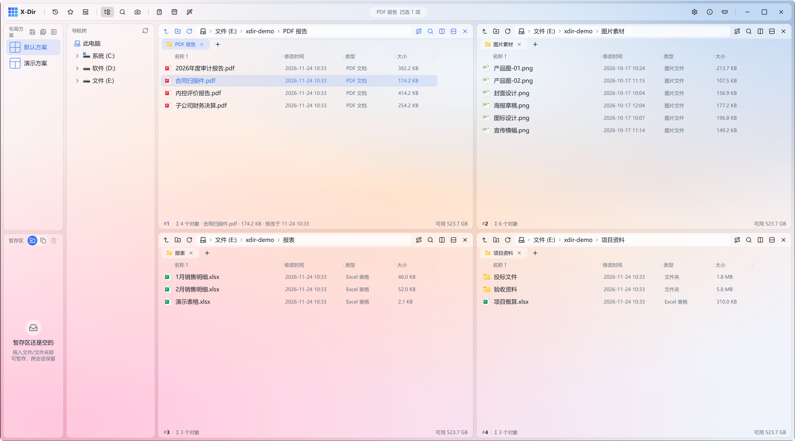
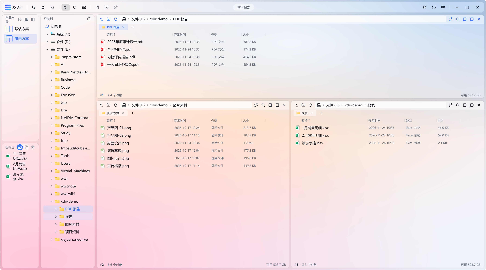
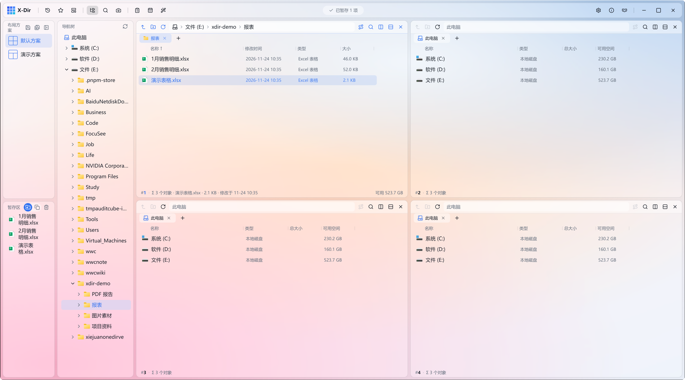
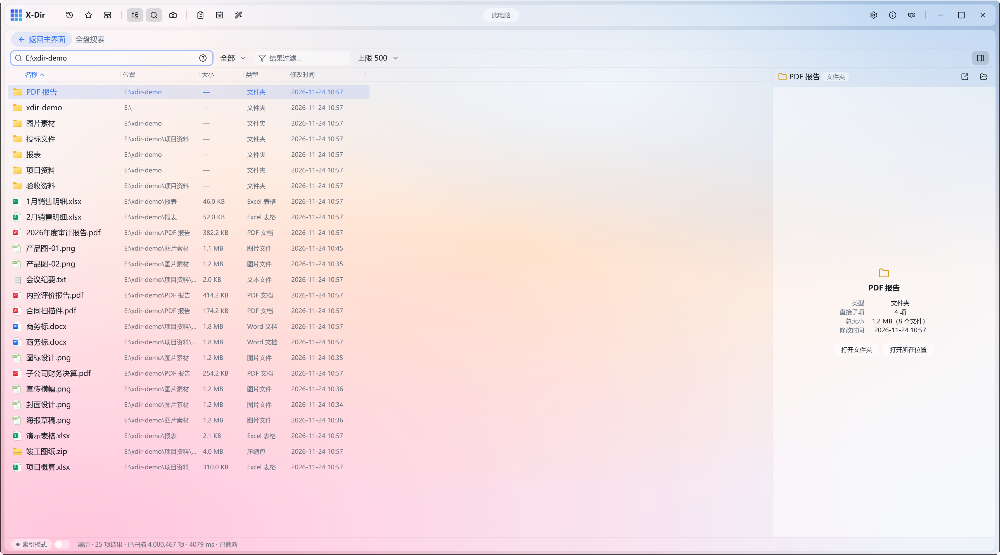
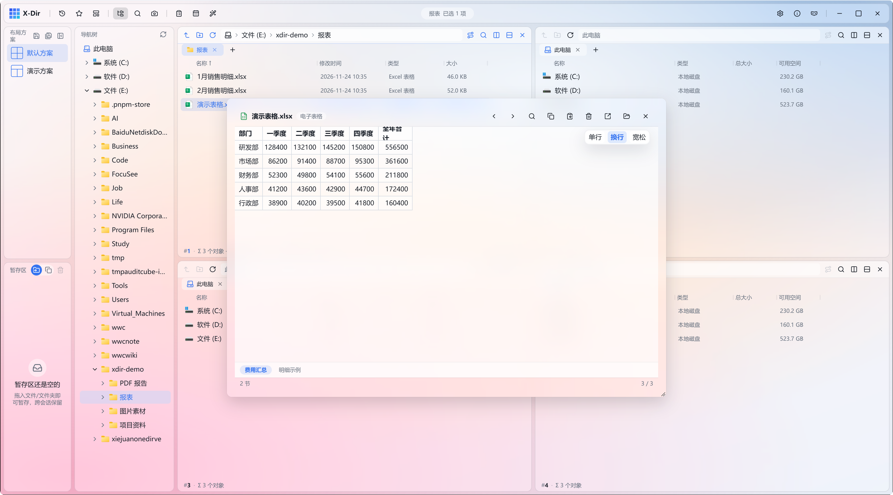
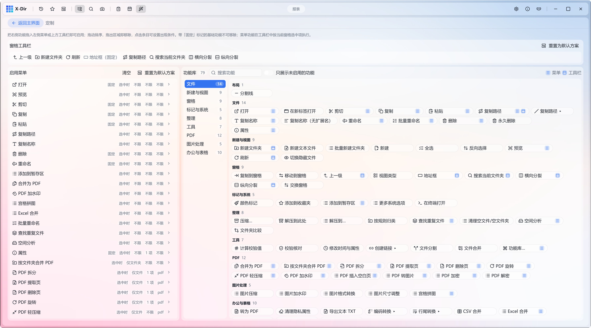
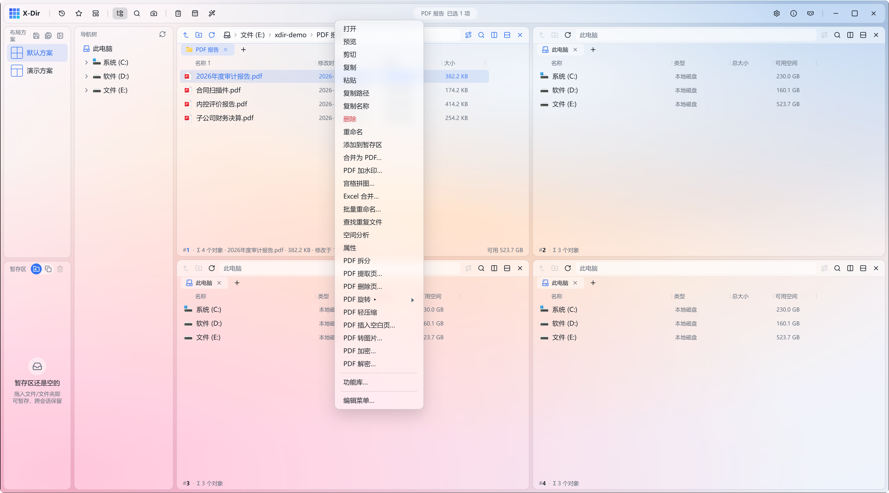
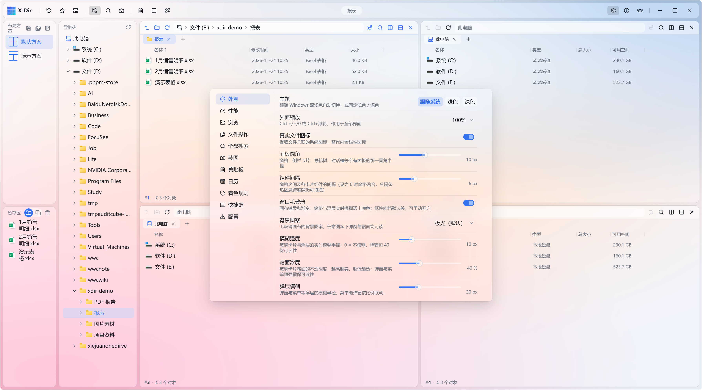

# X-Dir

[简体中文](README.md) · **English**


**A lightweight, Windows-first file manager with custom panes** — one window, unlimited panes (tmux-style free splitting); a modern take on the Q-Dir philosophy.

Tauri 2 + React 19 + TypeScript + Rust. Portable by design: no registry writes, no installer, config travels with the files.



## ✨ Features

### Custom pane layouts
- **Split anything**: any pane splits horizontally / vertically, recursively composing into any hybrid layout; 16 preset grids (2×2, 1+2, bento and more) in one click, open paths preserved in DFS order
- **Every pane is independent**: its own tabs, address bar (breadcrumbs + autocomplete + history), view mode, sorting, filter bar and status bar
- **Pane cooperation**: copy/move to the target pane (`Ctrl+Shift+C/X`, remembers the last target), drag between panes, OLE drag out of the window into Explorer



### Layout schemes & staging shelf
- **Layout schemes**: arrange your panes, "Save as new scheme", restore anytime; scheme cards show layout thumbnails, column widths / sidebar width persist with each scheme
- **Staging shelf**: park files/folders temporarily, then drop onto the target pane when needed (drop = move); contents survive restarts (200-item cap)



### Everything-style instant search
- **NTFS name index**: elevated daemon + USN journal incremental maintenance + mmap read-only queries — a 4.58M-entry full substring query over Chinese names takes ~0.3s
- **Pinyin search**: initials / toneless full pinyin / polyphonic characters, with matched Chinese characters highlighted
- **Query syntax** (aligned with Everything): `ext:jpg;png`, `size:>100mb`, `dm:thisweek`, path terms (anything containing `\` matches the full path), `!excluded`, `"phrases"`
- Falls back to multithreaded traversal scanning when no index is available (streamed, cancellable); embedded preview pane, column sorting, batch operations



### Quick preview
Select a file and hit `Space`: images (zoom/pan), video & audio, PDF (pdf.js page-by-page virtual rendering), text/code (encoding detection), Markdown, Word/Excel/PPT text extraction (pure Rust, zero external processes), spreadsheet virtual grid, archive listings (zip/tar/7z), font specimens, epub, TIFF; folders show child counts and recursive size. ↑/↓ cycles the file queue, `Enter` opens with the default app



### Screenshot · pin · scrolling capture (PixPin-grade)
- **Hotkey screenshot** (default `Ctrl+Alt+A`, global): DXGI capture, 4K in ~60–100ms, hotkey-to-freeze in ~300ms; smart window detection, pixel-level magnifier / color picker, crosshair nudging
- **Annotation tools**: rectangle / ellipse / arrows / pen / text / numbered badges / mosaic / blur; hover-scroll to tune, `1-8` switch colors, `Ctrl+Z` snapshot undo
- **Pin**: pin the selection as an always-on-top mini window; wheel zoom, `Alt+wheel` opacity; dragging driven by a Rust thread polling at 125Hz, zero jitter
- **Scrolling capture**: frame an area, then just scroll — NCC two-band consensus template matching stitches in real time, auto-finish on idle or page bottom
- **Performance**: zero PNG encoding on the hot path, click-to-clipboard-ready in ~50ms

### File operations
- Copy / move / rename / delete to recycle bin, conflict handling (overwrite / skip / keep both) + **undo / redo** (`Ctrl+Z / Ctrl+Y`)
- Long-running job engine: progress, pause/resume, cancel, live reporting in the top-bar **dynamic island**; optional native engine (IFileOperation)

### Built-in toolbox (79 tools, one right-click away)
Four tool groups cover the bulk of everyday file housekeeping; heavy lifting runs through the job engine, and **every output is written to a new side file — originals are never overwritten**. All tools live in the "Customize" page library: drag them into the context menu or pane toolbar, gated by object type / selection count / file extensions.

**PDF tools (nine-piece set)**: merge / merge by folder / split / extract pages / delete pages / rotate / light compress / watermark / images-to-PDF — watermark supports placeholders, four CJK fonts, 9-grid placement, odd-even page ranges, automatic supersampling so small text stays crisp

| PDF watermark (placeholders / 9-grid / odd-even) | PDF merge (drag-order list / blank-page padding) |
|---|---|
|  |  |

**Image tools (five-piece set)**: compress (Auto smart routing + PNG8 quantization + oxipng lossless) / watermark / convert (WebP, EXIF orientation baking) / resize (Lanczos3) / grid montage

**Office batch**: Office/WPS to PDF (COM dispatch to the local engine), privacy scrub, Excel/CSV/text merge, batch folder creation, batch rename (live preview), zip packing, organize by rule

**Disk tools**: extract zip/7z (zip-slip protection + 10GiB cap), find duplicates (SHA-256 groups), clean empty files/folders, space analysis (TreeSize-style bars + treemap drill-down), folder compare (three-way diff + directional sync)

| Batch rename (live preview) | Space analysis (size bars + treemap) |
|---|---|
|  |  |

### Customization & efficiency
- **Visual context-menu / toolbar editor**: 79-tool built-in function library, conditional visibility, drag-to-reorder
- **Type-ahead**: type to jump to matching files; Chinese matches by pinyin initials
- Color tags + coloring rules, real icons / thumbnails, light & dark themes (circular-reveal switch), window frosted glass (frosted cards + tunable parameters), UI scaling, global shortcuts across the whole workflow (full list in Settings → Shortcuts)



## 🖼️ Interface tour

| Context menu (data-driven, customizable) | Settings (appearance / performance / browsing…) |
|---|---|
|  |  |

## 📥 Download

- **GitHub Releases**: [github.com/wwc9/x-dir/releases](https://github.com/wwc9/x-dir/releases/latest)
- **Gitee Releases** (faster in mainland China): [gitee.com/wwc9/x-dir/releases](https://gitee.com/wwc9/x-dir/releases/latest)

Portable build: unzip and run — config lives next to the program. Requires Windows 10 / 11 (x64); the WebView2 runtime ships with the system. Update checking is built in (Settings → Config → Check for updates), driven by the repo's `latest.json`.

## 🛠️ Development

```powershell
npm install        # first time
npm run tauri dev  # desktop app dev debugging
npm run build      # frontend type check + build (Rust excluded)
npm test           # vitest unit tests
cargo test         # Rust unit tests (under src-tauri/)
```

The Rust toolchain requires rustup + stable-msvc (VS 2022 Build Tools "Desktop development with C++").

Release build: `npm run tauri build` (binary in `src-tauri/target/release/`, installers in `src-tauri/target/release/bundle/`).

Stress data: `tools/gen-test-tree.ps1` generates 10 × 12k real small files for re-testing memory and scroll frame rates.

README screenshots: captured by `tools/readme-shots.ps1` (UIA + CDP driven against a real build — demo tree, all 15 scenes in one run; DWM extended-bounds cropping + rounded-corner masks, frame-hugging with no black edges).

## ⚡ Performance & design constraints

- **Memory budget**: < 350MB total (WebView2 baseline 90–140MB + frontend heap ≤ 60MB + Rust ≤ 60MB), targeting ≥4GB machines
- **Three iron rules of performance**: virtualized lists keep only visible rows in the DOM; icon/caches are LRU-capped; scanning / sorting / filtering all happen paginated on the Rust side
- **Stack**: Tauri 2 · React 19 · Blueprint v6 · TanStack Virtual · Zustand · react-resizable-panels · Rust (tokio + notify + trash + pinyin + lopdf + image …)

## 📚 Documentation

- **[`docs/manual/`](docs/manual/README.md) — full user manual**: from basics to every one of the 40+ library tools, illustrated page by page (Chinese)
- [`AGENTS.md`](AGENTS.md) — engineering standards & component rules (design tokens, component inventory, audit tests) (Chinese)
- [`REQUIREMENTS.md`](REQUIREMENTS.md) — requirements & technical roadmap, the single source of truth (Chinese)

## 📄 License

[MIT](LICENSE) © 2026
