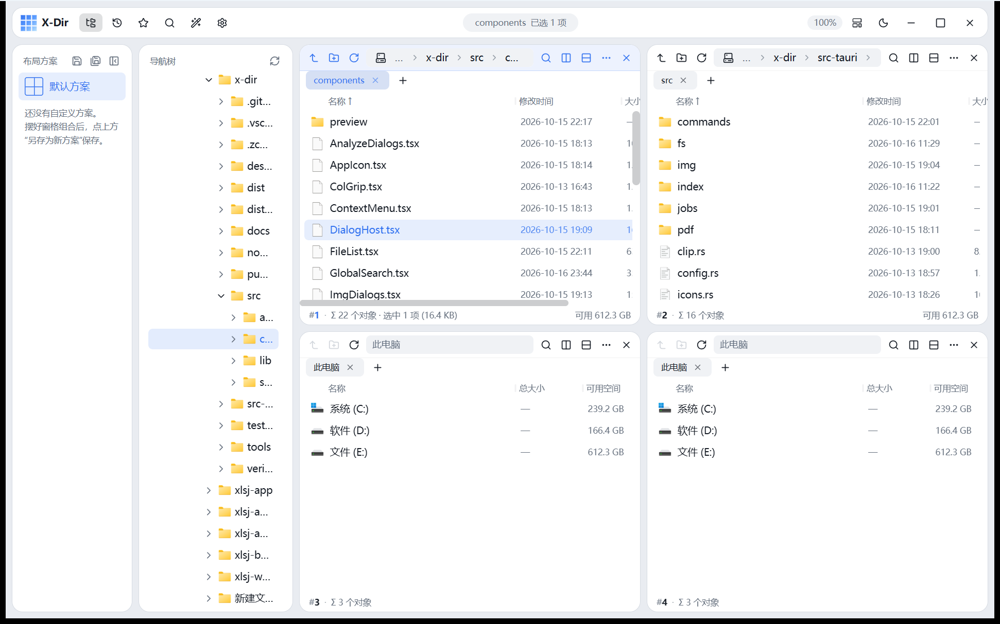
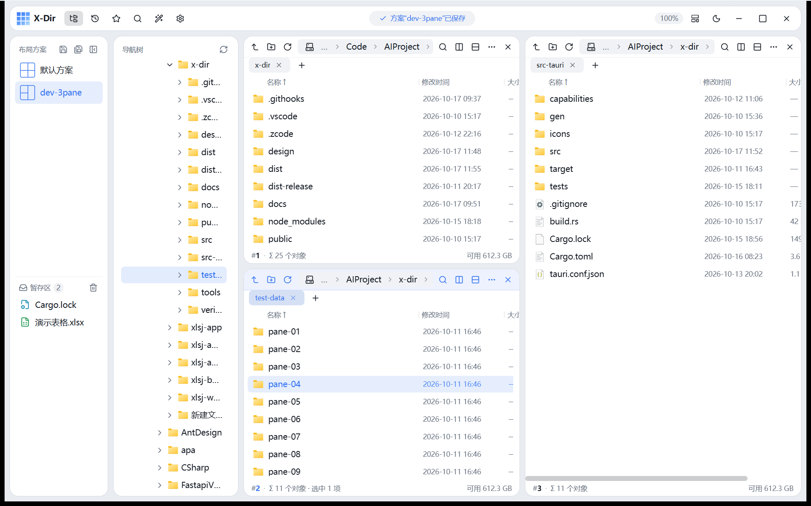
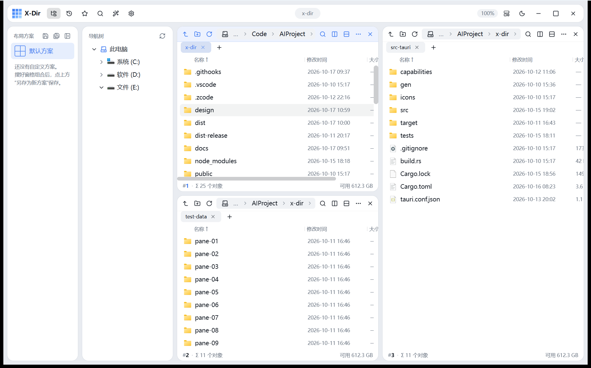
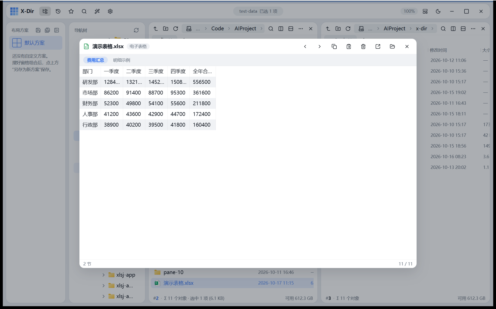
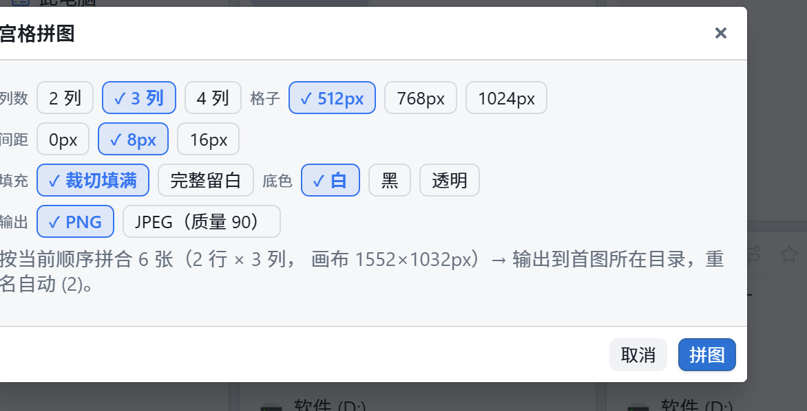
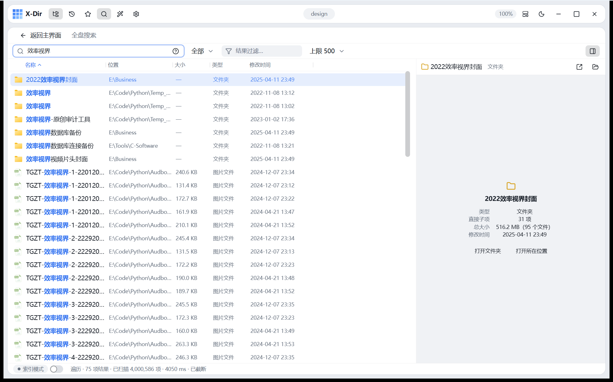
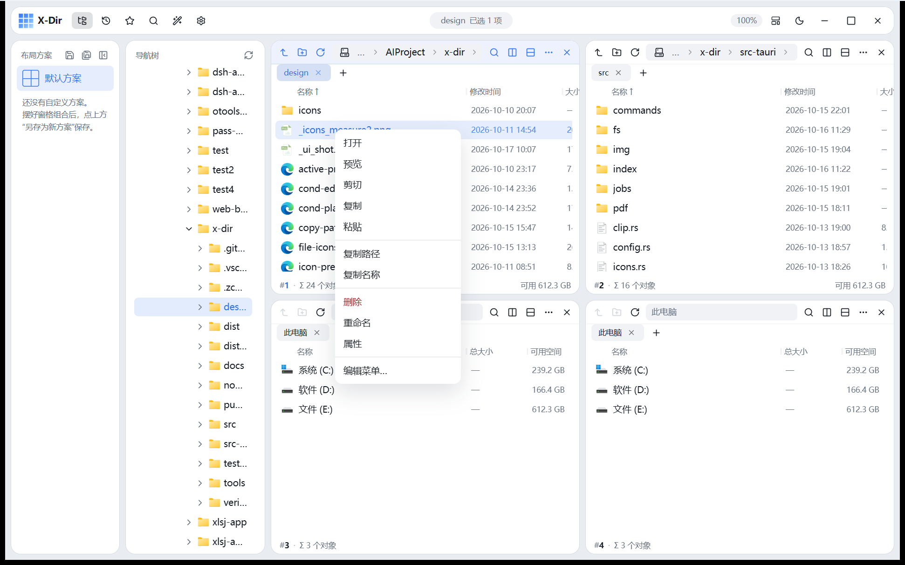
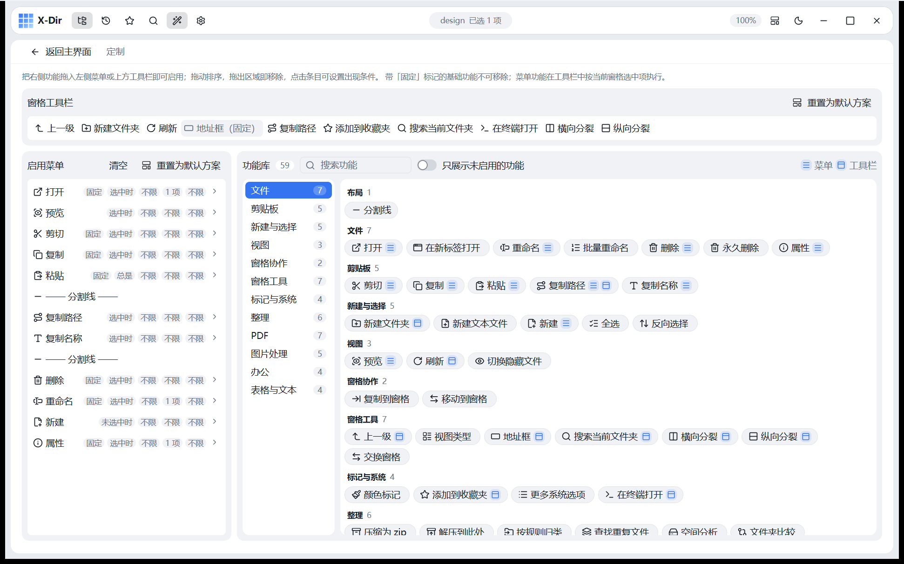
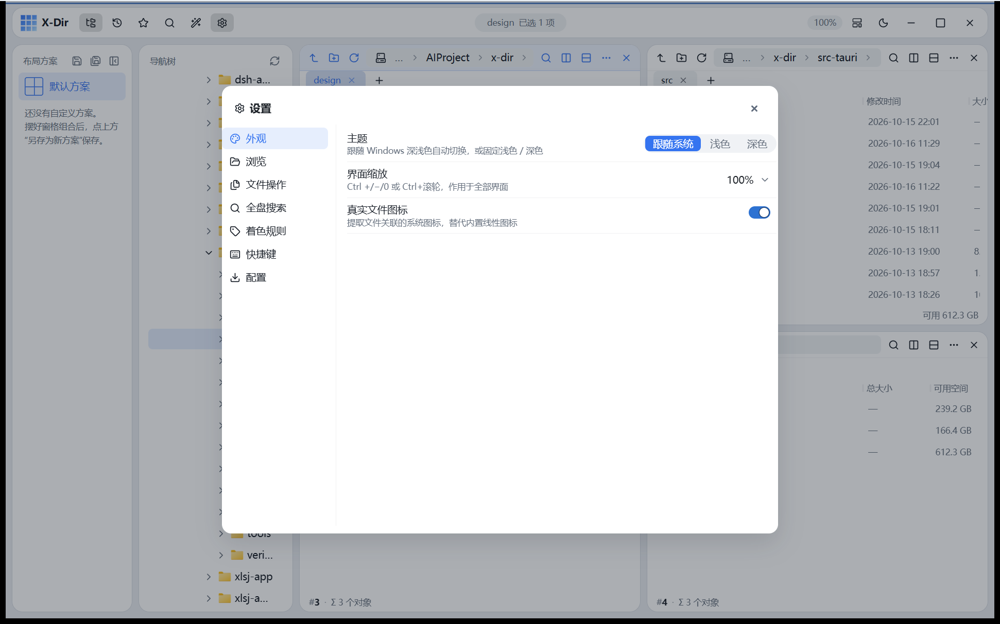

# X-Dir

[简体中文](README.md) · **English**

**A lightweight, Windows-first file manager with custom panes** — one window, unlimited panes (tmux-style free splitting); a modern take on the Q-Dir philosophy.

Tauri 2 + React 19 + TypeScript + Rust. Portable by design: no registry writes, no installer, config travels with the files.



## Feature Overview

### Custom pane layouts
- **Split anything**: any pane splits horizontally / vertically, recursively composing into any hybrid layout; drag dividers to resize, the active pane is outlined in the accent color
- **Preset grids**: 1×1, 2×2, 3×3, 1+2, 2+1 and more in one click (visual layout picker), open paths preserved in DFS order
- **Every pane is independent**: its own tabs, address bar (breadcrumbs + autocomplete + history), view mode, sorting, filter bar and status bar
- **Pane cooperation**: copy/move to the target pane (`Ctrl+Shift+C/X`, remembers the last target), drag between panes, OLE drag out of the window into Explorer

### Layout schemes & staging shelf
- **Layout schemes**: arrange your panes, then "Save as new scheme" and restore anytime; overwrite / delete supported, scheme cards show layout thumbnails; pane column widths and sidebar width persist with the scheme
- **Staging shelf** (lower half of the sidebar): drag files/folders in to park them temporarily, then drag onto the target pane when needed (drop = move); accepts direct drops from Explorer too; "Add to staging shelf" in the context menu, hover-to-remove rows, one-click clear; contents survive restarts (200-item cap)





### Everything-style instant search
- **NTFS name index**: elevated daemon + USN journal incremental maintenance + mmap read-only queries — a 4.58M-entry full substring query over Chinese names takes ~0.3s, pinyin lookups are millisecond-level
- **Pinyin search**: initials / toneless full pinyin / polyphonic characters, with matched Chinese characters highlighted
- **Query syntax** (aligned with Everything): `ext:jpg;png`, `size:>100mb`, `dm:thisweek`, `!excluded`, `"phrases"`
- Falls back to multithreaded traversal scanning when no index is available (streamed results, cancellable); embedded preview pane, column sorting, multi-select batch copy/move/delete

### Quick preview
Select a file and hit `Space`: images (zoom/pan), video & audio, PDF (pdf.js page-by-page virtual rendering), text/code (encoding detection), Markdown, Word/Excel/PPT text extraction (pure Rust, zero external processes), spreadsheet virtual grid, archive listings (zip/tar/7z), font specimens, epub, TIFF; folders show child counts and recursive size. ↑/↓ cycles through the current directory's file queue, `Enter` opens with the default app



### Screenshot · pin · scrolling capture (PixPin-grade)
- **Hotkey screenshot** (default `Ctrl+Alt+A`, global): resident overlay window + DXGI Desktop Duplication capture (4K in ~60–100ms, automatic GDI fallback), hotkey-to-freeze in ~300ms; smart window detection (preselects the window under the cursor on session start), pixel-level magnifier / color picker (`Shift` cycles formats, `C` copies the color, `P` relative coordinates), global crosshair, `WASD`/arrow nudging
- **Annotation tools**: rectangle (rounded/filled/dashed), ellipse, arrows (single/filled/hollow-head × straight/dashed/curved × one/two-way), pen & marker, text (highlight, bold/italic), auto-incrementing numbered badges, mosaic/blur (rect/circle); hover-scroll to tune (stroke width/font size/cell/opacity), `1-8` switch colors, right-click delete/clone/bring forward/send backward, hold `Tab` for the original, `Ctrl+Z` snapshot undo
- **Finish actions**: `Enter` copy & close / `Ctrl+P` pin / save as PNG / scrolling capture; exports support shadow & border decorations, annotation preferences persist across sessions
- **Pin**: pin the selection as an always-on-top mini window in place; wheel zoom, `Alt+wheel` opacity, double-click/Esc to close; dragging is driven by a Rust thread polling the system cursor at 125Hz (decoupled from WebView events, zero jitter); right-click to copy/save
- **Scrolling capture**: frame an area, then just scroll — a low-level wheel hook captures on the fly, NCC two-band consensus template matching (in-house) stitches in real time with a growing side preview; auto-finish on idle or reaching the bottom; the result window supports zoomed browsing, copy, save and re-pin; honest truncation with a notice when dynamic content keeps failing to match
- **Performance**: zero PNG encoding on the hot path (raw RGBA over IPC / in-process crop straight to clipboard CF_DIB), click-to-clipboard-ready in ~50ms; heavy work (encoding, disk writes, clipboard) stays on background threads — the main thread never stalls

### File operations
- Copy / move / rename / delete to recycle bin, **conflict handling** (overwrite / skip / keep both, applicable to all) + **undo / redo** (`Ctrl+Z / Ctrl+Y`)
- Long-running job engine: progress, pause/resume, cancel, with live reporting in the top-bar **dynamic island**
- Optional native engine (IFileOperation with system progress and conflict dialogs)

### Built-in toolbox (one right-click away)

Select files, right-click, done — no leaving the current directory. Four tool groups cover the bulk of everyday file housekeeping; all heavy lifting runs through the **job engine** (progress / pause / cancel, live updates in the dynamic island), and **every output is written to a new side file — originals are never overwritten** (PDF rotate is the sole in-place save, and it's reversible). All tools live in the "Customize" page library (52+ entries): drag them into the context menu or pane toolbar, and gate visibility by object type / selection count / file extensions.

#### PDF tools (nine-piece set)

Merge / merge by folder / split into pages / extract pages / delete pages / rotate / light compress / watermark / images-to-PDF:

- **Watermark**, fully parameterized: placeholders (`[filename]` / `[folder]` / `[page number]` / `[datetime]` and more), four CJK fonts (KaiTi / HeiTi / FangSong / DengXian), an 8-color palette, 9-grid + diagonal placement, opacity / margin / odd-even page ranges, five page-number formats; small text gets automatic 2–4× supersampling so zooming and printing stay crisp
- **Merge**: drag the pending list to set the order (merged in selected order); PDFs can mix with JPG/PNG, missing sources are skipped; optional auto A4 blank pages to round up to an even count (audit working-paper printing); "Merge by folder" recursively collects multiple folders and outputs one PDF per folder
- **Extract / delete pages**: page-range expressions `1-3,5,8-`; **rotate** ±90/180/270 across all pages, reversible; **light compress** = object dedup + object streaming; **split** outputs a `<stem>_分页\` subfolder; **images-to-PDF** puts one image per page

| PDF watermark (placeholders / 9-grid / odd-even pages) | PDF merge (drag-order list / blank-page padding) |
|---|---|
|  |  |

#### Image tools (five-piece set)

Compress / watermark / convert / resize / grid montage:

- **Compress**: Auto smart routing (JPEG→quality, PNG→PNG8 quantization, others→JPEG), plus JPEG quality, PNG8, and oxipng lossless modes
- **Watermark**: text / image × 45° tiled / bottom-right badge × three opacity and size levels
- **Convert**: PNG / JPEG / BMP / TIFF / ICO (≤256px) / lossless WebP; EXIF orientation can be baked in (stripping geotags along the way)
- **Resize**: percent (1–800%) / fixed width / fixed height (≤20000px), aspect ratio locked, Lanczos3 / Triangle resampling + shrink-only switch
- **Grid montage**: 4–36 images → columns (2–4) × cell (512–1024px) × gap (0–16px) canvas, cover-crop or fit-with-padding, white / black / transparent background

#### Office batch processing

- **Office/WPS to PDF**: dispatches to the locally installed engine via COM (MS Office first, WPS fallback — no external programs bundled)
- **Privacy scrub**: OOXML repack that strips author / company / revisions / timestamps, written to `*_清洁.ext`
- **Export to TXT** (reuses the preview extraction pipeline), **encoding conversion** (UTF-8 BOM / UTF-8 / GBK)
- **Merging**: Excel merge (keep-sheets / append-rows modes; reads xlsx/xlsm/xls/xlsb/ods, dedupes repeated headers, preserves cell value types), CSV merge (deduped headers), text merge (blank-line separated) — all output UTF-8 BOM
- **Batch folder creation**: name-list or numbered-template modes (`{}` placeholder zero-padded to the stop number), with a preview that flags illegal and duplicate names
- **Batch rename**: find & replace + prefix/suffix + numbering (extension-safe), real-time conflict/legality preview, every rename undoable
- **Compress to zip** (files flat / folders recursive with top level), **organize by rule** (extension / modified-date grouping into subfolders)

#### Disk tools

- **Extract here**: zip / 7z, each archive into its own subfolder; zip-slip path traversal protection and a 10GiB total-size hard cap
- **Find duplicates**: same-size bucketing → SHA-256 content fingerprinting into groups; copies pre-checked, deletion goes to the recycle bin
- **Clean empty files / folders**: recursive scan; a parent containing only empty subfolders doesn't count (no accidental over-deletion); both groups checked by default
- **Space analysis**: TreeSize-style per-child size bars, click a folder to drill down
- **Folder compare**: path-aligned three-way diff (A-only / B-only / content-differing, judged by size + mtime); check items and sync by direction (through the conflict-handling flow)

| Grid montage | Excel merge (keep-sheets / append-rows) |
|---|---|
|  |  |

| Batch rename (live preview) | Find duplicates (SHA-256 groups) |
|---|---|
|  |  |

| Space analysis (TreeSize-style bars) |
|---|
|  |

### Customization & efficiency
- **Editable context menu**: data-driven menus + a visual editor (52+ built-in function library, conditional visibility, drag-to-reorder); pane toolbars are equally customizable
- **Type-ahead**: type to jump to matching files; Chinese matches by pinyin initials
- In-view filtering, selection memory, color tags + coloring rules, real icons / thumbnails, light & dark themes (circular-reveal switch animation), UI scaling
- Global shortcuts across the whole workflow (full list in Settings → Shortcuts)

## Interface tour

| Everything-style search (full page + embedded preview) | Context menu (data-driven, customizable) |
|---|---|
|  |  |

| Customize page (menu / toolbar editor) | Settings |
|---|---|
|  |  |

## Development

```powershell
npm install        # first time
npm run tauri dev  # desktop app dev debugging
npm run build      # frontend type check + build (Rust excluded)
npm test           # vitest unit tests
cargo test         # Rust unit tests (under src-tauri/)
```

The Rust toolchain requires rustup + stable-msvc (VS 2022 Build Tools "Desktop development with C++").

Release build: `npm run tauri build` (binary in `src-tauri/target/release/`, installers in `src-tauri/target/release/bundle/`).

Stress data: `tools/gen-test-tree.ps1` generates 10 × 12k real small files for re-testing memory and scroll frame rates.

README toolbox screenshots: captured by `tools/readme-shots.ps1` (UIA accessibility-driven against a real build — demo tree, right-click into dialogs, crop by dialog rectangle; rerun anytime).

## Design constraints

- **Memory budget**: < 350MB total (WebView2 baseline 90–140MB + frontend heap ≤ 60MB + Rust ≤ 60MB), targeting ≥4GB machines
- **Three iron rules of performance**: virtualized lists keep only visible rows in the DOM; icon/caches are LRU-capped; scanning / sorting / filtering all happen paginated on the Rust side
- **Stack**: Tauri 2 · React 19 · Blueprint v6 · TanStack Virtual · Zustand · react-resizable-panels · Rust (tokio + notify + trash + pinyin + lopdf + image …)

## Documentation

- [`AGENTS.md`](AGENTS.md) — engineering standards & component rules (design tokens, component inventory, audit tests) (Chinese)
- [`REQUIREMENTS.md`](REQUIREMENTS.md) — requirements & technical roadmap (the single source of truth) (Chinese)
- [`design/preview.html`](design/preview.html) — standalone static UI preview (not part of the build)

## License

[MIT](LICENSE) © 2026
