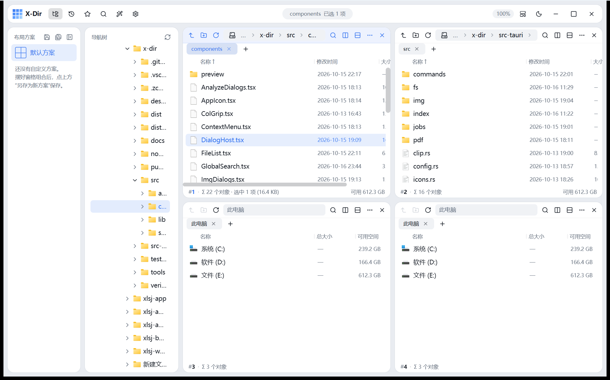
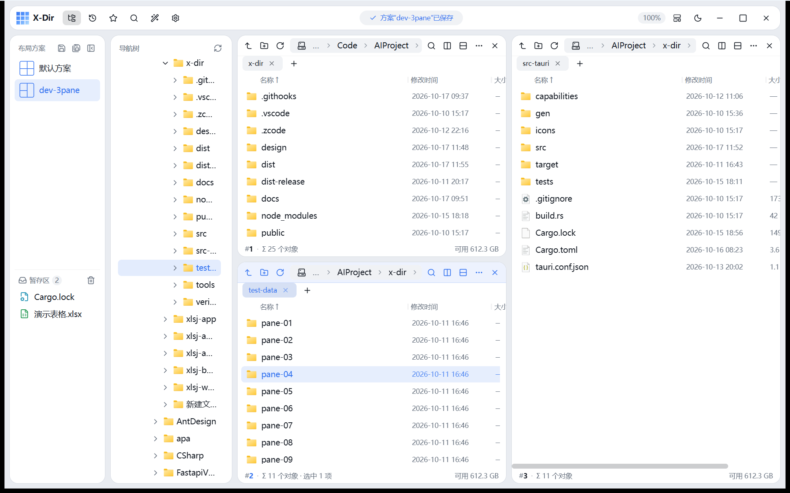
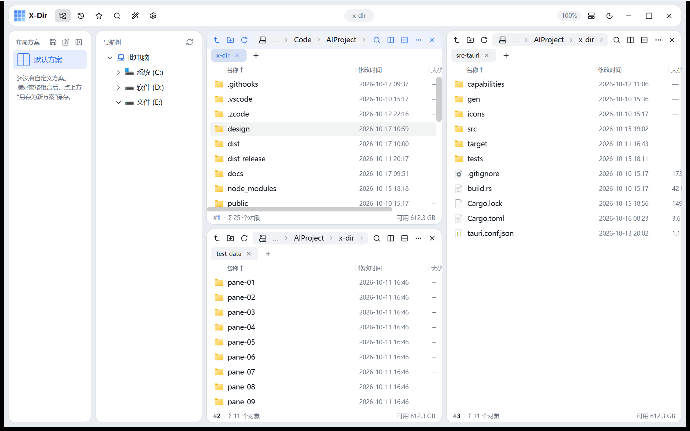
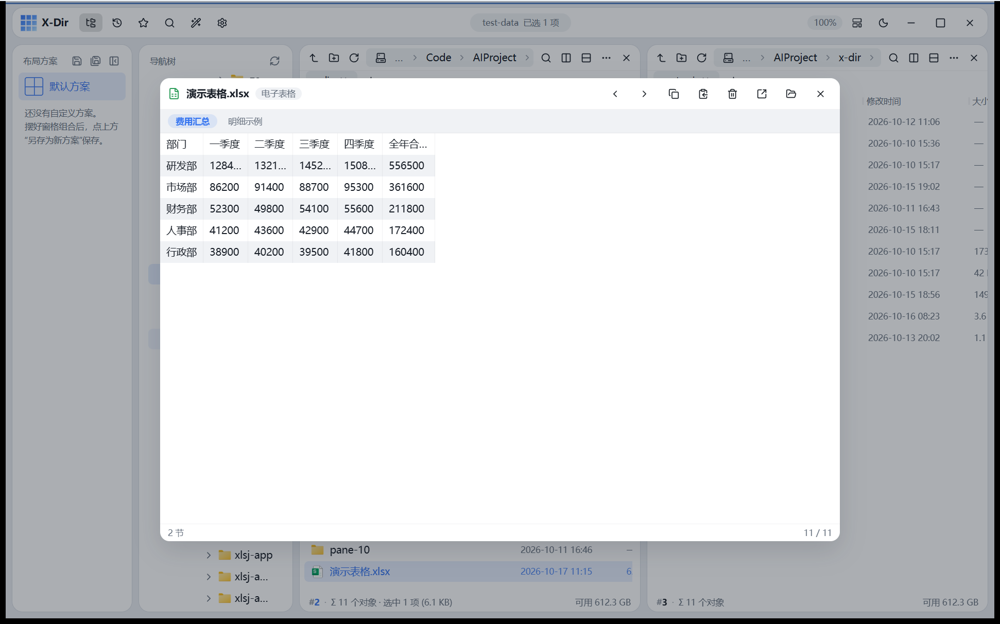
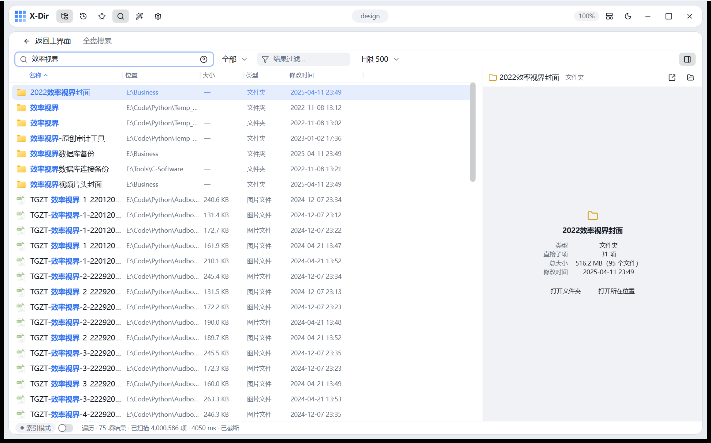
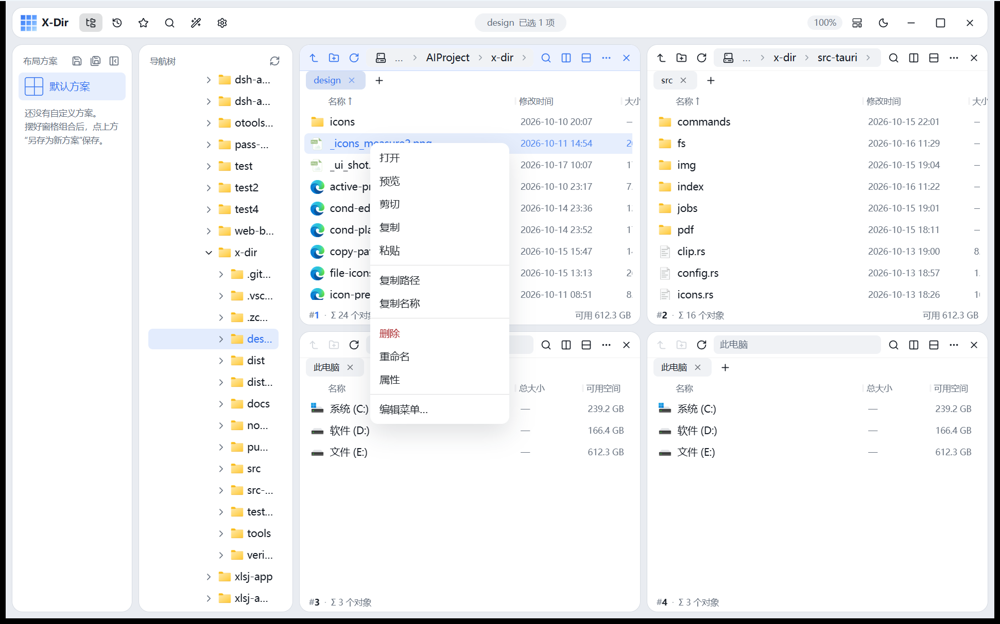
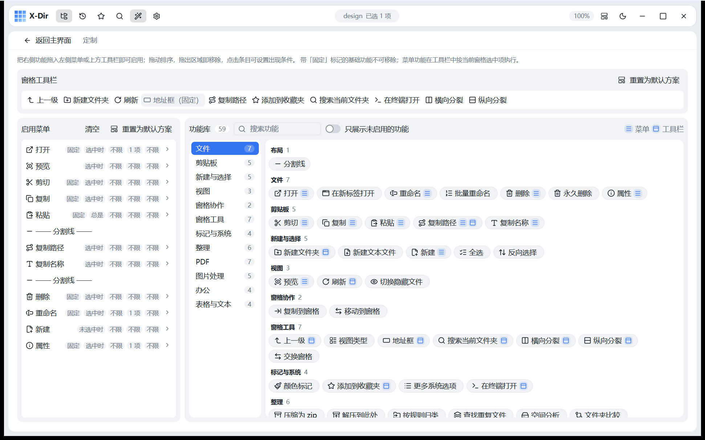
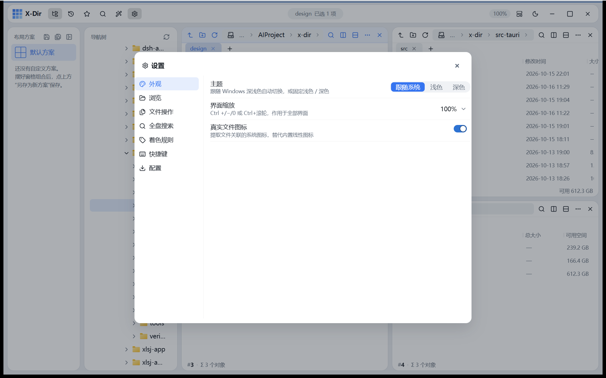

# X-Dir

**Windows 优先的轻量级自定义窗格文件管理器** —— 单窗口 + 不限数量窗格（tmux 式自由分割），Q-Dir 哲学的现代化延伸。

Tauri 2 + React 19 + TypeScript + Rust。绿色便携：不写注册表、免安装、配置随文件走。



## 特性一览

### 自定义窗格布局
- **任意分裂**：任何窗格可横向 / 纵向一分为二，递归组合成任意混合布局；分隔条拖拽调宽高，激活窗格以强调色描边标识
- **预设网格**：1×1、2×2、3×3、1+2、2+1 等一键切换（可视化布局选择器），按 DFS 顺序保留已开路径
- **每窗格独立**：各自的标签页、地址栏（面包屑 + 自动补全 + 历史）、视图模式、排序、过滤条、状态条
- **窗格协作**：复制/移动到目标窗格（`Ctrl+Shift+C/X`，记忆上次目标）、窗格间拖拽、OLE 拖出窗口到资源管理器

### 布局方案与暂存区
- **布局方案**：摆好窗格组合后「另存为新方案」，随时一键恢复；支持覆盖保存、删除，卡片带布局缩略图；窗格列宽、侧栏宽度随方案持久化
- **暂存区**（侧边栏下半）：把文件/文件夹临时拖进来集中暂存，用到时再拖到目标窗格（落格即移动），也可从资源管理器直接拖入；右键菜单「添加到暂存区」、行悬停移除、一键清空；内容跨会话保留（上限 200 项）





### 全盘搜索（Everything 式秒搜）
- **NTFS 名称索引**：提权守护 + USN 日志增量维护 + mmap 只读查询，458 万条目中文子串全量查询约 0.3s，拼音词毫秒级
- **拼音检索**：首字母 / 无声调全拼 / 多音字，命中汉字高亮
- **查询语法**（对齐 Everything）：`ext:jpg;png`、`size:>100mb`、`dm:thisweek`、`!排除词`、`"短语"`
- 无索引时自动回落多线程遍历扫描（流式结果、可取消）；内嵌文件预览右栏、列头排序、多选批量复制/移动/删除

### 快速预览
选中按 `Space` 唤起：图片（缩放/平移）、视频音频、PDF（pdf.js 逐页虚拟渲染）、文本/代码（编码探测）、Markdown、Word/Excel/PPT 文本抽取（纯 Rust，零外部进程）、表格虚拟网格、压缩包清单（zip/tar/7z）、字体样字、epub、TIFF；文件夹显示子项数与递归体积。↑/↓ 在当前目录文件队列中循环切换，`Enter` 用默认程序打开



### 截图 · 贴图 · 滚动长图（PixPin 级体验）
- **热键截图**（默认 `Ctrl+Alt+A`，全局）：常驻覆盖窗 + DXGI Desktop Duplication 捕获（4K ~60-100ms，失败自动回落 GDI），热键到定格上屏 ~300ms 内；智能窗口识别（进会话即预选光标下窗口，随移动切换），像素级放大镜 / 取色器（`Shift` 换格式、`C` 复制色值、`P` 相对坐标）、全局十字线、`WASD`/方向键准星微调
- **标注工具**：矩形（圆角/实心/虚线）、椭圆、箭头（单/实心/空头 × 直/虚/曲线 × 单双向）、画笔·马克笔、文字（高亮/粗斜体）、自动递增序号标记、马赛克/模糊（方/圆区域）；滚轮悬停指哪调哪（线宽/字号/格子/不透明度），`1-8` 换色、右键菜单删除/克隆/置前/置后、`Tab` 按住查看原图、`Ctrl+Z` 快照式撤销
- **完成动作**：`Enter` 复制并关闭 / `Ctrl+P` 贴图 / 保存为 PNG / 滚动长图；导出可加阴影与边框装饰，标注偏好（默认宽度等）跨会话记忆
- **贴图**：选区钉成置顶小窗原地顶替，滚轮缩放、`Alt+滚轮` 透明度、双击/Esc 关闭；拖动由 Rust 线程 125Hz 轮询系统光标直接驱动窗口（与 WebView 事件解耦，零抖动）；右键复制/另存
- **滚动长图**：框选区域后正常滚动页面即可——低级滚轮钩子跟手捕获，NCC 两带共识模板匹配（自研）实时拼接，侧边窄条预览同步增长；到底/停歇自动收尾，结果窗支持缩放浏览、复制、保存、再贴图；动态内容连续失配时诚实截断并提示
- **性能口径**：全程零 PNG 编码热路径（RGBA 原始字节 IPC 直传 / 进程内裁剪直写剪贴板 CF_DIB），复制点击→剪贴板就绪 ~50ms；重活（编码、写盘、剪贴板）全部在后台线程，主线程零卡顿

### 文件操作
- 复制 / 移动 / 重命名 / 删除到回收站，**冲突处理**（覆盖 / 跳过 / 保留两者，可应用到全部）+ **撤销 / 重做**（`Ctrl+Z / Ctrl+Y`）
- 长任务引擎：进度、暂停/继续、取消，顶栏**灵动岛**实时播报
- 可选原生引擎（IFileOperation，系统进度与冲突对话框）
- 批量重命名（查找替换 + 前后缀 + 序号，重名 / 非法名预检）

### 内置工具箱（右键菜单即达）
- **PDF 七件套**：合并 / 拆分为单页 / 提取页 / 删除页 / 旋转 / 轻压缩 / 文字水印
- **图片处理五件套**：压缩（含 PNG8 量化）/ 水印 / 格式转换 / 尺寸调整 / 宫格拼图
- **办公批处理**：Office/WPS 转 PDF、隐私属性清理、导出 TXT、编码转换（UTF-8/GBK）、CSV/文本合并、压缩为 zip、按规则归类
- **磁盘工具**：解压到此处、查找重复文件（SHA-256）、空间分析（TreeSize 式）、文件夹比较

### 定制与效率
- **右键菜单可编辑**：数据驱动菜单 + 可视化编辑器（52+ 内置功能库、条件可见性、拖拽排序），窗格工具栏同样可定制
- **type-ahead**：输入字符即跳转匹配文件，中文按拼音首字母
- 视图内过滤、选择记忆、颜色标记 + 着色规则、真实图标 / 缩略图、深浅主题（圆形扩散切换动画）、界面缩放
- 全局快捷键覆盖全流程（应用内设置 → 快捷键页可查完整清单）

## 界面速览

| 全盘搜索（整页 + 内嵌预览） | 右键菜单（数据驱动，可自定义） |
|---|---|
|  |  |

| 定制页（菜单 / 工具栏编辑器） | 设置面板 |
|---|---|
|  |  |

## 开发

```powershell
npm install        # 首次
npm run tauri dev  # 桌面应用开发调试
npm run build      # 前端类型检查 + 构建（不含 Rust）
npm test           # vitest 单测
cargo test         # Rust 单测（在 src-tauri/ 下）
```

Rust 工具链要求 rustup + stable-msvc（VS 2022 Build Tools「使用 C++ 的桌面开发」）。

发布构建：`npm run tauri build`（产物在 `src-tauri/target/release/`，安装包在 `src-tauri/target/release/bundle/`）。

压测数据：`tools/gen-test-tree.ps1` 可生成 10 × 1.2 万真实小文件，用于复测内存与滚动帧率。

## 设计约束

- **内存预算**：整机 < 350MB（WebView2 基础 90~140MB + 前端堆 ≤ 60MB + Rust ≤ 60MB），按 ≥4GB 内存电脑设计
- **性能三铁律**：虚拟滚动只有可见行 DOM；图标 / 缓存有上限（LRU）；扫描 / 排序 / 过滤全部在 Rust 端分页下发
- **技术栈**：Tauri 2 · React 19 · Blueprint v6 · TanStack Virtual · Zustand · react-resizable-panels · Rust（tokio + notify + trash + pinyin + lopdf + image …）

## 文档

- [`AGENTS.md`](AGENTS.md) —— 工程规范与组件标准（设计 token、组件清单、审计测试）
- [`REQUIREMENTS.md`](REQUIREMENTS.md) —— 需求与技术路线（唯一需求源）
- [`design/preview.html`](design/preview.html) —— 独立静态 UI 预览（不参与构建）

## 许可证

[MIT](LICENSE) © 2026
