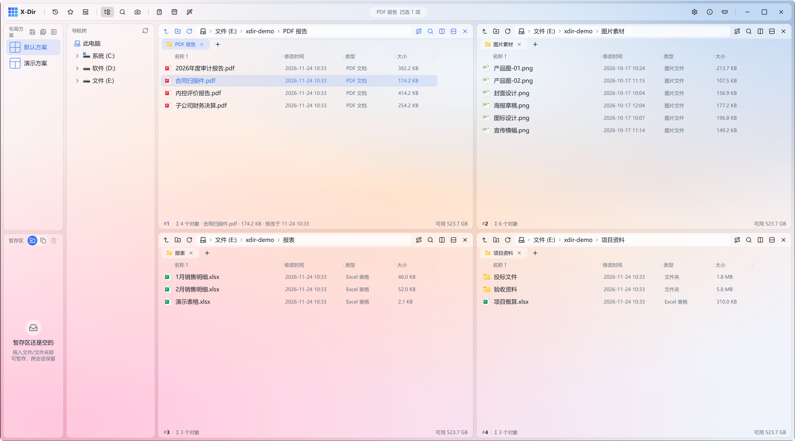
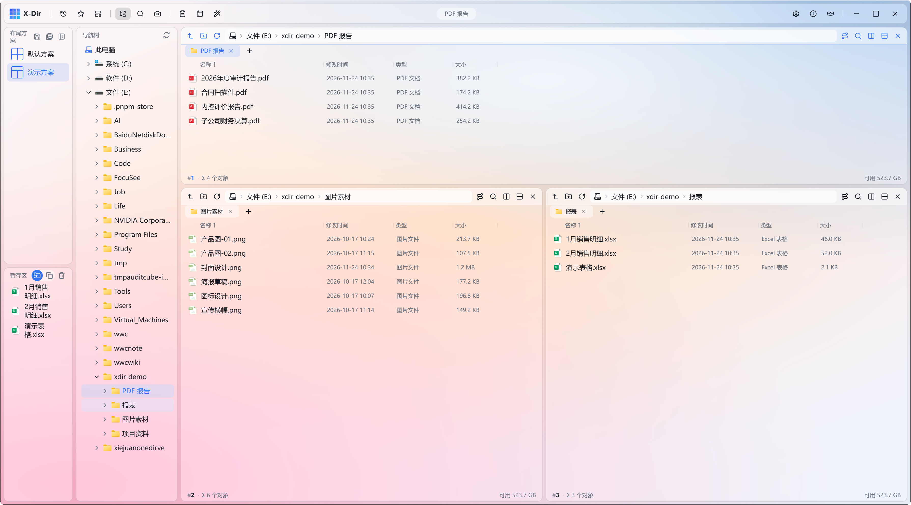
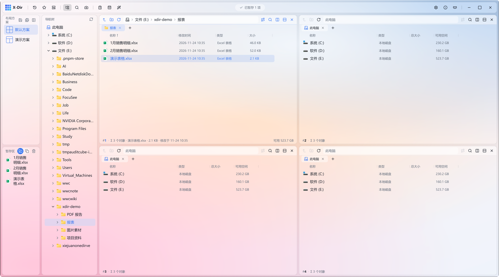
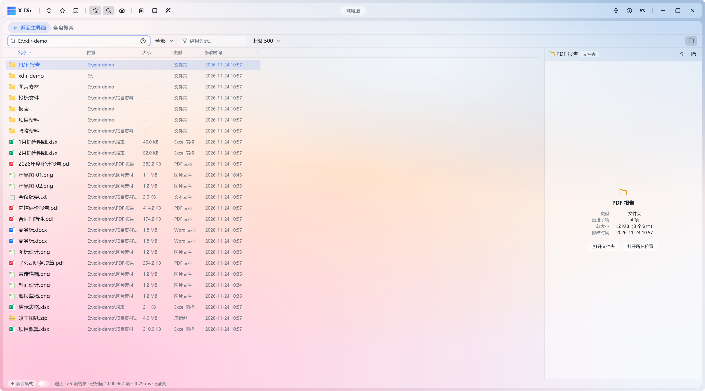
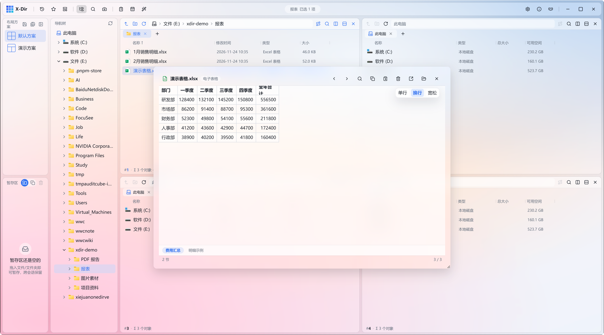
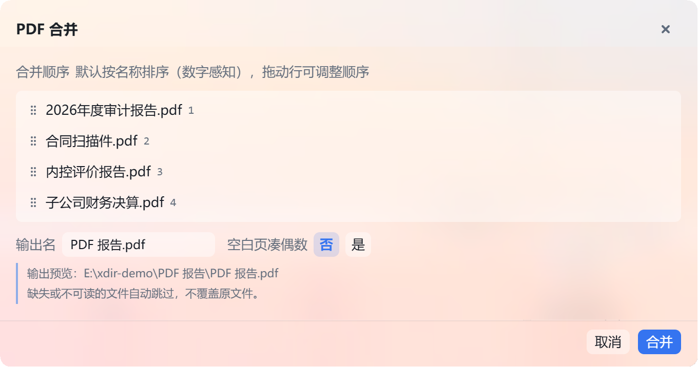
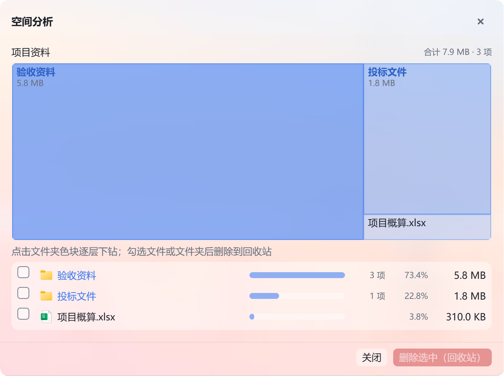
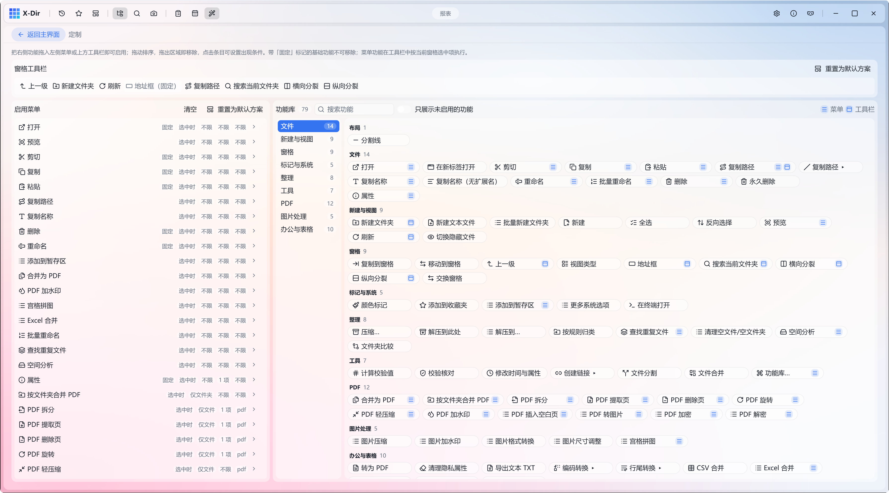
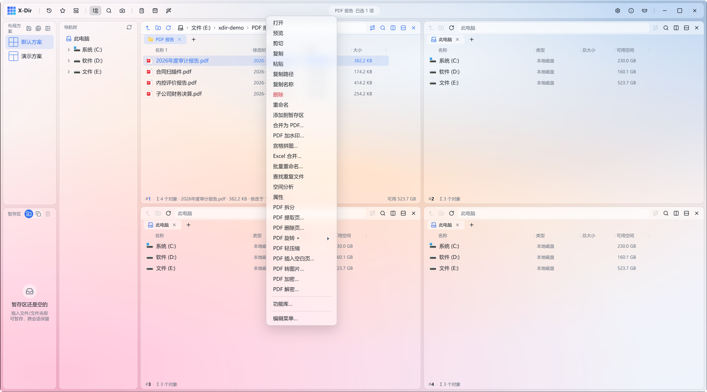
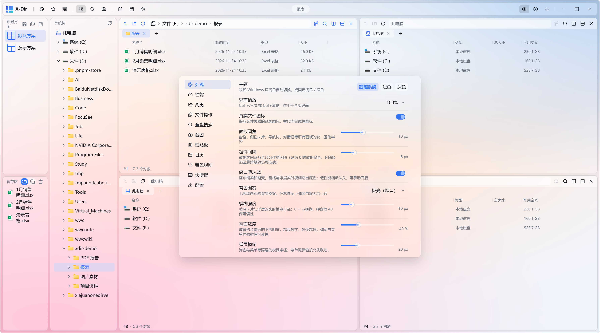

# X-Dir

**简体中文** · [English](README.en.md)


**Windows 优先的轻量级多窗格文件管理器** —— 单窗口 + 不限数量窗格（tmux 式自由分割），Q-Dir 哲学的现代化延伸。

Tauri 2 + React 19 + TypeScript + Rust。绿色便携：不写注册表、免安装、配置随文件走。



## ✨ 特性一览

### 自定义窗格布局
- **任意分裂**：任何窗格可横向 / 纵向一分为二，递归组合成任意混合布局；16 种预设网格（2×2、1+2、便当等）一键切换，打开路径按 DFS 顺序保留
- **每窗格独立**：各自的标签页、地址栏（面包屑 + 自动补全 + 历史）、视图模式、排序、过滤条、状态条
- **窗格协作**：复制/移动到目标窗格（`Ctrl+Shift+C/X`，记忆上次目标）、窗格间拖拽、OLE 拖出窗口到资源管理器



### 布局方案与暂存区
- **布局方案**：摆好窗格组合「另存为新方案」，随时一键恢复；卡片带布局缩略图，列宽 / 侧栏宽度随方案持久化
- **暂存区**：文件/文件夹临时拖进来集中暂存，用到时拖到目标窗格（落格即移动）；跨会话保留（上限 200 项）



### 全盘搜索（Everything 式秒搜）
- **NTFS 名称索引**：提权守护 + USN 日志增量维护 + mmap 只读查询，458 万条目中文子串全量查询约 0.3s
- **拼音检索**：首字母 / 无声调全拼 / 多音字，命中汉字高亮
- **查询语法**（对齐 Everything）：`ext:jpg;png`、`size:>100mb`、`dm:thisweek`、路径词（含 `\` 即按全路径匹配）、`!排除词`、`"短语"`
- 无索引自动回落多线程遍历扫描（流式结果、可取消）；内嵌预览右栏、列头排序、批量操作



### 快速预览
选中按 `Space` 唤起：图片（缩放/平移）、视频音频、PDF（pdf.js 逐页虚拟渲染）、文本/代码（编码探测）、Markdown、Word/Excel/PPT 文本抽取（纯 Rust，零外部进程）、表格虚拟网格、压缩包清单（zip/tar/7z）、字体样字、epub、TIFF；文件夹显示子项数与递归体积。↑/↓ 循环切换文件队列，`Enter` 用默认程序打开



### 截图 · 贴图 · 滚动长图（PixPin 级体验）
- **热键截图**（默认 `Ctrl+Alt+A`，全局）：DXGI 捕获 4K 约 60–100ms，热键到定格 ~300ms；智能窗口识别、像素级放大镜 / 取色器、准星微调
- **标注工具**：矩形 / 椭圆 / 箭头 / 画笔 / 文字 / 序号标记 / 马赛克 / 模糊；滚轮悬停指哪调哪，`1-8` 换色，`Ctrl+Z` 快照式撤销
- **贴图**：选区钉成置顶小窗，滚轮缩放、`Alt+滚轮` 透明度；拖拽由 Rust 线程 125Hz 轮询驱动，零抖动
- **滚动长图**：框选后正常滚动页面即可，NCC 两带共识模板匹配实时拼接，到底/停歇自动收尾
- **性能口径**：全程零 PNG 编码热路径，复制点击 → 剪贴板就绪 ~50ms

### 文件操作
- 复制 / 移动 / 重命名 / 删除到回收站，冲突处理（覆盖 / 跳过 / 保留两者）+ **撤销 / 重做**（`Ctrl+Z / Ctrl+Y`）
- 长任务引擎：进度、暂停/继续、取消，顶栏**灵动岛**实时播报；可选原生引擎（IFileOperation）

### 内置工具箱（79 项，右键即达）
四组工具覆盖日常文件整理绝大部分需求；重活全部走任务引擎，**输出一律旁写新文件、绝不覆盖原件**。全部工具入「定制」页功能库，可自由拖入右键菜单 / 窗格工具栏，并按对象类型 / 选中数量 / 扩展名配置条件可见性。

**PDF 处理（九件套）**：合并 / 按文件夹合并 / 拆分 / 提取页 / 删除页 / 旋转 / 轻压缩 / 加水印 / 图片合并转 PDF——水印支持占位符、四种中文字体、九宫格定位、奇偶页范围、小字号自动超采样防发糊

| PDF 加水印（占位符 / 九宫格 / 奇偶页） | PDF 合并（清单调序 / 空白页凑偶数） |
|---|---|
|  |  |

**图片处理（五件套）**：压缩（Auto 智能分型 + PNG8 量化 + oxipng 无损）/ 加水印 / 格式转换（含 WebP、EXIF 方向烘焙）/ 尺寸调整（Lanczos3）/ 宫格拼图

**办公批处理**：Office/WPS 转 PDF（COM 派发本机引擎）、隐私属性清理、Excel/CSV/文本合并、批量新建文件夹、批量重命名（实时预演）、压缩为 zip、按规则归类

**磁盘工具**：解压 zip/7z（防 zip-slip + 10GiB 硬闸）、查找重复文件（SHA-256 成组）、清理空文件/空文件夹、空间分析（TreeSize 式体积条 + 色块下钻）、文件夹比较（三段差异 + 按方向同步）

| 批量重命名（实时预演） | 空间分析（体积条 + 色块下钻） |
|---|---|
|  |  |

### 定制与效率
- **右键菜单 / 工具栏可视化编辑**：79 项内置功能库、条件可见性、拖拽排序
- **type-ahead**：输入字符即跳转匹配文件，中文按拼音首字母
- 颜色标记 + 着色规则、真实图标 / 缩略图、深浅主题（圆形扩散切换）、窗口毛玻璃（磨砂卡片 + 可调参数）、界面缩放、全局快捷键全流程覆盖（设置 → 快捷键可查完整清单）



## 🖼️ 界面速览

| 右键菜单（数据驱动，可自定义） | 设置面板（外观 / 性能 / 浏览…） |
|---|---|
|  |  |

## 📥 下载安装

- **GitHub Releases**：[github.com/wwc9/x-dir/releases](https://github.com/wwc9/x-dir/releases/latest)
- **Gitee Releases**（国内更快）：[gitee.com/wwc9/x-dir/releases](https://gitee.com/wwc9/x-dir/releases/latest)

绿色便携版：解压即用，配置随程序目录走。系统要求 Windows 10 / 11（x64），WebView2 运行时随系统自动就绪。更新检测内置（设置 → 配置 → 检查更新），也可随仓库 `latest.json` 自动升级。

## 🛠️ 本地开发

```powershell
npm install        # 首次
npm run tauri dev  # 桌面应用开发调试
npm run build      # 前端类型检查 + 构建（不含 Rust）
npm test           # vitest 单测
cargo test         # Rust 单测（在 src-tauri/ 下）
```

Rust 工具链要求 rustup + stable-msvc（VS 2022 Build Tools「使用 C++ 的桌面开发」）。

发布构建：`npm run tauri build`（产物在 `src-tauri/target/release/`，安装包在 `src-tauri/target/release/bundle/`）。

压测数据：`tools/gen-test-tree.ps1` 可生成 10 × 1.2 万真实小文件，用于复测内存与滚动帧率。

README 截图采集：`tools/readme-shots.ps1`（UIA + CDP 驱动实机，演示目录树 + 全部 15 张场景一键重拍；DWM 扩展边界裁剪 + 圆角蒙版，贴合窗框无黑边）。

## ⚡ 性能与设计约束

- **内存预算**：整机 < 350MB（WebView2 基础 90~140MB + 前端堆 ≤ 60MB + Rust ≤ 60MB），按 ≥4GB 内存电脑设计
- **性能三铁律**：虚拟滚动只有可见行 DOM；图标 / 缓存有上限（LRU）；扫描 / 排序 / 过滤全部在 Rust 端分页下发
- **技术栈**：Tauri 2 · React 19 · Blueprint v6 · TanStack Virtual · Zustand · react-resizable-panels · Rust（tokio + notify + trash + pinyin + lopdf + image …）

## 📚 文档

- **[`docs/manual/`](docs/manual/README.md) —— 完整使用手册**：从基础使用到功能库 40+ 个工具的逐项图文讲解（每个功能一篇，全部实机截图）
- [`AGENTS.md`](AGENTS.md) —— 工程规范与组件标准（设计 token、组件清单、审计测试）
- [`REQUIREMENTS.md`](REQUIREMENTS.md) —— 需求与技术路线（唯一需求源）

## 📄 许可证

[MIT](LICENSE) © 2026
