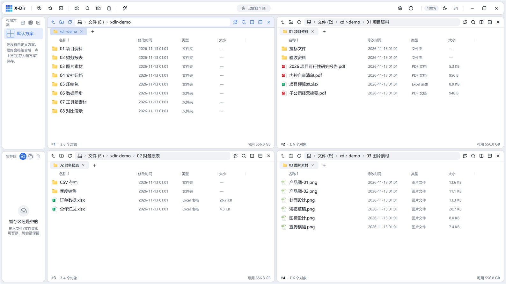
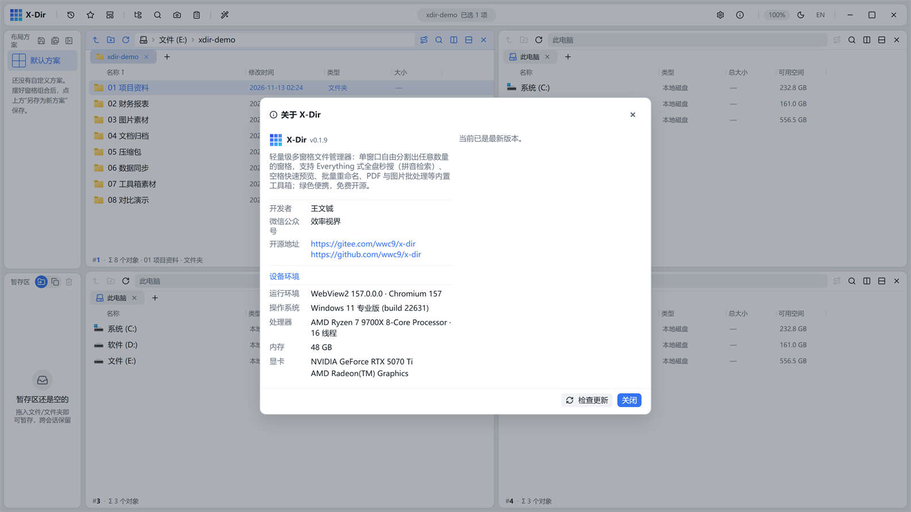

# 01 · 安装与启动

X-Dir 是 **Windows 优先的绿色便携软件**：不写注册表、免安装、配置随文件走。

## 获取与安装

1. 从项目发布页（Gitee / GitHub Releases）下载安装包：
   - `X-Dir_x.y.z_x64-setup.exe` —— 安装版，双击即装；
   - `X-Dir_x.y.z_x64-portable.zip` —— 便携版，解压即用。
2. 系统要求：Windows 10/11 x64，自带 WebView2 运行时安装引导（绝大多数 Win11 已内置，无需联网安装）。
3. 升级安装：双击新安装包即可**原地覆盖升级**，配置、布局方案、剪贴板历史全部保留，无需先卸载。

## 首次启动

- 启动后默认给出 **2×2 四窗格**布局与浅色主题；窗格各自独立，可单独导航。
- 默认布局、主题、语言、列宽等均为出厂值，可随时在设置面板调整（见 [13 设置与配置](../basics/13-settings.md)）。

## 配置存放在哪里

便携版的所有用户数据都在程序目录旁边的 `config\` 文件夹内：

| 文件/目录 | 内容 |
|---|---|
| `config\settings.json` | 全部用户偏好：布局方案、右键菜单编排、列宽、主题、剪贴板设置等 |
| `config\workspaces\*.json` | 布局方案（窗格组合与路径） |
| `config\clipboard.db` | 剪贴板历史（独立数据库，可整库备份） |
| `config\index\` | 全盘搜索的 NTFS 索引缓存（可删除重建） |

> 把整个程序目录拷到 U 盘/新电脑，配置跟着走——这就是「绿色便携」。

## 应用内一键更新

打开顶栏右侧的「关于 X-Dir」，发现新版本时会出现「一键更新（自动安装）」按钮：

- 点击后自动下载并**同路径静默安装**，完成后自动重启应用；
- settings.json、布局方案、剪贴板历史在更新过程中**全部保留**；
- 若发布早期 latest.json 尚未就绪，按钮会回落为「手动下载」，跳转发布页下载安装包即可。

## 启动参数与多开

- 双击桌面图标即可启动；已运行时再次双击不会多开（单实例）。
- 便携版可直接运行 `X-Dir.exe`；如需以管理员运行（全盘搜索建索引会自动引导提权），右键 →「以管理员身份运行」。
