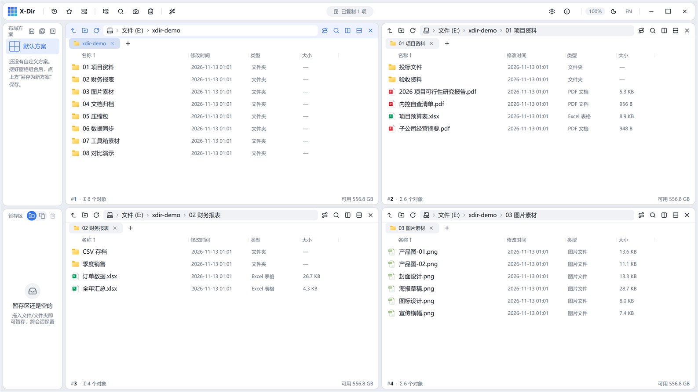
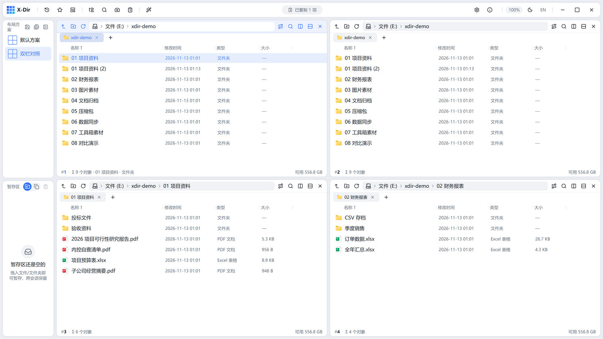

# 02 · 界面总览

主界面由五个区域组成：**顶栏、边栏、窗格区、状态条、灵动岛**。

## 顶栏

| 区域 | 内容 |
|---|---|
| 左段 | 品牌 + 弹层入口（浏览记录 / 收藏夹 / 布局预设）+ 模式开关（导航树 / 全盘搜索 / 截图 / 剪贴板历史）+ 定制入口 |
| 中段 | **灵动岛**：空闲时显示活动窗格路径（含已选数量）；任务进行时变成进度条；操作完成后播报回执 |
| 右段 | 设置、关于、界面缩放（100%，Ctrl+滚轮可调）、深浅主题切换、中英文切换、窗口控制按钮 |

顶栏空白处均可拖动窗口，双击最大化/还原。

## 边栏（左侧）

- 上半部 **导航树**：此电脑 → 各盘符 → 目录树，点击节点定位活动窗格；可点击树内文件夹直接导航，支持真实图标。
- 下半部 **布局方案卡** 与 **暂存区**：中间的横把手可拖动调整上下比例。
- 详见 [06 边栏与暂存区](06-sidebar.md)。

## 窗格区

- 每个窗格 = 一个独立的文件浏览区：**标签页 + 工具栏（上一级/新建/刷新/地址框/搜索/分裂）+ 列表 + 状态条**。
- 活动窗格以强调色描边标识；点击任意窗格即激活它。
- 任意窗格可横向/纵向分裂，组合出任意布局（详见 [03 窗格与布局](03-panes-layout.md)）。

## 窗格工具栏与地址栏

- 地址框空闲时显示**面包屑**（如 `文件 (E:) › xdir-demo › 01 项目资料`），点击任意一段直接跳转；点击空白处变为可编辑输入框，支持路径自动补全。
- 列表列头（名称/修改时间/类型/大小）点击排序，再点反向。

## 状态条（窗格底部）

- 左侧：标签页序号 + 对象统计（`Σ 6 个对象`）；
- 选中条目时变为选中统计：单选显示「名称 · 大小 · 修改于」行内属性条，多选显示「选中 N 项 (合计大小)」；
- 右侧：该盘剩余空间。

## 灵动岛（顶栏中央）

| 状态 | 显示 |
|---|---|
| 空闲 | 活动窗格路径（点击无动作，纯指示） |
| 任务进行中 | 迷你进度条 + 标签 + 百分比；**点击展开任务面板**（逐条进度、暂停/继续、取消） |
| 操作回执 | 「已复制 1 项」「已更新到 vX」等提示，数秒后自动消退，失败驻留更久 |

