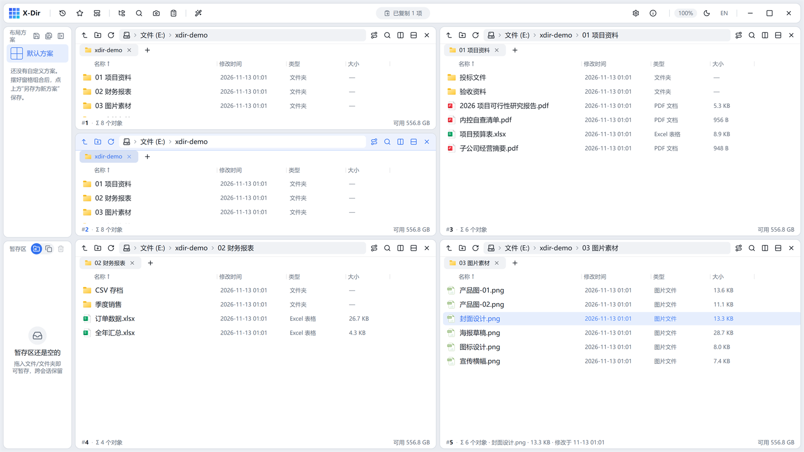
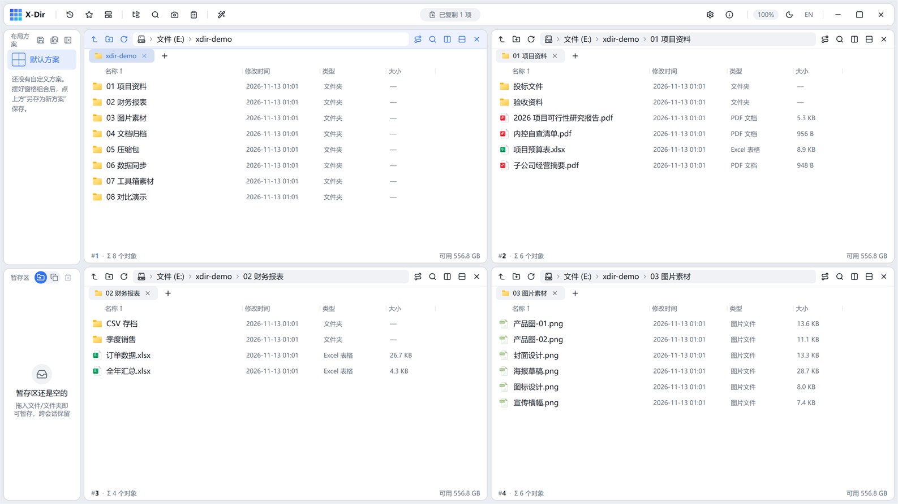
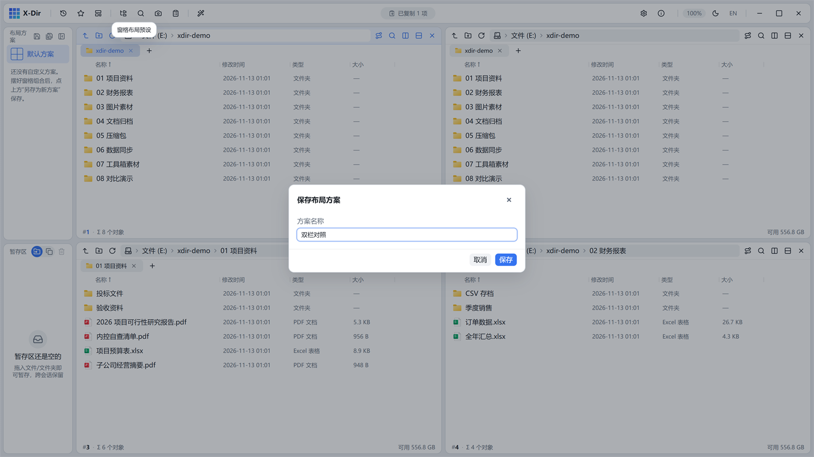

# 03 · 窗格与布局

X-Dir 的核心是 **tmux 式的自由窗格**：任何窗格都可以再分裂，组合成任意布局。

## 分裂窗格

每个窗格工具栏末尾有两颗分裂按钮：

- **横向分裂**：左右一分为二；
- **纵向分裂**：上下一分为二。

新窗格继承当前路径，独立拥有自己的标签页、地址栏、视图与排序。下图是右下窗格纵向分裂后的混合布局：

- 分隔条可拖动调整宽高（双击恢复默认比例）；
- 每个窗格右上角有「关闭窗格」按钮（窗格唯一时不可关）；
- 关闭的只是窗格本身，不影响标签页在其他窗格中的副本。

## 布局预设

顶栏「窗格布局预设」按钮提供常用网格，一键切换：

- 单格、1×2、2×1、1×3、3×1、**2×2**、2×3、3×2、3×3 等预设；
- 切换预设时按 DFS 顺序**尽量保留已开的路径**（原窗格顺序依次填入新网格）。

## 布局方案（保存/恢复）

摆好窗格组合后，可以存成方案随时一键恢复：

1. 点击顶栏「把当前窗口组合另存为新方案」；
2. 输入方案名（如「双栏对照」），确认保存：

3. 方案出现在左侧边栏的方案卡里，点击卡片即恢复整套布局：

- 再次点击方案卡上的保存按钮可**覆盖更新**当前布局到该方案；
- 悬停方案卡可重命名或删除；
- 窗格列宽、边栏宽度随方案一起保存。

## 窗格协作

- **复制/移动到目标窗格**：选中文件后 `Ctrl+Shift+C`（复制）/ `Ctrl+Shift+X`（移动），或右键菜单「复制到窗格 / 移动到窗格」；应用会记住上次目标窗格，跨窗格传输一键完成。
- **窗格间拖拽**：直接把文件拖到另一个窗格即复制（按住移动语义时为移动）。
- **拖出窗口**：把文件拖到 X-Dir 窗口外（如资源管理器、聊天窗口）即触发系统 OLE 拖放。
- **交换窗格**：右键空白处 →「交换窗格」，两个窗格位置对调。
