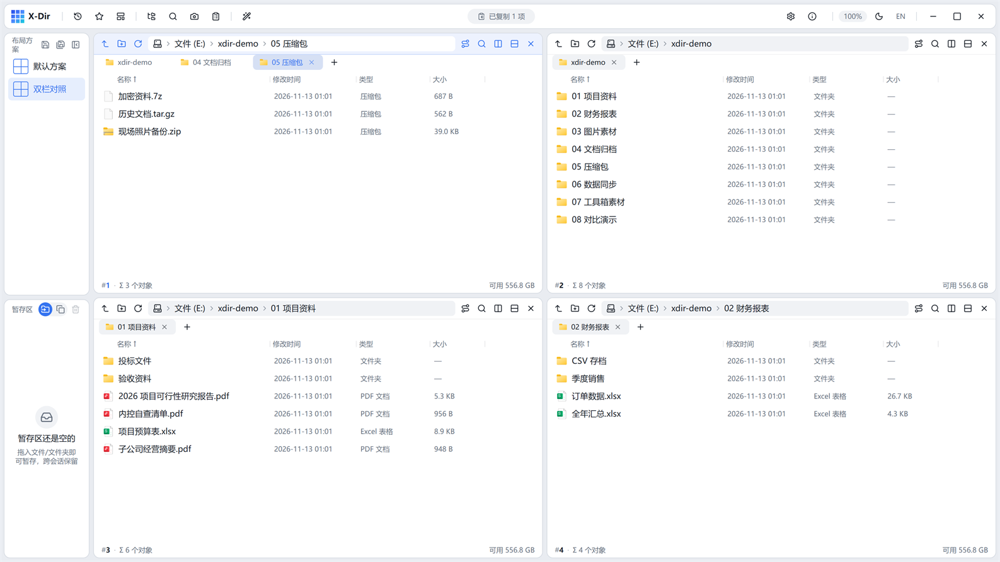
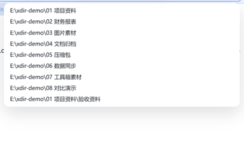
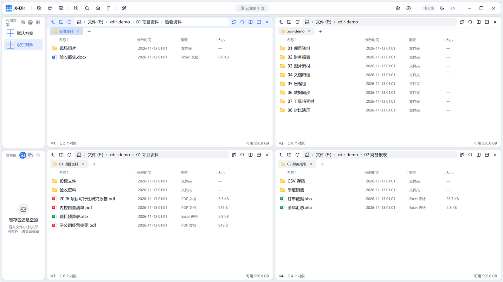

# 04 · 标签页与导航

## 标签页

每个窗格都有自己的标签页条：

- 「+」新建标签，**继承当前路径**；中键点击列表里的文件夹 = 在新标签打开；
- 标签可拖动排序；右键标签弹出菜单：**复制标签 / 关闭其他标签 / 关闭右侧标签**；
- 标签图标跟随内容：文件夹 = Folder 语义色，盘符 = 硬盘图标；开启「真实图标」后显示文件系统图标。

## 地址栏：面包屑与输入

- 空闲态显示**面包屑**（`文件 (E:) › xdir-demo › 01 项目资料 › 验收资料`），点击任意一段直接跳到该层级；超过 5 段时中段自动省略。
- 点击地址框进入编辑态，输入路径支持**自动补全**（子目录下拉建议）：

- `Alt+D` 快速聚焦地址栏；粘贴完整路径回车即导航；路径支持反斜杠与正斜杠。

## 历史与收藏

- 顶栏「**浏览记录**」：当前窗格的导航历史，点击回跳：

- 鼠标 **X1/X2 侧键** = 后退 / 前进（活动标签的历史）；`Backspace` = 上一级。

## type-ahead 键入跳转

在文件列表直接敲字符即跳转匹配项，**中文支持拼音首字母**（如 `cw` 跳到「财务报表」），匹配过程以胶囊条回显：

- 继续键入缩小匹配；`Esc` 清除；
- 与「视图内过滤」（`Ctrl+E`，见 [07 视图与过滤](07-view.md)）不同：type-ahead 只移动选中项，不过滤列表。

## 快速定位常用位置

- 导航树：点开盘符逐层展开，点击节点定位活动窗格；
- **收藏夹**：顶栏「收藏夹」弹层，右键文件夹 →「添加到收藏夹」收录常用目录；
- **此电脑**：地址栏清空回车或点击面包屑首段，回到盘符列表（含各盘容量）。
