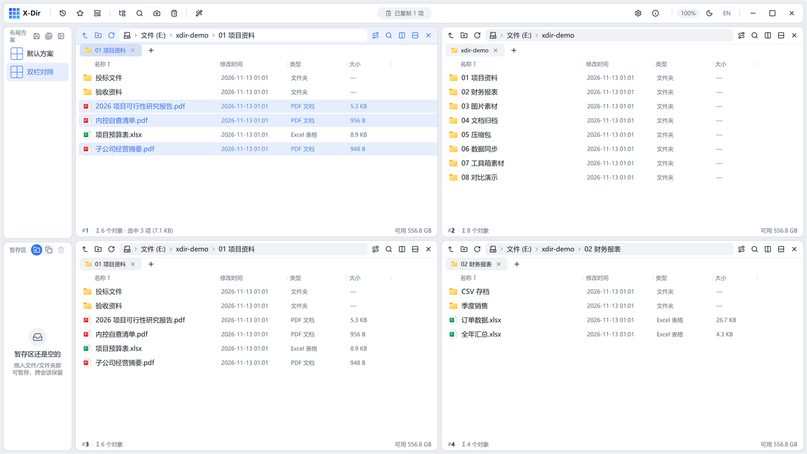
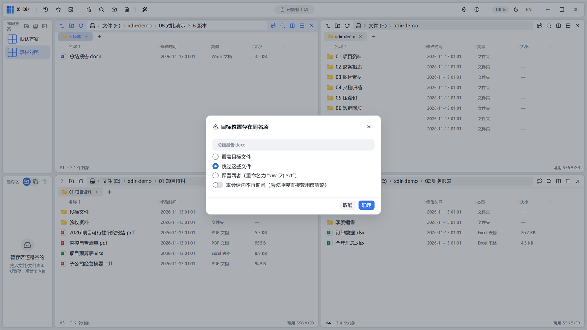
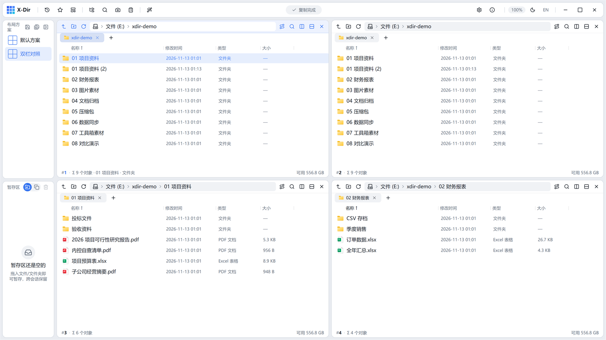
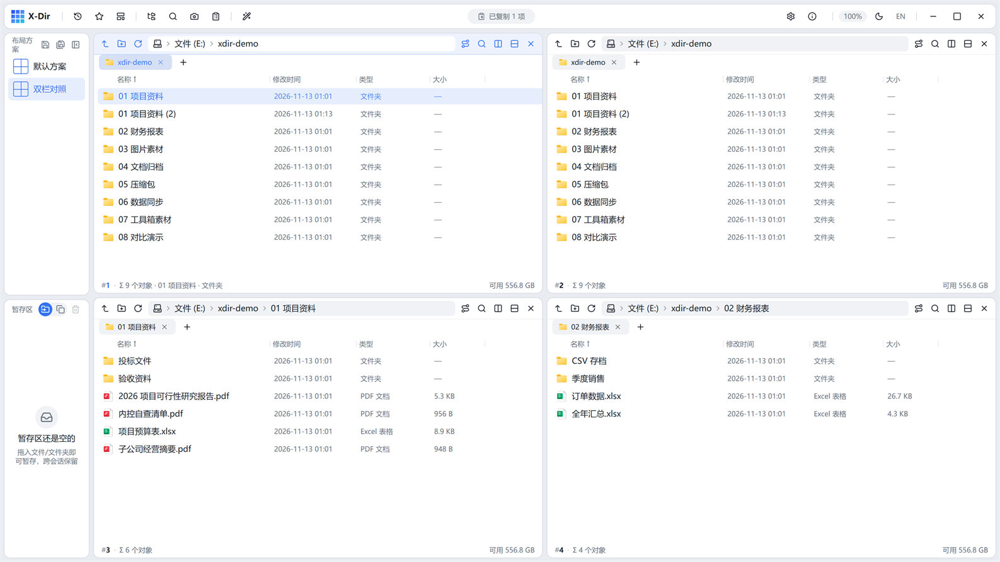
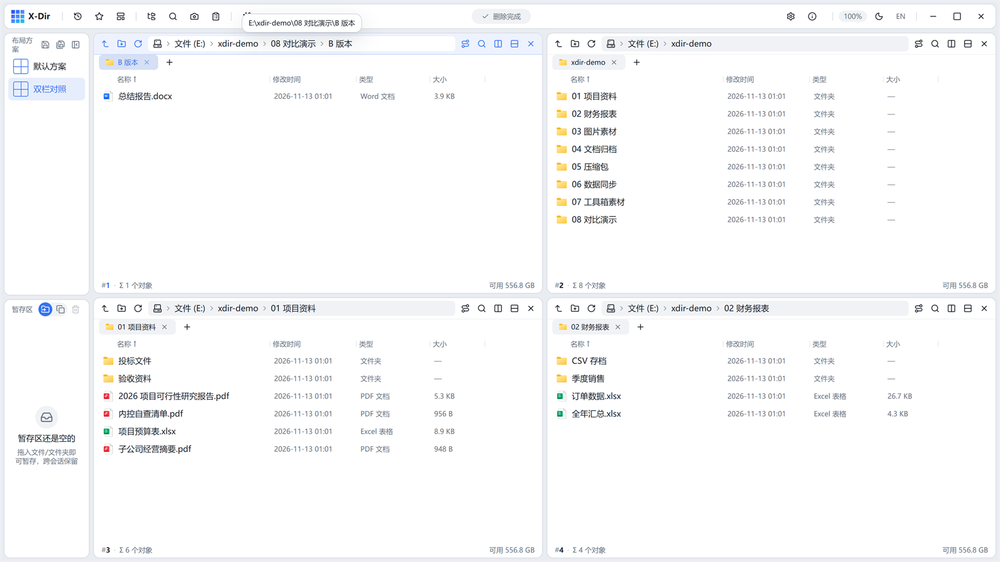

# 05 · 文件操作

## 选择

- 单击选中；`Ctrl+点击` 翻选；`Shift+点击` 范围选；`Ctrl+A` 全选；`Esc` 清空选择；
- 多选时状态条显示「选中 N 项 (合计大小)」；单选显示行内属性条（名称 · 大小 · 修改时间）：

- **选择记忆**：离开再回到某目录时，自动恢复上次的选择集（设置 → 浏览可关）。

## 复制 / 移动 / 删除

| 操作 | 方式 |
|---|---|
| 复制 | `Ctrl+C` 或右键 → 复制；跨窗格粘贴 `Ctrl+V` |
| 剪切（移动） | `Ctrl+X`；同卷移动瞬时完成 |
| 删除到回收站 | `Delete` |
| 永久删除 | `Shift+Delete`（红色确认框） |
| 新建文件夹 | `Ctrl+Shift+N`，直接落盘并进入行内重命名 |
| 重命名 | `F2` 行内改名 |

## 冲突处理

粘贴/移动遇到同名文件时弹出冲突对话框：

- **覆盖目标文件** / **跳过这些文件** / **保留两者**（重命名为 `xxx (2).ext`）；
- 勾选「本会话内不再询问」后，本次会话的后续冲突直接套用所选策略。

## 任务进度与灵动岛

大文件/大量文件的操作会走任务引擎，顶栏灵动岛实时显示进度：

点击灵动岛展开任务面板，可查看逐条进度并**暂停/继续/取消**（复制与移动支持暂停）：

任务完成（或失败）经灵动岛回执播报：

- 回执上的「打开」动作可直达输出目录；
- 删除撞上被占用文件时，会弹出「解除占用」列出占用进程，确认后自动重删。

## 撤销 / 重做

- `Ctrl+Z` 撤销上一步文件操作（复制/移动/删除/重命名/粘贴），`Ctrl+Y` 重做：

- 删除类操作经任务完成后仍可撤销；撤销栈跨操作串联，连续 `Ctrl+Z` 逐级回退；
- 批量重命名对话框内还提供「撤回上次重命名」专用入口（见 [批量重命名](../tools/office/batch-rename.md)）。
