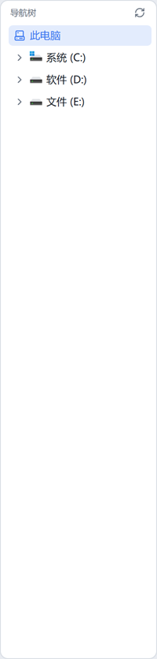
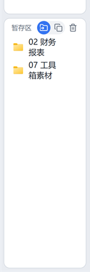
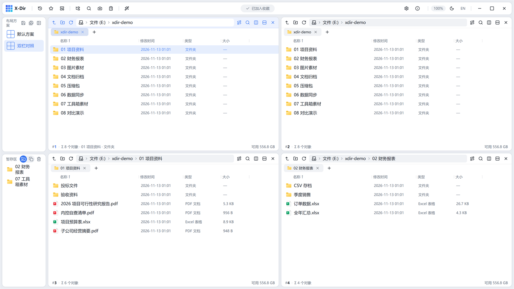

# 06 · 边栏与暂存区

左侧边栏由三部分组成：**导航树**（上）、**布局方案卡**（下·上）、**暂存区**（下·下）。中间的横把手可拖动调整上下比例（0.2–0.8）。

## 导航树

- 顶栏导航树按钮可**显示/隐藏**（所有窗格共用一份状态）；
- 点击节点即让**活动窗格**跳转；点节点左侧箭头仅展开/折叠；
- 节点图标支持「真实图标」设置（与文件列表一致）；
- 「此电脑」根节点固定显示电脑图标，展开可见全部盘符（含容量语义色）。

## 布局方案卡

- 摆好窗格后「另存为新方案」（见 [03 窗格与布局](03-panes-layout.md)），方案以卡片列出，**点击即应用**；
- 卡片上的软盘按钮 = 用当前布局覆盖保存；悬停可重命名/删除；
- 方案随 `workspaces\*.json` 持久化，并包含在配置导出中。

## 暂存区

把分散在各处的文件先**集中暂存**，再统一拖去目标位置：

- **加入**：右键文件/文件夹 →「添加到暂存区」，或从资源管理器直接拖入暂存区卡（上限 200 项，跨会话保留）；
- **取出**：把条目**拖到任意窗格**即落位。落格语义由暂存区右上角按钮切换：
  - 「移动」（默认）：拖出即移动，并自动移出暂存；
  - 「复制」：拖出即复制，条目保留；
- 条目拖回暂存区 = 无操作；悬停条目可单条移除，「清空」按钮一键清空；
- 路径大小写不敏感去重，同名条目不会重复入区。

## 收藏夹

- 右键文件夹 →「添加到收藏夹」，或选中文件夹后在功能库执行；
- 顶栏「收藏夹」按钮弹出收藏列表，点击即让活动窗格跳转：

