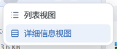
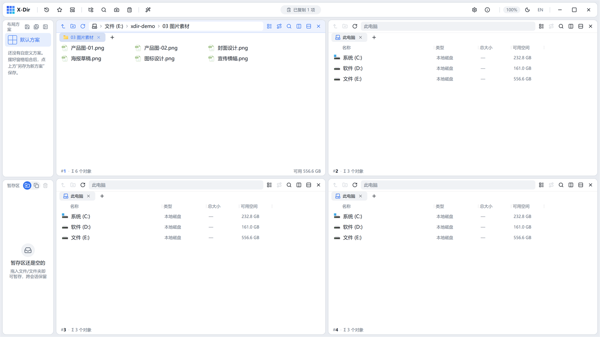
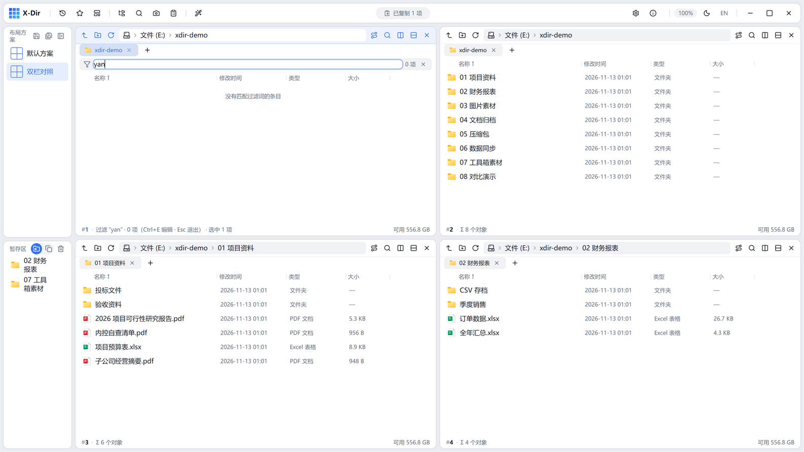
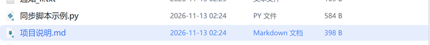

# 07 · 视图与过滤

## 视图模式

窗格支持 **详细信息 / 列表** 两种视图：

- `F3` 在两者之间循环切换；
- 窗格工具栏的「视图类型」按钮弹出菜单直接选择：

- **详细信息**：名称 / 修改时间 / 类型 / 大小 四列，列头点击排序（同列再点反向）；
- **列表**：紧凑单列，一屏看更多：

## 真实图标与缩略图

设置 → 浏览 中可开启「真实图标」：列表显示文件系统提取的真实图标（PDF/Excel/图片各具其貌），「此电脑」盘符同样生效；关闭则回落为按类型着色的语义图标（375+ 扩展名映射，见状态条类型列）。

## 视图内过滤（Ctrl+E)

`Ctrl+E` 唤起过滤条，**只过滤当前列表**（不递归子文件夹）：

- 支持名称与**拼音首字母**子串（如输入 `yan` 命中「项目资料」），多词 AND；
- 状态条回显「过滤后 N/M」；
- `Esc` 退出过滤并还原列表；导航进新目录自动还原，前进/后退保留过滤。

## type-ahead 与过滤的区别

- **type-ahead**（直接键入）：只移动选中项，列表不变；
- **视图内过滤**（Ctrl+E）：列表实时收窄。

## 颜色标记

右键文件 →「颜色标记 ▸」选一个颜色，行首出现色点，配合「着色规则」（设置 → 着色规则）可按扩展名/名称自动着色，快速识别重点文件：

## 排序细节

- 详细信息视图：点击列头排序，再点反向；类型列不可排；
- 同大小/同时间的平局按名称自然序排（`2.docx` 排在 `10.docx` 之前）；
- 列宽拖拽调整，双击列头分隔线恢复默认。
