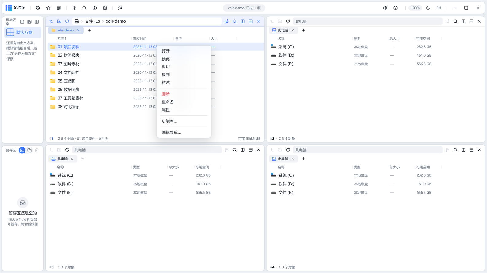
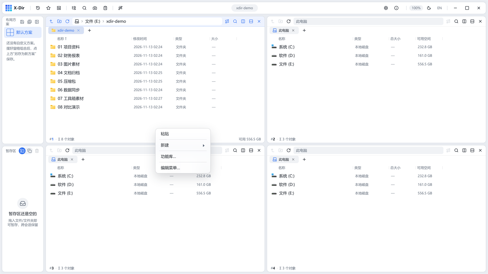
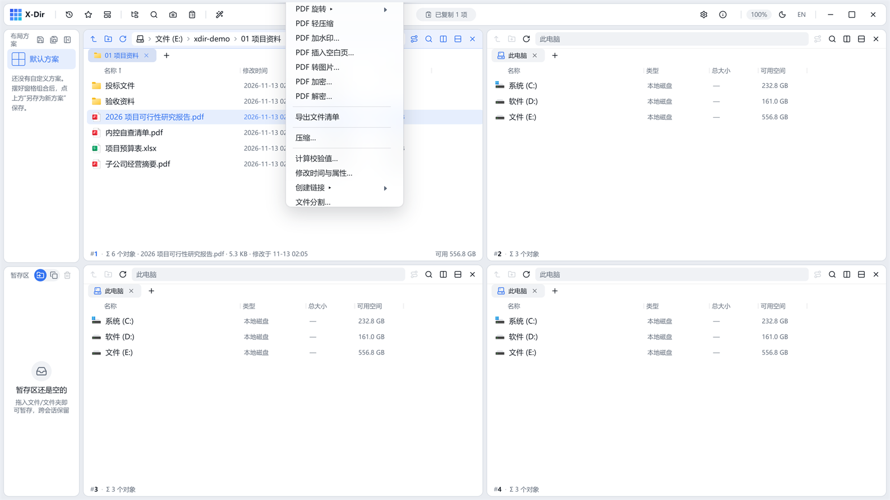
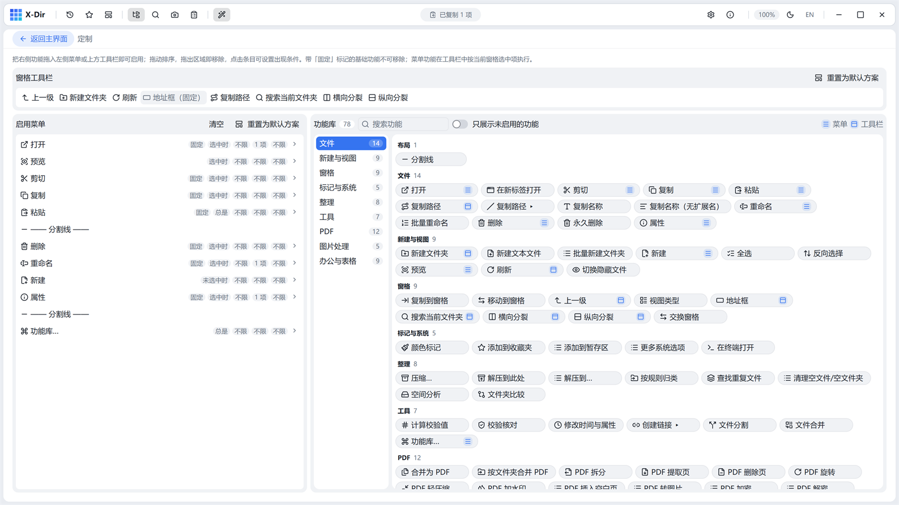
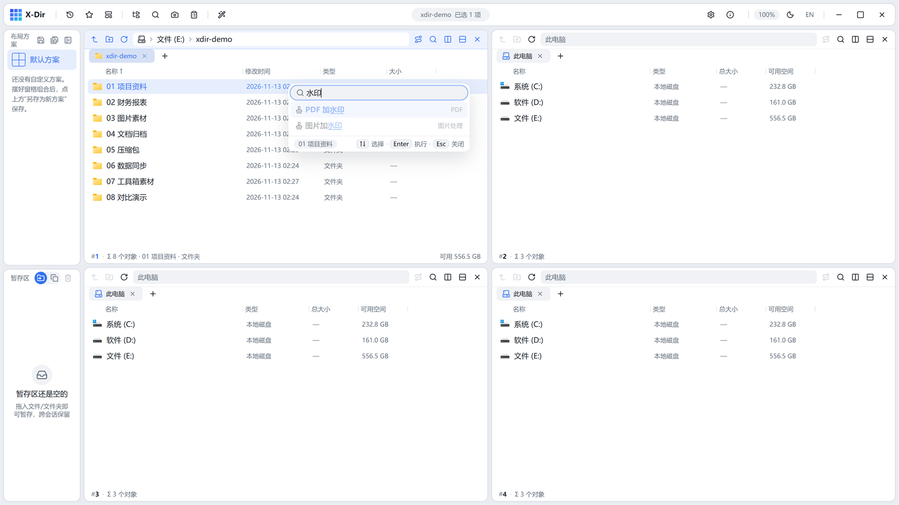

# 08 · 右键菜单与定制

X-Dir 的右键菜单是**数据驱动**的：菜单里有什么、什么条件下出现、按什么顺序排，全部可以在「定制」页可视化编辑。

## 默认右键菜单

选中条目右键（基础项）：

空白处右键（含「新建」「功能库」入口）：

定制过工具后，菜单会按条件出现对应工具（下图为一份收录了 PDF/图片/办公工具的菜单）：

- 带标题尾部 `…` 的条目会打开参数对话框；带 `▸` 的条目有子菜单；
- 「更多系统选项（Shift+右键）」调出系统原生右键菜单（打开方式/发送到等）。

## 定制页

顶栏「定制」按钮（或右键菜单尾部的「编辑菜单…」）打开整页编辑器：

页面分三块：

| 区块 | 说明 |
|---|---|
| 上·窗格工具栏 | 模拟窗格导航栏的编辑条带，拖入条目即上工具栏（见下文） |
| 左·启用菜单 | 当前右键菜单的实际内容，每行右侧四个条件 chip |
| 右·功能库 | 83 项内置功能按 9 个分组排列的「胶囊墙」 |

## 功能库

右侧功能库是所有可用功能的清单（文件 14 / 新建与视图 9 / 窗格 9 / 标记与系统 5 / 整理 8 / 工具 7 / PDF 12 / 图片处理 5 / 办公与表格 9，外加分割线）：

- **拖拽添加**：把胶囊拖到左侧菜单（或上方工具栏）即启用；拖出区域即移除；在菜单内拖动排序；
- 点击胶囊上的条件 chip 可设置**出现条件**；
- 顶部搜索框即时过滤；「只展示未启用的功能」开关帮你找漏项；
- 「打开/剪切/复制/粘贴/删除/重命名/属性」七项带「固定」标记，**不可移除**。

## 条件可见性

点击条目的条件 chip 打开条件编辑浮层，四个维度实时预览成人话：

| 维度 | 选项 |
|---|---|
| 出现区域 | 两处出现 / 仅选中时 / 仅空白处 |
| 对象 | 不限 / 仅文件 / 仅文件夹 |
| 数量 | 不限 / 1 项 / ≥N 项 |
| 扩展名 | 不限 / 指定列表（如 `pdf;docx`） |

标题行右侧还有「重置为默认方案」与「清空」，均需确认。

## 窗格工具栏

顶部编辑条带模拟窗格导航栏（图标 + 地址框占位同排）：

- **全部内置功能都可以入工具栏**（无能力位限制），拖入即用、拖出即删、卡内拖动排序；
- 「地址框」为固定条目不可移除；
- 条目默认作用域：与文件夹相关的能力（上一级/新建/刷新…）在无选中时也亮，其余在选中不满足条件时**置灰**（`.np-tool-off`）；
- 出厂默认 8 键：上一级 / 新建文件夹 / 刷新 / 地址框 / 复制路径 / 搜索当前文件夹 / 横向分裂 / 纵向分裂。

## 快速命令面板（功能库…）

右键菜单尾部的「**功能库…**」打开一个贴身轻浮窗：跨全库搜索名称/说明/分组（空格分词 AND、支持拼音首字母），`↑↓` 选择、`Enter` 执行、`Esc` 关闭。现场条件不满足的功能整行降灰：

这是执行任意功能最快的方式——不需要先把功能拖进菜单。
