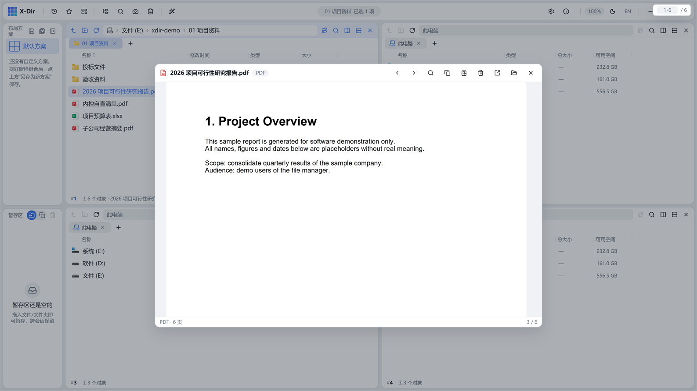
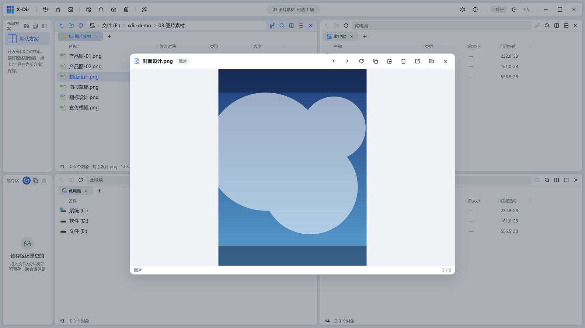
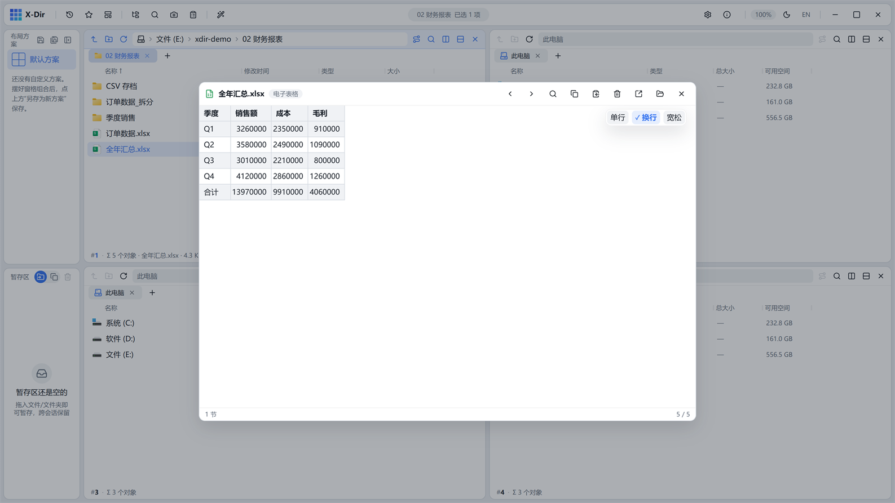
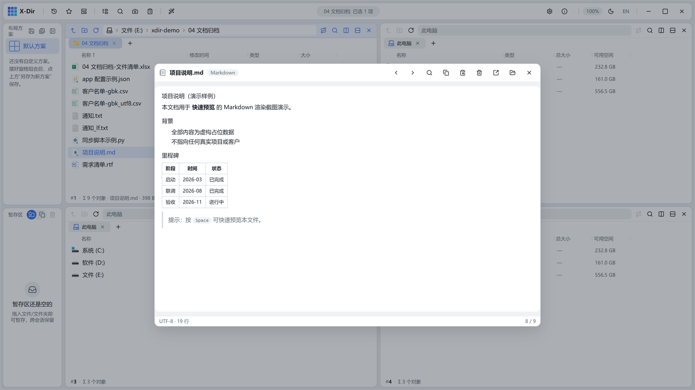
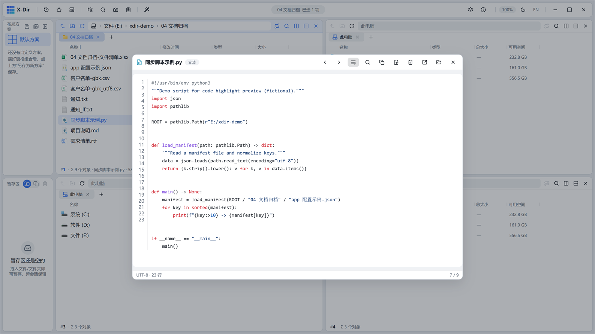
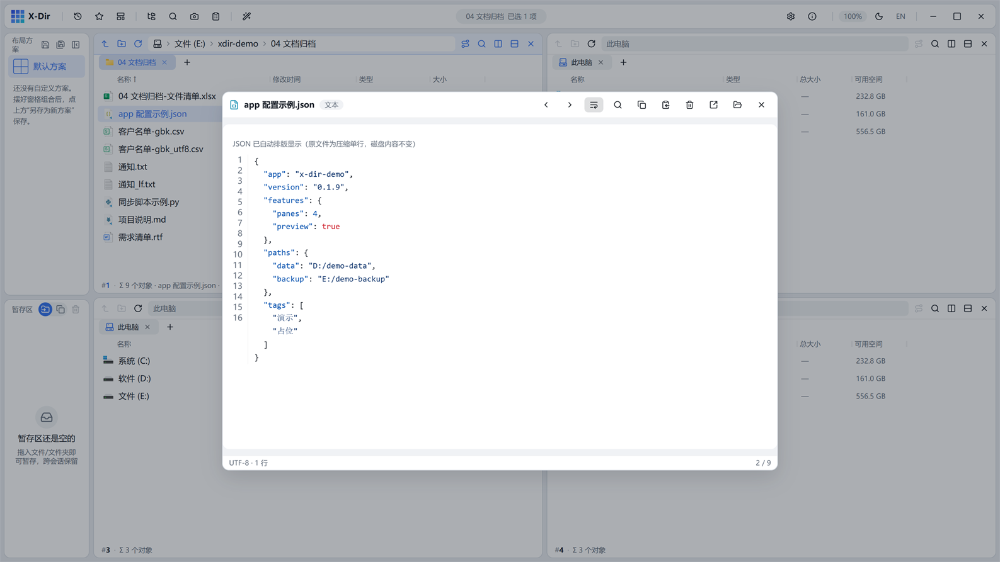
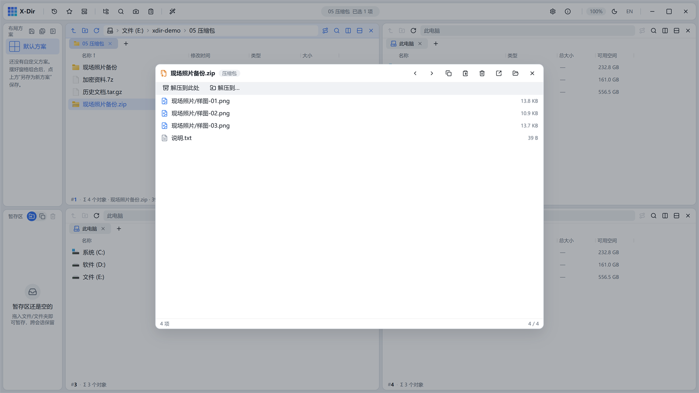
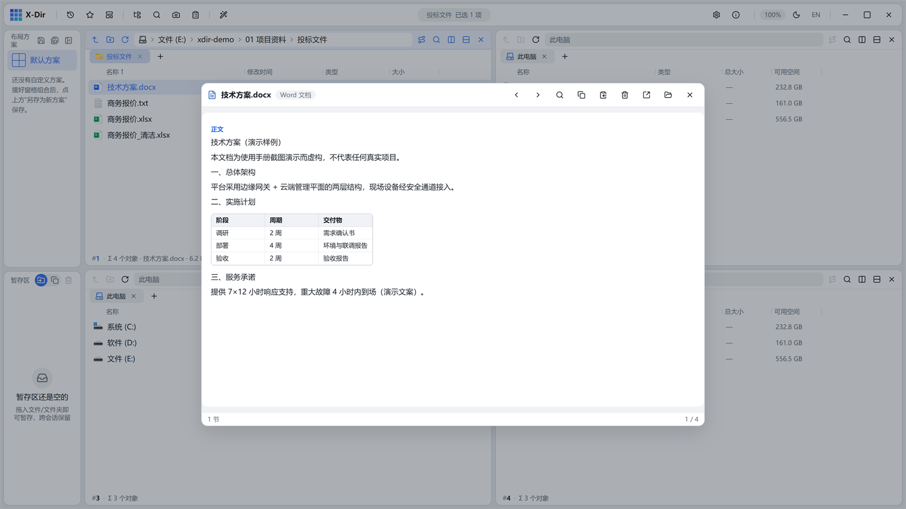
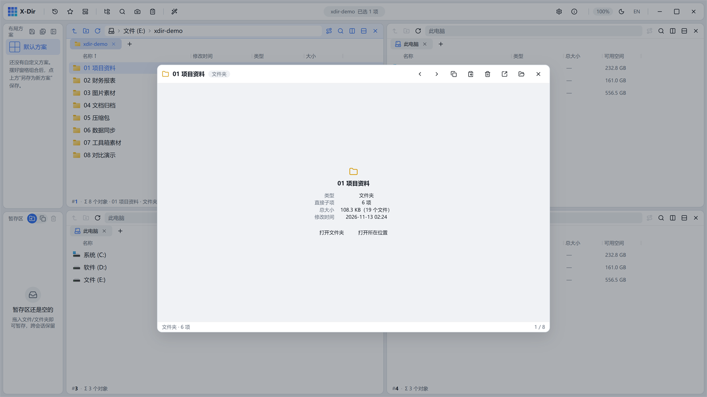

# 10 · 快速预览

选中文件按 `Space`（或右键 →「预览」）唤起快速预览浮层；`↑/↓` 在当前目录队列中切换文件，`Esc` 关闭，`Enter` 用系统默认程序打开。

## PDF

pdf.js 逐页虚拟渲染，文本层可选中复制，未嵌入字体的中文扫描件经内置 CMap 正常显示；页码跳转框直达指定页：

## 图片

缩放/平移查看；支持 PNG/JPEG/WebP/BMP/TIFF 等常规格式与动画帧预览：

## Excel / 表格

虚拟网格渲染工作表：**首行表头加粗冻结、数值列右对齐**；日期/百分数/千分位等单元格格式按 Excel 口径显示；右上角浮动档位切换行高（单行省略 / 换行自适应 / 宽松留白）：

## Markdown

渲染标题/列表/表格/代码块：

## 代码与文本

编码自动探测；22 种扩展名代码语法高亮（浅/深主题各配 GitHub 配色）；换行开关 + 行号（≤2 万行）：

- 压缩成一行的 JSON 自动排版展示（磁盘内容不变），并提示「已自动排版」：

## 压缩包

zip / tar / tar.gz / 7z / rar 清单预览，底部提供「解压到此处 / 解压到…」工具行：

## Word

docx 结构化抽取：标题分级、列表缩进、内嵌表格；旧版 .doc/.ppt 经旧版二进制原生抽取或 COM 通道（见下）。

## 文件夹

文件夹行按 `Space` 显示子项数与递归体积卡片；`Enter` 直接进入该文件夹：

## 其他格式

- **视频/音频**：播放器预览；
- **字体**：样字预览；**epub**：封面 + 目录；
- **.odt/.odp/.rtf/.eml/.msg/.ofd**：结构化文本抽取；
- **.et/.wps/.dps**：容器嗅探分流，识别不了的提示右键转 PDF；
- **旧版 Office（.doc/.ppt）**：优先纯 Rust 原生抽取（零依赖），失败回落 COM 通道（需本机装 Office/WPS）。

## 预览内查找

预览浮层内 `Ctrl+F`：文本/表格/PDF 全文高亮，PDF 命中列表滚动定位，表格命中格居中。
