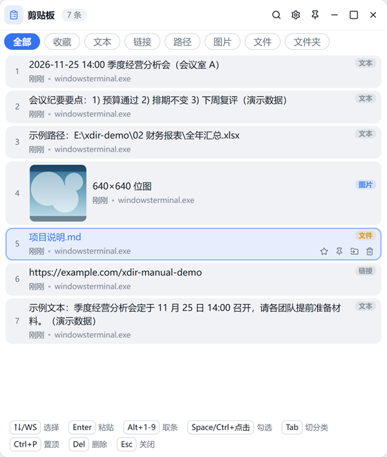
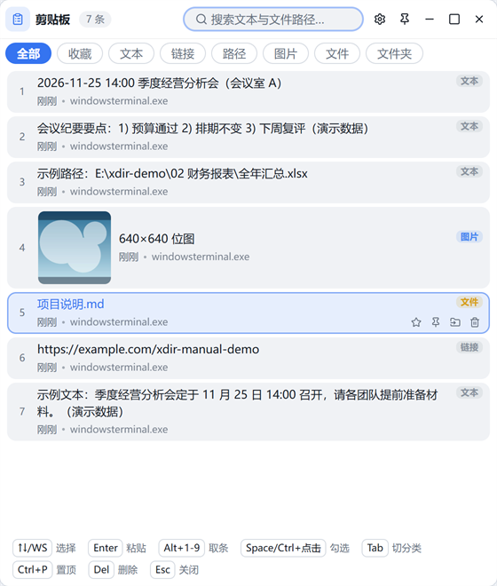

# 11 · 剪贴板历史

顶栏「剪贴板历史」按钮（或全局热键，默认设置里可改）唤起常驻浮窗：

## 基本行为

- 后台**持续监听**剪贴板，文本 / 图片 / 文件 / 链接 / 路径自动分类入库（去重命中置顶）；
- 文本上限 1MiB、位图 20MB、文件 500 条；容量默认 500 条、保留 30 天（0 = 永不清），可改；
- 检测到高置信敏感内容（PEM 证书、AWS/JWT/常见平台令牌）**自动跳过不入库**；
- 也可在设置里排除指定应用（如密码管理器）的剪贴板写入。

## 键盘操作

呼出即处于**列表模式**：

| 键 | 动作 |
|---|---|
| `↑` `↓`（或 W/S） | 选择条目 |
| `Enter` | 直接粘贴到呼出前的窗口 |
| `Alt+1-9` | 取第 N 条 |
| `Space` / `Ctrl+点击` | 勾选多条（合并粘贴） |
| `Ctrl+P` | 置顶/取消置顶 |
| `Del` | 删除条目 |
| `Tab` | 循环切换分类（全部/收藏/文本/链接/路径/图片/文件/文件夹） |
| `Esc` | 关窗 |

## 搜索（折叠式）

默认**折叠**为一枚搜索图标——不抢焦点，列表模式即刻全效；键入任意字符或点击图标展开搜索框：

- 全文检索 + 拼音首字母（如 `jlys` 命中「季度流水」）；
- `Esc` 收起并清词，再按关窗。

## 直接粘贴

默认开启：回车后自动回写剪贴板 → 恢复目标窗口焦点 → 模拟 `Ctrl+V`，一步到位。目标窗口是管理员权限/UAC 界面时降级为「已复制」提示，手动粘贴即可。

## 收藏与置顶

- `Ctrl+P` 或行内按钮置顶（豁免清理、排最前）；
- 行内收藏按钮把条目放入「收藏」分组，分类循环可单独查看。

## 其他能力

- **富文本保真**：HTML 格式随文本一起回写（设置可关）；
- **OCR 取字**：图片条目右键 → OCR，识别文本写回剪贴板（需系统语言包）；
- **多选合并粘贴**：勾选多条文本按列表序合并；
- **备份**：设置 → 剪贴板 可导出/导入全部历史（JSON，含图片 base64）；
- 「粘贴到当前窗格」：浮窗右键菜单直达 X-Dir 活动窗格。
