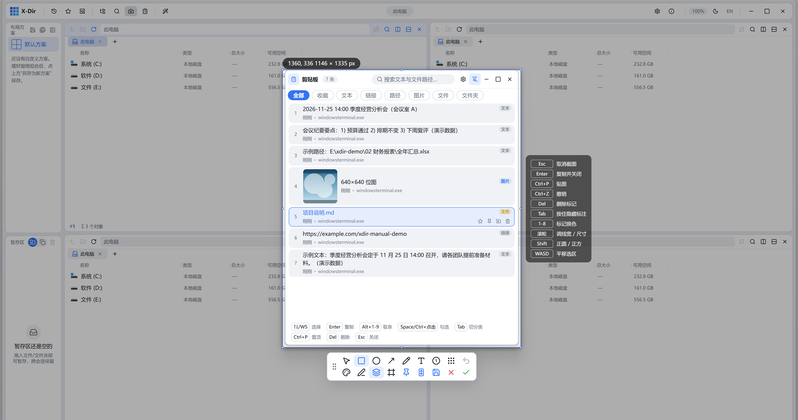
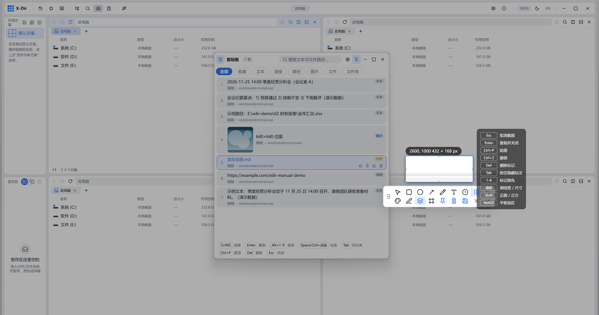

# 12 · 截图与贴图

顶栏「截图」按钮或全局热键（默认 `Ctrl+Alt+A`，设置 → 截图 可改）进入截图会话。热键到定格上屏约 0.3 秒（DXGI 桌面复制引擎，4K 约 60-100ms）。

## 选区

- 进入会话即**智能预选光标下的窗口**（跟随移动自动切换），点击窗口或直接拖拽框选；
- 像素级**放大镜与取色器**：`Shift` 切换颜色格式、`C` 复制色值、`P` 复制相对坐标；
- 全局**十字辅助线**（设置可关）；`WASD`/方向键微调选区（`Shift` 大步进）；
- 选区确认后浮出**快捷键清单**面板：

## 标注工具

工具栏两行：矩形（圆角/实心/虚线）、椭圆、箭头（单向/双向 × 直线/虚线/曲线 × 空心/实心）、画笔·马克笔、文字（高亮底/粗/斜体）、**自动递增序号**、马赛克/模糊（方形/圆形区域）；行 2 为颜色（`1-8` 快速换色）/线宽/阴影/边框。

**滚轮悬停指哪调哪**：鼠标悬停任意已画标记上滚动滚轮即可调节它的属性——线宽（1~30）、字号（10~80）、序号数值、马赛克密度、模糊不透明度；HUD 实时显示数值。

更多交互：

- 拖动标记移位；`Alt+拖动` 克隆；`Del` 删除悬停标记；
- `Ctrl+Z` 快照式撤销；`Tab` 按住查看原图（导出仍含标注）；
- 悬停标记右键菜单：置前/置后/克隆/删除；
- 每类工具的默认值会话内立即生效并跨会话记忆。

## 完成动作

| 键 | 动作 |
|---|---|
| `Enter` / 双击 | 复制并关闭 |
| `Ctrl+P` | **贴图**：钉成置顶小窗 |
| 保存按钮 | 导出 PNG（可加阴影/边框装饰） |
| 滚动长图按钮 | 滚动截长图 |
| 红色 X | 关闭不保存 |

## 贴图（Pin）

选区原地钉成置顶小窗（8px 圆角 + 双层柔和阴影）：滚轮缩放、`Alt+滚轮` 调透明度、拖动零抖动（Rust 线程 125Hz 直接驱动）、右上角悬停关闭、右键菜单可复制/另存、`Esc`/双击关闭。

## 滚动长图

框选区域后正常滚动页面即可——自研 NCC 两带共识模板匹配实时拼接，侧边窄条预览同步增长；到底/停歇自动收尾；结果窗支持缩放浏览、复制、保存、再贴图。
