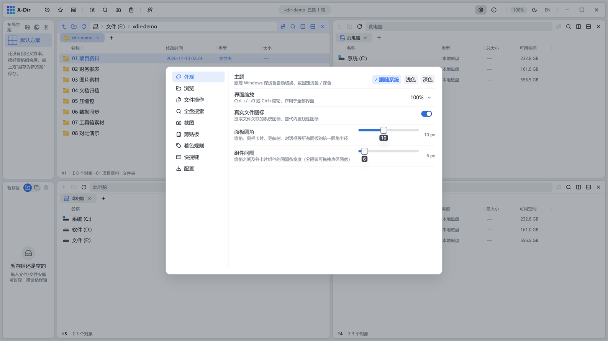
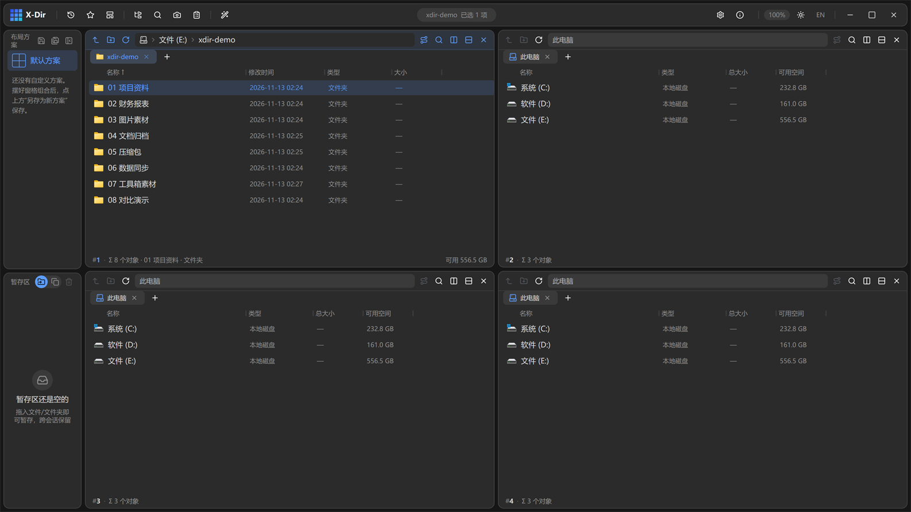
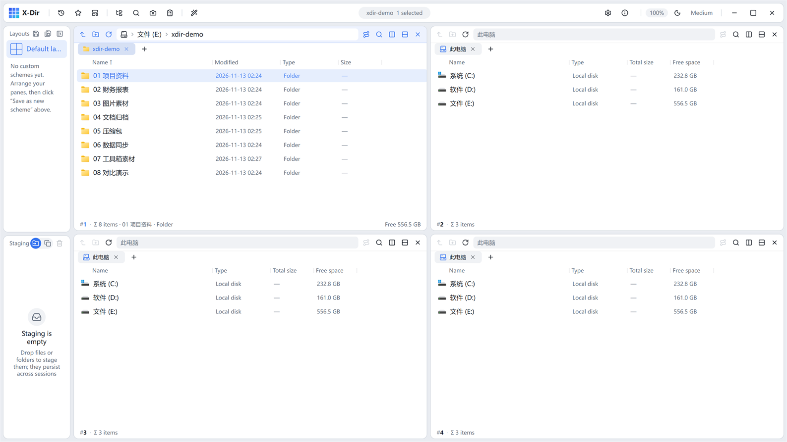
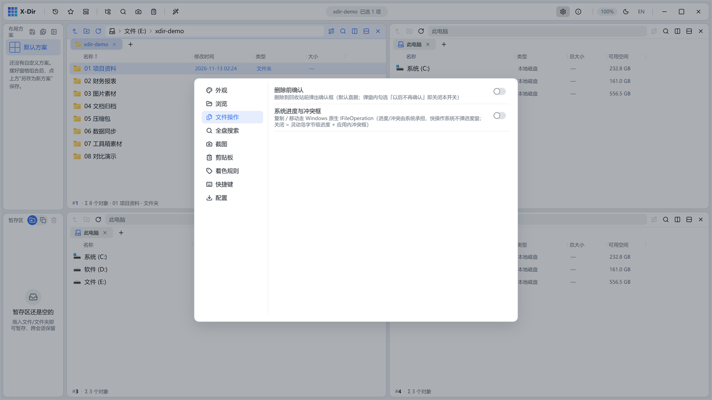
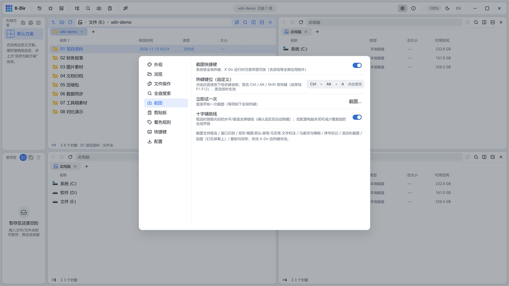
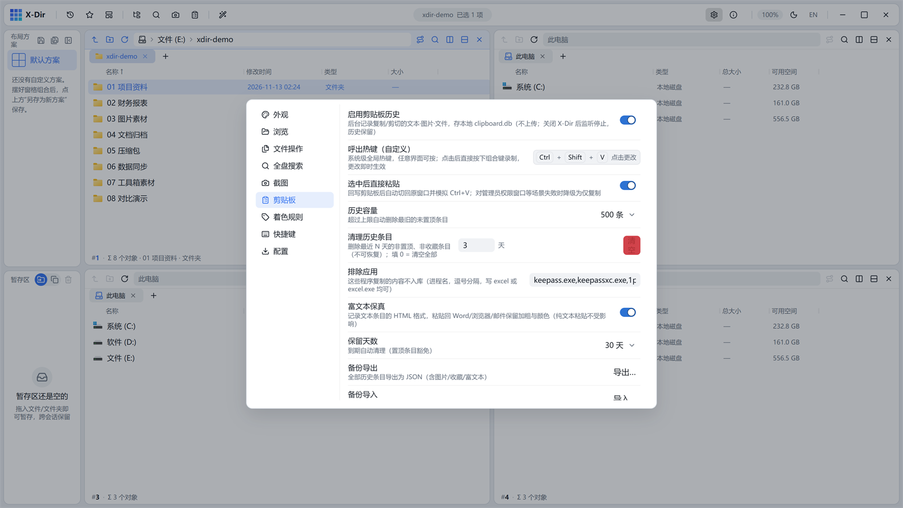
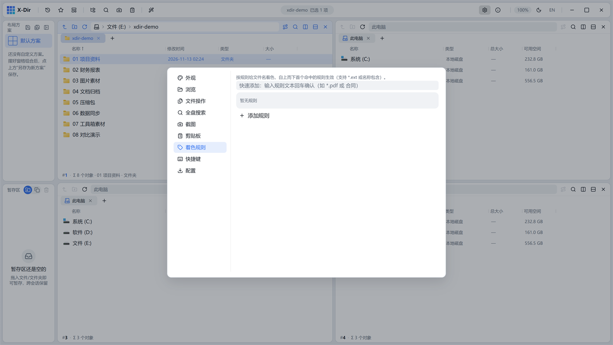
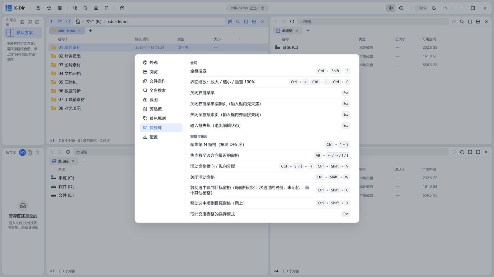
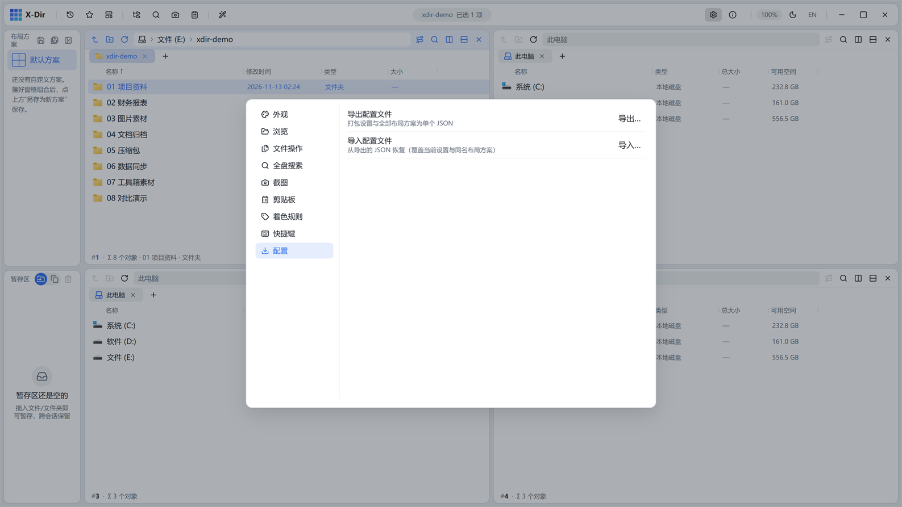

# 13 · 设置与配置

顶栏「设置」按钮打开设置面板，共九类：

## 外观

- 主题：浅色 / 深色 / 跟随系统；切换带**圆形扩散动画**（从触发点揭示新主题）：

- 界面缩放：100%（`Ctrl+滚轮` 全局缩放，点击重置）；
- 界面语言：中文 / English（顶栏一键切换，词条持续补全）：

- 圆角大小（`--np-radius-pane`）、真实图标开关等。

## 浏览

单/双击打开、选择记忆、type-ahead、视图默认值、导航树行为等。

## 文件操作

- 原生文件操作引擎（IFileOperation）开关：开启后进度/冲突走系统 UI，默认关闭以使用灵动岛实时进度；
- 删除确认、冲突默认策略等。

## 全盘搜索

索引守护的引导文案（开关已移至全盘搜索页状态条）。

## 截图

全局热键（截图/贴图/滚动长图）、十字辅助线开关、标注默认值、导出装饰等。

## 剪贴板

启用开关、呼出热键、直接粘贴、容量与保留天数、排除应用、清理历史条目（最近 N 天 / 全部非置顶收藏）、备份导入导出。

## 着色规则

按扩展名/名称关键词给文件行自动着色，与右键「颜色标记」叠加。

## 快捷键

全部快捷键集中展示（数据源单一清单），点击条目录制新键，冲突即回执提示。

## 配置

- **导出配置**：settings.json + 全部布局方案打包为单个 JSON；
- **导入配置**：校验后整体覆盖并热重载（常驻的剪贴板浮窗也会同步主题）；
- 不随导出的数据：剪贴板历史库、全盘索引缓存（可重建）。
