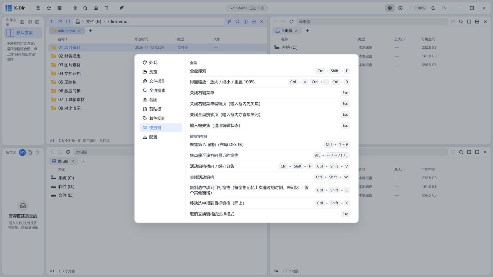

# 14 · 快捷键速查

全部快捷键在 **设置 → 快捷键** 页集中展示，点击条目录制新键：

以下为默认清单（与设置页数据同源）：

## 全局

| 快捷键 | 动作 |
|---|---|
| `Ctrl+Shift+F` | 全盘搜索页 |
| `Ctrl+F` | 窗格内递归搜索 |
| `Ctrl+E` | 视图内过滤当前文件夹 |
| `Alt+D` | 聚焦活动窗格地址栏 |
| `Backspace` | 上一级 |
| `F5` | 刷新活动窗格 |
| `F3` | 循环切换视图（详细信息 ↔ 列表） |
| `Ctrl+A` | 全选 |
| `Ctrl+C / X / V` | 复制 / 剪切 / 粘贴 |
| `Ctrl+Shift+C / X` | 复制 / 移动到目标窗格 |
| `Ctrl+Z / Y` | 撤销 / 重做 |
| `Ctrl+Shift+N` | 新建文件夹（Explorer 式，直接落盘改名） |
| `F2` | 重命名 |
| `Delete / Shift+Delete` | 回收站删除 / 永久删除 |
| `Space` | 快速预览 |
| `Ctrl+Enter` | （全盘搜索）打开所在文件夹 |
| `Ctrl+滚轮` | 界面缩放 |

## 预览浮层内

| 快捷键 | 动作 |
|---|---|
| `↑ / ↓` | 上/下一个文件 |
| `Enter` | 默认程序打开 |
| `Esc` | 关闭 |
| `Ctrl+F` | 预览内查找 |

## 剪贴板浮窗

| 快捷键 | 动作 |
|---|---|
| `↑↓ / W S` | 选择条目 |
| `Enter` | 直接粘贴 |
| `Alt+1-9` | 取第 N 条 |
| `Space` / `Ctrl+点击` | 勾选（合并粘贴） |
| `Ctrl+P` | 置顶 |
| `Del` | 删除条目 |
| `Tab` | 循环分类 |
| `Esc` | 收起搜索 → 关窗 |

## 截图会话

| 快捷键 | 动作 |
|---|---|
| `Ctrl+Alt+A` | 开始截图（全局热键，可改） |
| `Ctrl+P` | 贴图 |
| `Enter` / 双击 | 复制并关闭 |
| `Ctrl+Z / Y` | 撤销 / 重做标注 |
| `1-8` | 换标注色 |
| `Tab`（按住） | 查看原图 |
| `Del` | 删除悬停标记 |
| `Shift` | 绘制约束（正方/正圆/45°） |
| `WASD/方向键` | 准星微调（`Shift` 大步） |
| 滚轮（悬停标记） | 调节线宽/字号/序号/密度/不透明度 |

## 鼠标

| 操作 | 动作 |
|---|---|
| 中键点击文件夹 | 新标签打开 |
| 鼠标 X1 / X2 侧键 | 后退 / 前进 |
| 列分隔线双击 | 恢复默认列宽 |
