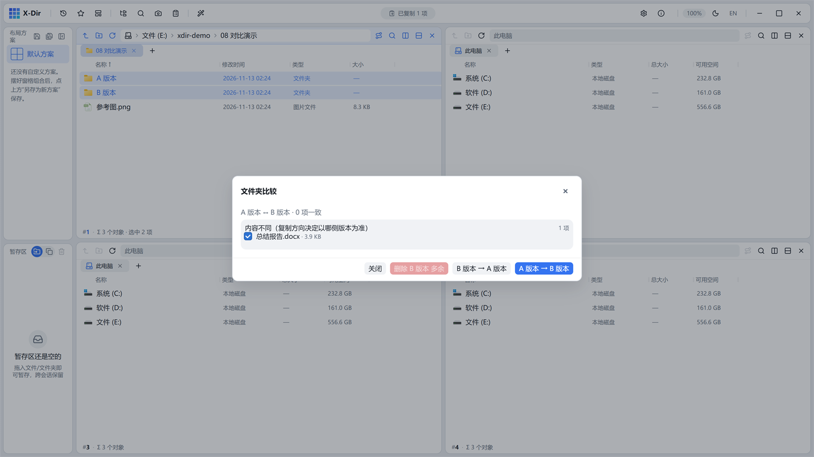

# 磁盘 · 文件夹比较

两个文件夹按相对路径对齐，三段差异一目了然。

## 入口

选中 **2 个文件夹** → 右键 →「文件夹比较」。

## 界面与参数

| 区段 | 含义 |
|---|---|
| A 独有 | 只在第一个文件夹存在 |
| B 独有 | 只在第二个文件夹存在 |
| 内容不同 | 同名但体积或修改时间不一致 |

- 每段独立勾选；
- 操作按钮：「A → B」「B → A」按勾选**覆盖复制同步**（走冲突流程）；「删除 B 多余」等清理动作走回收站。

## 步骤

1. 选中两个待比较的文件夹 →「文件夹比较」；
2. 核对三段差异；
3. 按方向同步勾选项，或清理多余文件。

## 输出与注意

- 判据 = 相对路径 + 体积 + 修改时间；
- 双向复制走 transfer 冲突流程，目标同名文件按冲突对话框处理；
- 护栏（MAX_FILES 等）防病态大目录；
- 「A 版本 vs B 版本谁新了哪些文件」「备份目录一致性核对」两步搞定。
