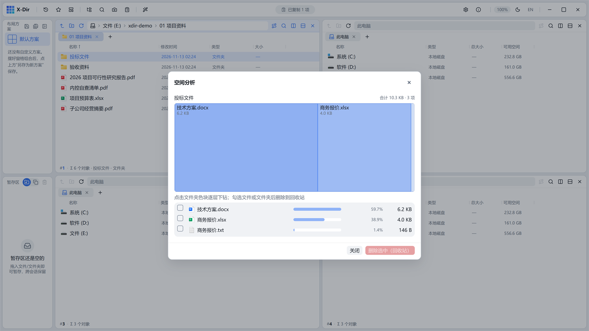

# 磁盘 · 空间分析

WizTree 式矩形树图 + TreeSize 式体积条，逐层钻取目录体积。

## 入口

选中 **1 个文件夹** → 右键 →「空间分析」。

## 界面

- **上·矩形树图**：色块面积 ∝ 体积，主题蓝单色、浓淡随占比分级；点击文件夹色块**逐层下钻**（面包屑栈回退），点击文件色块选中；
- **下·体积条清单**：每个子项一行读全（体积条 + 占比列 + 复选框），类型图标跟随「真实图标」设置；
- 标题行合计体积与项数。

## 步骤

1. 选中文件夹 →「空间分析」；
2. 在树图/清单里点击下钻，定位体积大户；
3. 勾选要清理的条目 →「删除选中（回收站）」。

## 输出与注意

- 目录体积异步补齐（best-effort），大数据目录首次进入会渐进刷新；
- 删除在弹窗内已确认，不再二次弹窗；
- 找「谁占了空间」比逐层右键属性快一个数量级。
