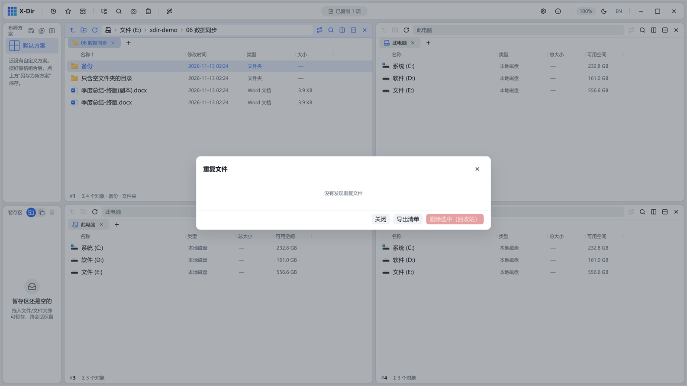

# 磁盘 · 查找重复文件

同体积粗分 → SHA-256 内容指纹成组，找出全部重复文件。

## 入口

选中 **1 个文件夹** → 右键 →「查找重复文件」。

## 参数

| 参数 | 说明 |
|---|---|
| 扫描范围 | 所选文件夹递归全层 |
| 默认勾选 | 每组自动勾选**副本**（保留最早一份），可直接批量删 |
| 导出 CSV | 统计头 + 全部重复组导出清单留档 |

## 步骤

1. 选中文件夹 →「查找重复文件」；
2. 等待扫描（同体积粗分先过滤，SHA-256 只算候选，快）；
3. 逐组核对 →「删除选中（回收站）」或先「导出 CSV」。

## 输出与注意

- 内容指纹判定，**改名/换目录的重复同样成组**；
- 删除走回收站，可恢复；
- 护栏：MAX_FILES / MAX_HASH / MAX_GROUPS 防病态目录；
- 「下载目录 vs 归档目录」谁删谁留，先看「路径」列再动手。
