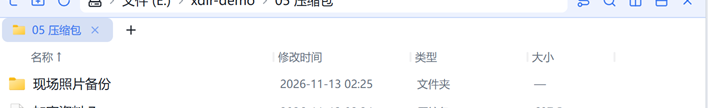

# 磁盘 · 解压

zip / 7z / tar 系 / rar（含分卷）/ xz / bz2 解压，进度字节化、条目级回执。

## 入口

选中 **压缩包** → 右键：

- 「**解压到此处**」：解到压缩包同名子文件夹（`现场照片备份\`），无对话框直接执行；
- 「**解压到…**」：弹出目标路径选择（记忆上次目标），适合指定输出位置；
- 预览压缩包时底部工具行也有同样的两颗按钮。

## 参数（解压到…）

| 参数 | 说明 |
|---|---|
| 目标路径 | 记忆 `settings.extractDestDir`，下次自动带出 |

## 步骤

1. 选中压缩包 →「解压到此处」；
2. 进度经灵动岛字节化显示（解压前预扫清单求总字节，64KB 分块拷贝可即时取消）；
3. 完成回执带「打开」动作直达输出目录。

## 输出与注意

- 多文件包解到 `<包名>\` 子文件夹；gz/xz/bz2 单文件流旁写内层名；
- **zip-slip 防护**：恶意路径条目逐条净化，跳过数在回执中明示（「已跳过 N 项非法条目」）；
- 解压总量 **10GiB 硬闸**（按实际解出字节计，条目尺寸谎报也拦得住）；
- 加密包解压失败时弹掩码密码框，带密码重试一次。
