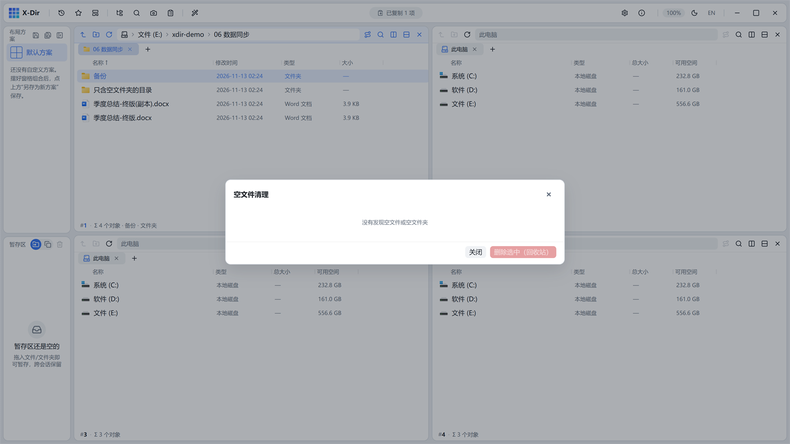

# 磁盘 · 清理空文件/空文件夹

递归扫描 0 字节文件与字面空目录，勾删走回收站。

## 入口

选中 **1 个文件夹** → 右键 →「清理空文件/空文件夹」。

## 参数

| 参数 | 说明 |
|---|---|
| 扫描结果 | 空文件 / 空文件夹 两组，默认全选 |
| 上限护栏 | MAX_FILES 防误删超大量 |

## 步骤

1. 选中文件夹 →「清理空文件/空文件夹」；
2. 核对两组勾选（取消不想删的）；
3. 「删除选中」走回收站。

## 输出与注意

- **防误删设计**：只含空子目录的父目录**不算**空目录（`空子目录\` 里的父层不会被删）；
- 0 字节文件 = 字面空文件；下载残留、中断产物一网打尽；
- 删除走回收站可恢复。
