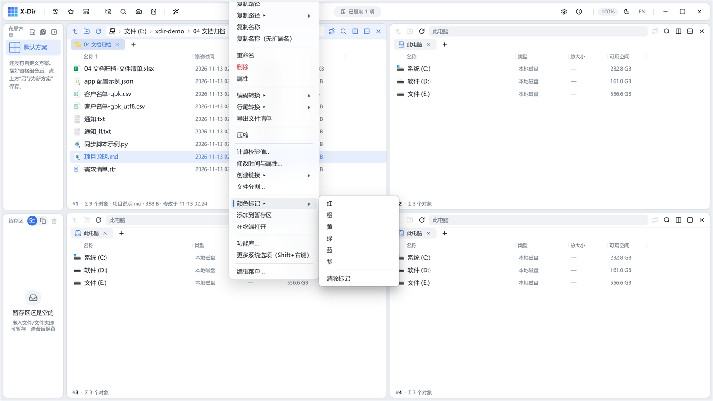
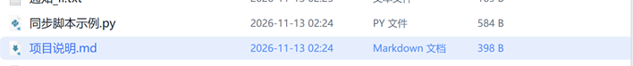
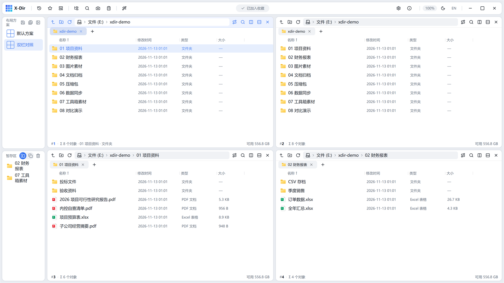

# 文件 · 颜色标记 / 收藏夹 / 暂存区 / 终端

标记与系统分组的四个轻量功能，配合边栏与顶栏弹层使用。

## 颜色标记

右键文件 →「颜色标记 ▸」→ 选色：

- 行首出现色点，重点文件一眼可辨：

- 配合**设置 → 着色规则**按扩展名/关键词自动着色。

## 添加到收藏夹

右键**文件夹** →「添加到收藏夹」；顶栏「收藏夹」弹层点击直达：

## 添加到暂存区

右键 →「添加到暂存区」，条目进入边栏暂存区，之后拖到任意窗格落位（移动或复制由暂存区模式开关决定）。详见[边栏与暂存区](../../basics/06-sidebar.md)。

## 在终端打开

右键空白处或选中文件夹 →「在终端打开」，直接在当前目录唤起系统终端；跑脚本/查目录免手动 cd。
