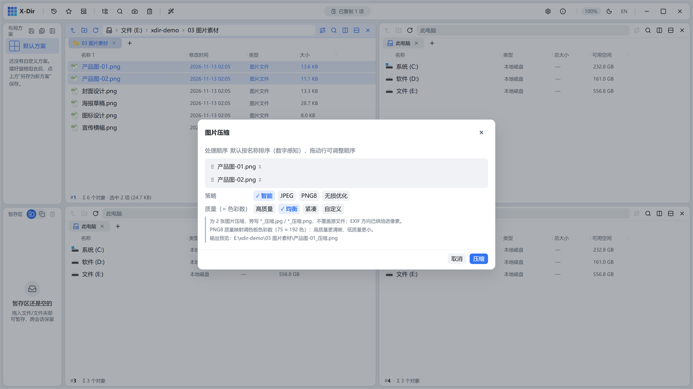

# 图片 · 压缩

四档压缩策略，输出旁写 `*_压缩.*`，绝不覆盖原图。

## 入口

选中 **图片文件**（可多选批量）→ 右键 →「图片压缩」。

## 参数

| 档位 | 行为 |
|---|---|
| 智能（Auto） | JPEG→按质量压缩、PNG→PNG8 色板量化、其余→转 JPEG；批量时逐张判型 |
| JPEG | 固定输出 JPEG，按质量档压缩 |
| PNG8 | 256 色量化（图标/截图效果极佳，体积骤降） |
| 无损优化 | oxipng 无损重压缩 PNG，画质 100% 保留 |

- 质量档支持「高质量 / 均衡 / 紧凑」预设与「自定义」滑杆（1–100）；
- PNG8 / 无损 / 非 JPEG 目标下质量档自动禁用（引擎不读取）。

## 步骤

1. 选中图片 →「图片压缩」；
2. 选档位与质量；
3. 执行，进度经灵动岛播报，输出旁写新文件。

## 输出与注意

- 输出名 `<原名>_压缩.png/jpg`，重名 `(2)` 递增；
- 批处理上限 200 张；
- 摄影/截图用「智能」通常即可；对画质零容忍的 PNG 用「无损优化」。
