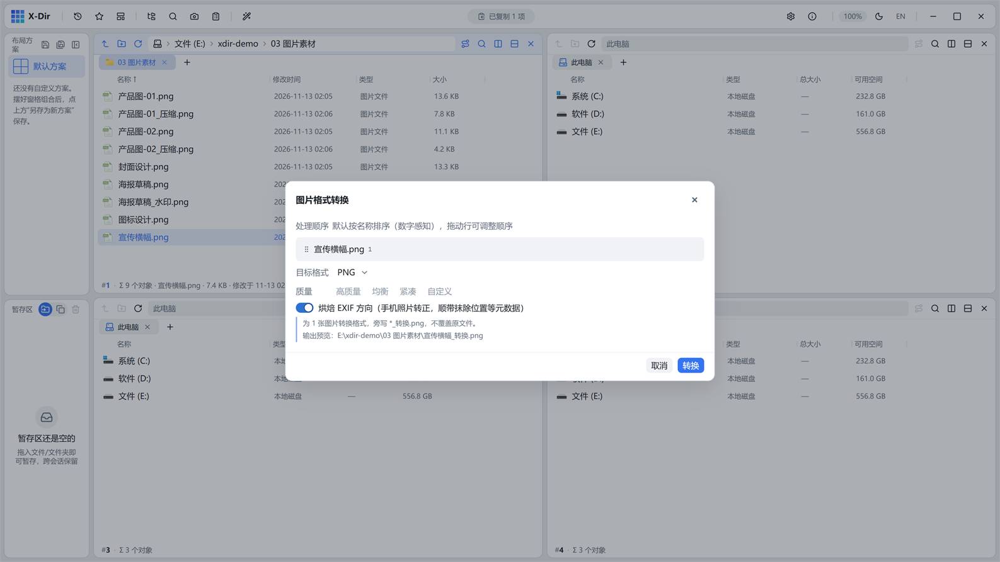

# 图片 · 格式转换

PNG / JPEG / BMP / TIFF / ICO / WebP 互转，全程无损路径。

## 入口

选中 **图片文件**（可多选批量）→ 右键 →「图片格式转换」。

## 参数

| 参数 | 说明 |
|---|---|
| 目标格式 | PNG / JPEG / BMP / TIFF / ICO（≤256px 自动缩）/ WebP |
| EXIF 方向烘焙 | 开（默认）：按拍摄方向旋转写入像素，**顺带抹除 GPS 等位置元数据** |
| 质量 | 仅 JPEG 目标可用 |

## 步骤

1. 选中图片 →「图片格式转换」；
2. 选目标格式（如 WebP）；
3. 执行，输出 `<原名>_转换.<ext>`。

## 输出与注意

- PNG↔WebP↔BMP↔TIFF 互转无损；转 JPEG 有压缩（按质量档）；
- 转 ICO 时超过 256px 的源图自动缩放；
- 需要彻底清除照片隐私元数据：转一次格式（EXIF 烘焙开启）即可。
