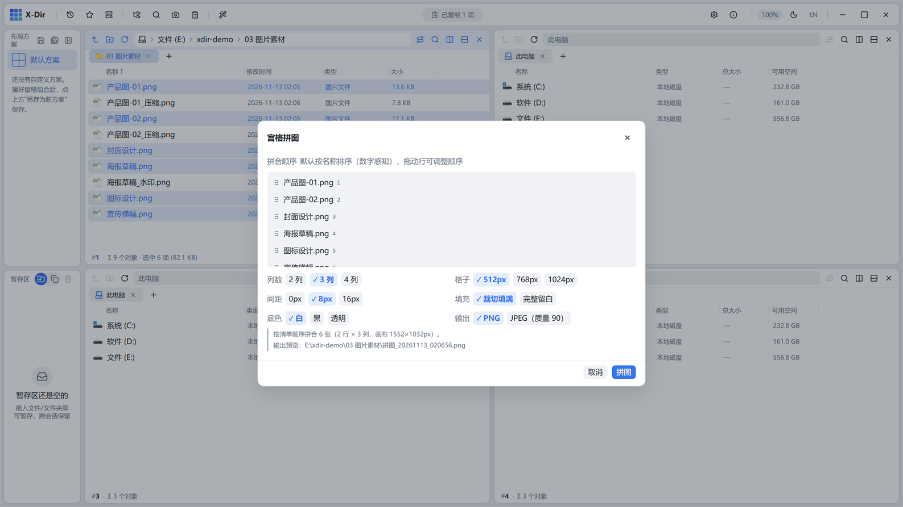
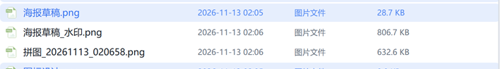

# 图片 · 宫格拼图

4–36 张图片拼成一张网格画布（对比图、审核底稿附件常用）。

## 入口

选中 **4–36 张图片** → 右键 →「宫格拼图」。

## 参数

| 参数 | 说明 |
|---|---|
| 列数 | 2 / 3 / 4 列（行数按张数自动排） |
| 格子尺寸 | 512 / 768 / 1024 px |
| 间距 | 0 / 8 / 16 px |
| 填充方式 | 裁切填满（等比裁切）/ 完整留白（等比缩小留白边） |
| 底色 | 白 / 黑 / 透明（透明强制输出 PNG，JPEG 项自动禁用） |

## 步骤

1. 按拼合顺序选中图片（清单顺序 = 拼合顺序，超 36 张截断提示）；
2. 选列数/格子/间距/底色；
3. 执行，输出 `拼图_yyyyMMdd_HHmmss.png`：

## 输出与注意

- 输出重名自动 `(2)` 递增；
- 「裁切填满」适合同比例照片；「完整留白」适合截图/文档页；
- 清单即顺序：第一张排在左上，从左到右、从上到下。
