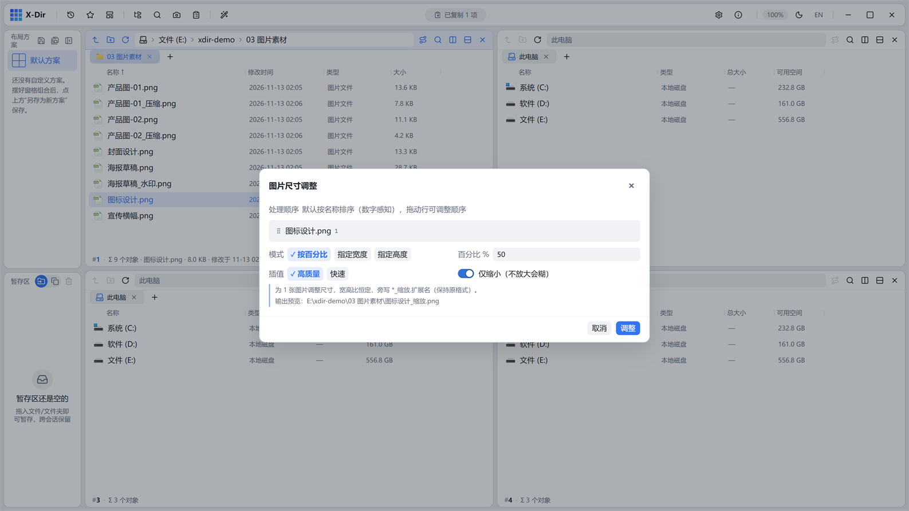

# 图片 · 尺寸调整

按百分比或指定宽高等比缩放。

## 入口

选中 **图片文件**（可多选批量）→ 右键 →「图片尺寸调整」。

## 参数

| 参数 | 说明 |
|---|---|
| 模式 | 百分比（1–800%）/ 指定宽 / 指定高（≤20000px） |
| 重采样 | Lanczos3（高质量缩放）/ Triangle（快速）；「仅缩小」开关防止放大糊图 |
| 宽高比 | 恒定，改一边另一边自动换算 |

## 步骤

1. 选中图片 →「图片尺寸调整」；
2. 选模式并输入目标尺寸（如 50%）；
3. 执行，输出 `<原名>_缩放.*`。

## 输出与注意

- 等比缩放，不会拉伸变形；
- 缩小图标类图片选 Lanczos3 + 仅缩小，边缘干净；
- 批处理上限 200 张。
