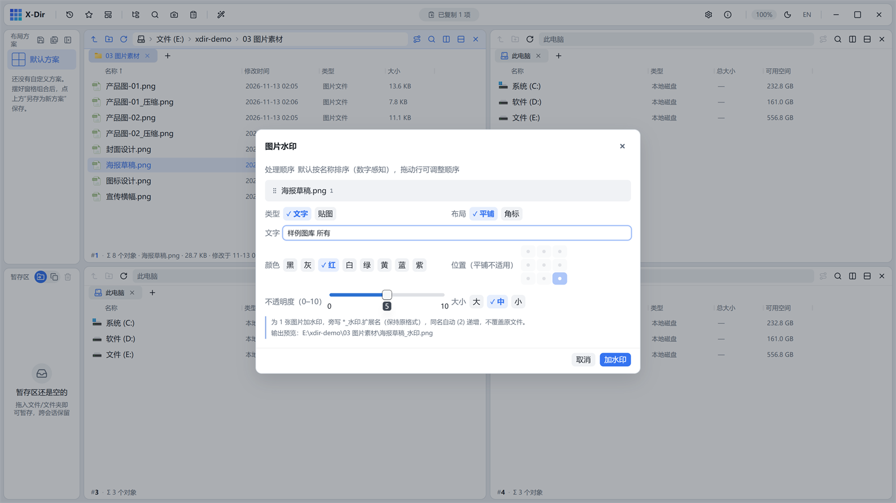

# 图片 · 加水印

文字或贴图水印，平铺 45° 或九宫格角标，批处理一并搞定。

## 入口

选中 **图片文件**（可多选批量）→ 右键 →「图片加水印」。

## 参数

| 参数 | 说明 |
|---|---|
| 类型 | 文字 / 贴图（图片文件做水印） |
| 布局 | 平铺 45°（满图斜纹）× 九宫格角标（右下等） |
| 不透明度 | 0–10 滑杆（与 PDF 水印同口径） |
| 大小 | 三档（角标尺寸/平铺密度） |
| 颜色 | 文字水印 8 色板 |

## 步骤

1. 选中图片 →「图片加水印」；
2. 输入文字（如「样例图库 所有」）、选布局与不透明度；
3. 执行，输出保持原格式旁写 `<原名>_水印.*`。

## 输出与注意

- 批处理上限 200 张；重名 `(2)` 递增；
- 文字水印由 ab_glyph 光栅化，抗锯齿清晰；
- 透明 PNG 加水印保持透明通道。
