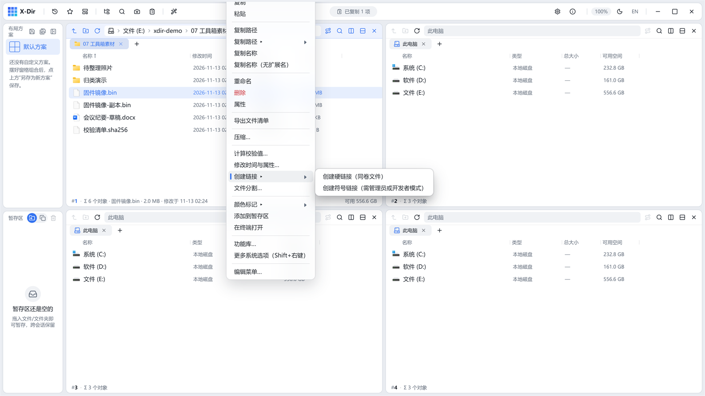

# 工具 · 创建链接

在不复制内容的前提下给文件/文件夹创建硬链接或符号链接。

## 入口

选中 **文件或文件夹** → 右键 →「创建链接 ▸」→ 硬链接（同卷）/ 符号链接。

## 两种链接

| 类型 | 特点 |
|---|---|
| 硬链接 | 同一文件的两个名字，**同卷内**有效；删除任一名字内容仍在 |
| 符号链接 | 指向路径的引用，可跨卷；删除源后链接失效 |

## 步骤

1. 选中源文件 →「创建链接 ▸」→ 选类型；
2. 直接执行，链接旁写在同目录（`<原名>_硬链接.<ext>`）。

## 输出与注意

- 输出旁写，绝不覆盖；重名 `(2)` 递增；
- 多选批量一次建多条；
- 典型场景：同一份大文件需要在多个目录可见但只想存一份；蓝屏排查需要符号链接布局。
