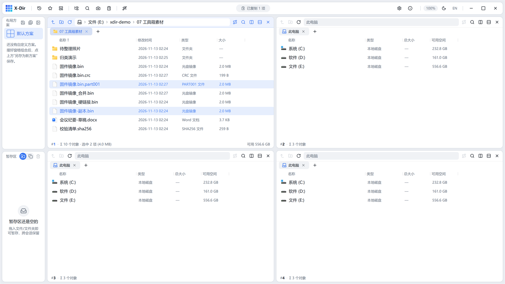

# 工具 · 文件合并

把分片按顺序重组还原原文件（与[文件分割](file-split.md)成对使用）。

## 入口

选中 **≥2 个分片文件** → 右键 →「文件合并」。

## 参数

| 参数 | 说明 |
|---|---|
| 合并清单 | 按选中顺序（`.part` 序号自动排序），可拖动调整 |
| 输出名 | 默认还原为分割前的文件名 |

## 步骤

1. 按序选中全部 `.partNNN` 文件 →「文件合并」；
2. 确认顺序与输出名 → 执行；
3. `.crc` 清单在旁边时顺带核对一遍（SHA-256 与源一致）。

## 输出与注意

- 字节级拼接，与分割前的源文件**逐字节一致**；
- 清单缺片/顺序错乱会输出错误数据——以 `.part` 序号排序为准；
- 跨机器搬运大镜像、绕过单文件大小限制的标准流程：分割 → 分批传 → 合并 → 校验。
