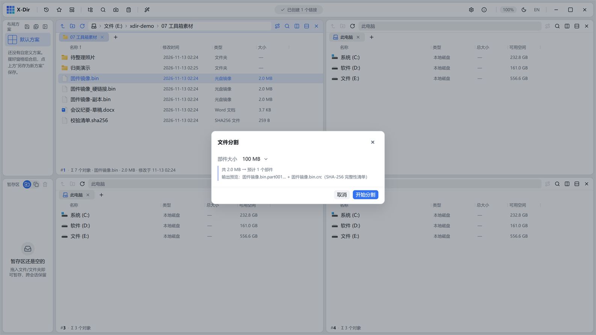
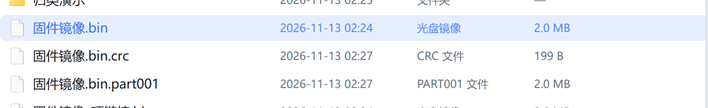

# 工具 · 文件分割

把大文件按大小切块，自动生成 `.crc` 校验清单。

## 入口

选中 **1 个文件** → 右键 →「文件分割」。

## 参数

| 参数 | 说明 |
|---|---|
| 块大小 | 每片大小（如 1 MB / 100 MB），按源体积自动算片数 |
| 输出 | `.part001 / .part002 …` 顺序命名 + 一份 `.crc` 清单（SHA-256 校验） |

## 步骤

1. 选中大文件 →「文件分割」；
2. 设置块大小 → 执行；
3. 输出分片 + `.crc` 清单（部分点一下清单可[校验核对](hash-verify.md)）：

## 输出与注意

- 分片是纯字节切块，合并后与源**逐字节一致**（.crc 校验兜底）；
- 拷到另一台机器后用[文件合并](file-combine.md)还原；
- 老的不可分割目标（如邮箱附件上限）按限制大小切块。
