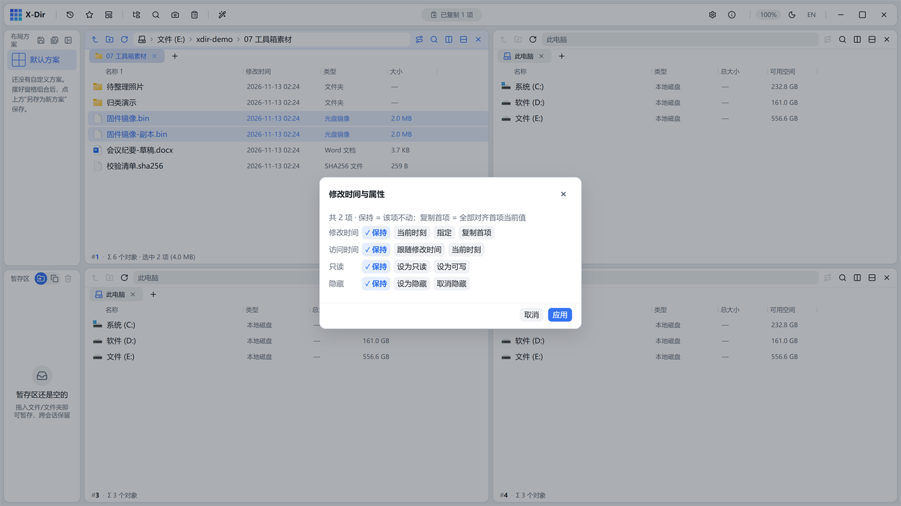

# 工具 · 修改时间与属性

批量修改文件修改时间与只读/隐藏属性位。

## 入口

选中 **文件/文件夹**（可多选批量）→ 右键 →「修改时间与属性」。

## 参数

| 参数 | 说明 |
|---|---|
| 修改时间 | 四态：保持不变 / 设为指定时间 / 取当前时间 / 照抄首个选中项 |
| 只读位 | 三态：不变 / 设只读 / 取消只读 |
| 隐藏位 | 三态：不变 / 隐藏 / 取消隐藏 |

## 步骤

1. 选中文件 →「修改时间与属性」；
2. 设定时间与属性位；
3. 执行，即时生效（列表刷新可见）。

## 输出与注意

- 直接原地修改元数据（本工具不旁写）；
- 照相底稿归档统一时间戳、交付文件去只读，两步常用；
- 隐藏位配合窗格「切换隐藏文件」（功能库）查看。
