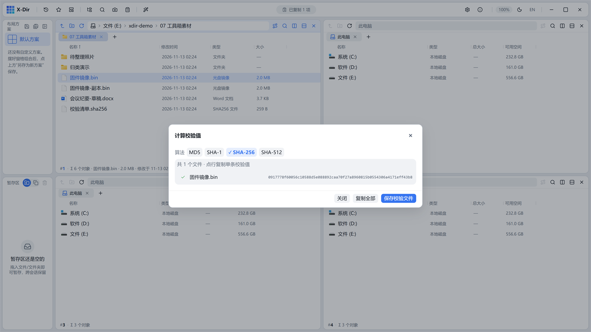

# 工具 · 计算校验值

计算 MD5 / SHA-1 / SHA-256 / SHA-512，一键保存 GNU 风格校验文件。

## 入口

选中 **文件**（可多选批量）→ 右键 →「计算校验值」。

## 参数

| 参数 | 说明 |
|---|---|
| 算法 | MD5 / SHA-1 / SHA-256 / SHA-512（多选并行计算） |
| 保存校验文件 | 生成 `<算法>` 大写命名的 SUMS 文件（如 `SHA256SUMS`，GNU SUMS 格式、无 BOM） |

## 步骤

1. 选中文件 →「计算校验值」；
2. 勾选算法，实时显示进度与结果；
3. 需要留档/分发时点「保存校验文件」。

## 输出与注意

- 校验文件与[校验核对](hash-verify.md)成对使用：发文件附 SUMS，对方一键核对；
- 行级点亮显示进度，大文件不卡界面；
- 保存的 SUMS 兼容 GNU `sha256sum -c` 语法。
