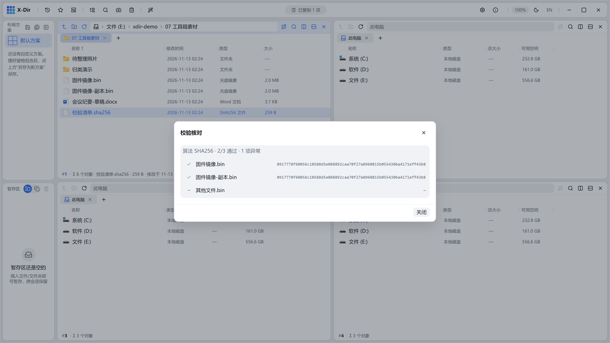

# 工具 · 校验核对

按校验文件逐项核对实际文件，✓✗缺失一览无余。

## 入口

选中 **校验文件**（`.md5` / `.sha256` / `.sha256sums` 等）→ 右键 →「校验核对」。

## 步骤

1. 选中校验清单（如 `校验清单.sha256`）→「校验核对」；
2. 自动逐项计算并比对；
3. 报告列出：✓ 一致 / ✗ 不一致 / 缺失文件。

## 输出与注意

- 支持 GNU SUMS 语法与常见 `hash  filename` 变体；
- 行级结果即时点亮，不合格项标红；
- 下载大文件 / 分发固件 / 交接底稿前核对一遍，数据完整性有据可查；
- 校验文件本身可用[计算校验值](hash-calc.md)生成。
