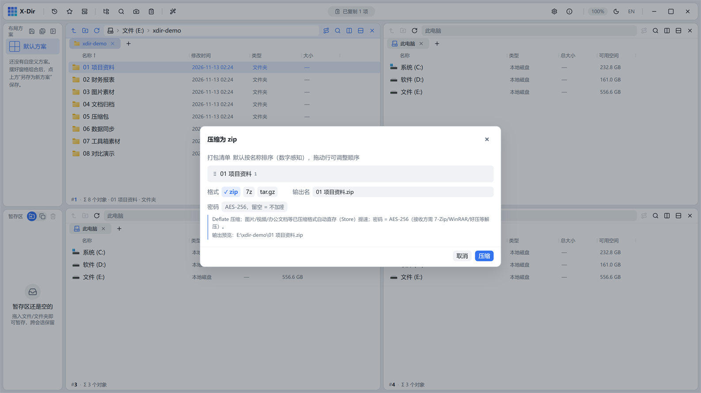

# 办公 · 压缩

zip / 7z / tar.gz 三格式打包，支持密码加密。

## 入口

选中 **文件或文件夹**（可混合多选）→ 右键 →「压缩…」。

## 参数

| 参数 | 说明 |
|---|---|
| 格式 | zip（进程内 Deflate）/ 7z（内嵌 7-Zip，LZMA2）/ tar.gz（流式） |
| 密码 | zip = AES-256（接收方需 7-Zip/WinRAR 解压）；7z = AES-256 + 可选加密文件名 |
| 输出名 | 智能默认：单对象取对象名、多对象取所在目录名，重名 `(2)` 递增 |

## 步骤

1. 选中要打包的内容 →「压缩…」；
2. 选格式（要加密就填密码）；
3. 确认输出名 → 执行；进度字节化（按实际字节数），可取消。

## 输出与注意

- zip 对已压缩内容（图片/音视频/办公容器）**智能直存**提速；
- 半成品 `.tmp` 原子改名，不会留下坏包；
- 同名输出冲突对话框内联红字提示，Rust 端兜底 E_EXISTS；
- Windows 自带解压**不支持任何加密 zip**，发给对方加密包请附 7-Zip/WinRAR 提示。
