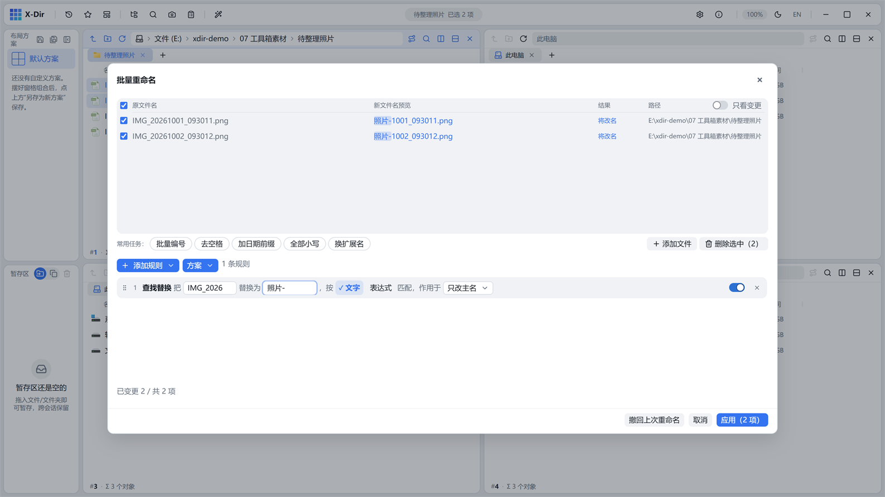

# 办公 · 批量重命名

规则链式批量改名：20 种规则任意堆叠、实时预演、diff 高亮，一次 `Ctrl+Z` 整批撤回。

## 入口

选中 **≥2 个文件** → 右键 →「批量重命名」。

## 规则链（4 大类 20 规则）

| 大类 | 规则 |
|---|---|
| 添加 | 前缀 / 后缀 / 插入文字 / 加序号 / 加日期 / 父文件夹名 |
| 替换 | 查找替换（字面或正则，支持 `$1` 捕获组）/ 替换扩展名 |
| 删除 | 删除文字 / 删除指定字符（空格/数字/汉字/字母/中英符号勾选）/ 掐头去尾 / 去首尾空白 |
| 转换 | 大小写 / 扩展名小写 / 简繁转换 / 转拼音 / 中文数字 / 补齐位数 / 数字四则 / 日期格式化 |

- 每条规则可独立作用域三档：**主名 / 整名 / 扩展名**；
- 规则卡单行展示「词槽句式即效果」，参数改动句式实时切换；指针拖拽排序；启用开关逐条控制；
- 方案可保存（设置 → 方案面板套用），常用组合一键复用。

## 预演与安全

- 四列表格：原文件名 / **新文件名预览** / 结果 / 路径；改动片段 accent 高亮；
- 错误提前暴露：「改完后会与第 N 行重名」「含有不允许的字符『?』」等**人话报错**；
- 「只看变更」开关聚焦有改动的行；
- 执行后 footer 常驻「撤回上次重命名」，或直接 `Ctrl+Z` 整批撤回。

## 步骤

1. 选中文件 →「批量重命名」；
2. 「添加规则」→ 两栏分类面板点选规则（如「替换」）；
3. 填词槽（如查找 `IMG_2026` 替换为 `照片-`），预览即时刷新；
4. 确认无误 →「执行重命名」。
