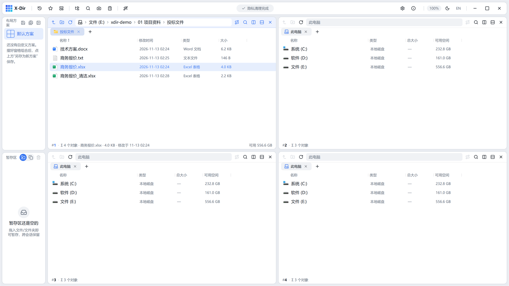

# 办公 · 清理隐私属性

OOXML 文档重打包，抹除作者/公司/修订记录/创建修改时间等文档属性。

## 入口

选中 **OOXML 文档**（docx/docm/xlsx/xlsm/xlsb/pptx/pptm，可多选批量）→ 右键 →「清理隐私属性」。

## 步骤

1. 选中文档 →「清理隐私属性」；
2. 直接执行；
3. 输出旁写 `<原名>_清洁.<ext>`。

## 输出与注意

- 清除项：作者、最后修改者、公司、修订版本、总编辑时间、创建/修改时间戳等 `docProps` 内容；
- **正文、样式、公式、图表全部不动**（zip 重打包仅重建属性部件）；
- 外发合同/报表前清一遍，避免泄露内部署名信息；
- 旧版 .doc/.ppt（非 OOXML）不支持，请先转存 docx/pptx。
