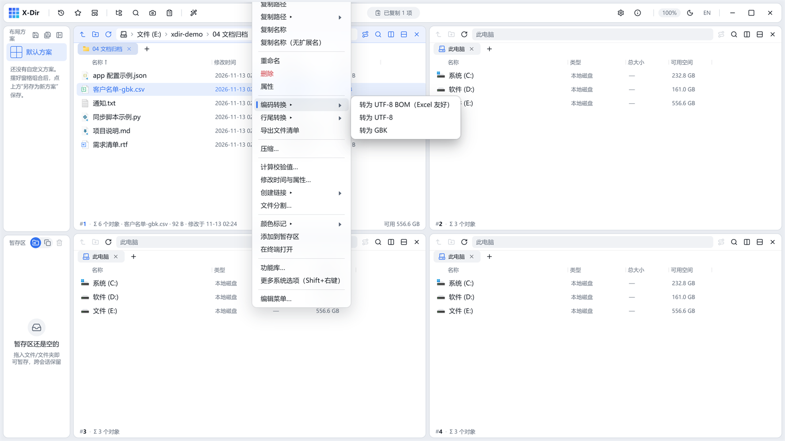

# 办公 · 编码转换

CSV/TSV/TXT/MD/LOG 在 UTF-8 BOM / UTF-8 / GBK 之间互转。

## 入口

选中 **文本文件**（可多选批量）→ 右键 →「编码转换 ▸」→ 选择目标编码。

## 目标编码

| 选项 | 适用 |
|---|---|
| UTF-8 BOM | 旧版 Excel 双击打开 CSV 不乱码的稳妥选择 |
| UTF-8 | Web/程序通用 |
| GBK | 老系统/部分国产软件要求 |

## 步骤

1. 选中文件（如 GBK 编码的 `客户名单-gbk.csv`）→「编码转换 ▸」；
2. 点目标编码，**直接执行**（无对话框）；
3. 输出旁写，灵动岛回执完成。

## 输出与注意

- 输出文件名带编码后缀旁写，绝不覆盖原文件；
- 转换按字节级解码/编码，内容逐字对应；
- 拿不准源文件是什么编码时，先用 `Space` 预览——预览器自动探测编码，能正常显示说明可读。
