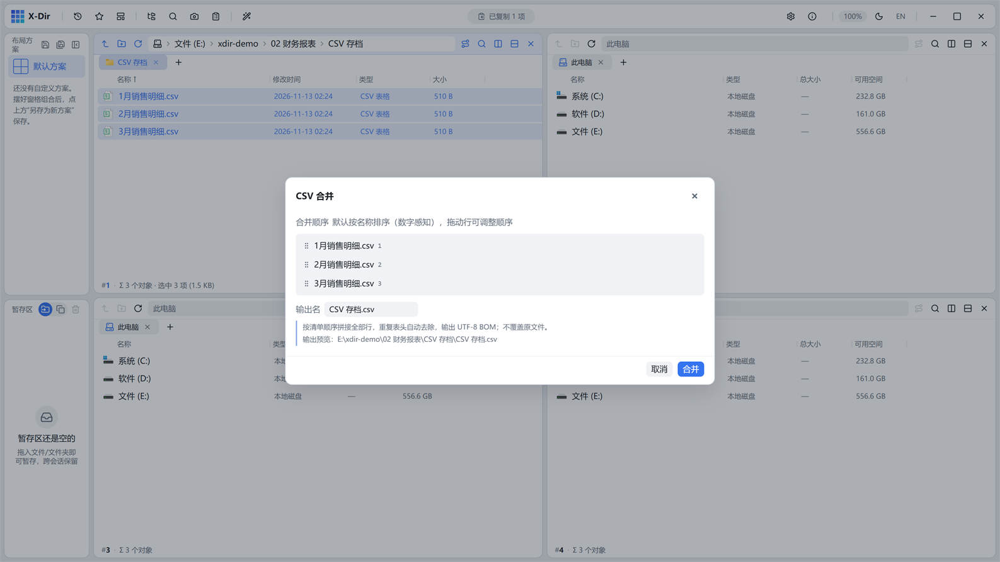

# 办公 · CSV 合并

多份 CSV/TSV 按选中顺序合并，**自动去除重复表头**。

## 入口

选中 **≥2 个 CSV/TSV** → 右键 →「CSV 合并」。

## 参数

| 参数 | 说明 |
|---|---|
| 合并清单 | 置顶列表拖动定序 |
| 输出名 | 默认 `合并表格.csv`，可改 |

## 步骤

1. 按时间顺序选中各月明细（如 1月/2月/3月销售明细.csv）；
2. 右键 →「CSV 合并」；
3. 确认顺序与输出名 →「合并」。

## 输出与注意

- **去重复表头**：后续文件与首文件相同的表头行自动跳过，只保留一份列名；
- 输出 **UTF-8 BOM**——Excel 双击打开不乱码；
- 字段不一致的文件按原样拼接（以首文件列结构为准的提示见对话框说明）。
