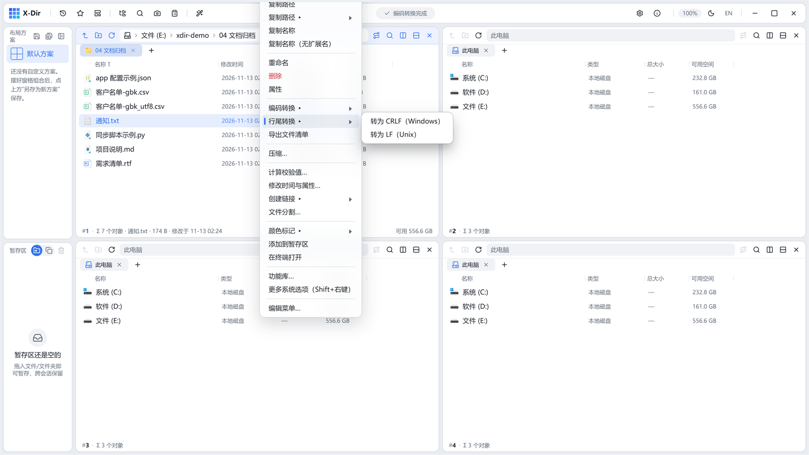

# 办公 · 行尾转换

CRLF（Windows）与 LF（Unix）行尾字节级互转，不改编码。

## 入口

选中 **文本文件**（txt/md/csv/tsv/log/json/代码文件等，可多选批量）→ 右键 →「行尾转换 ▸」→ CRLF / LF。

## 步骤

1. 选中文件 →「行尾转换 ▸」；
2. 点目标行尾，直接执行；
3. 输出旁写 `_crlf` / `_lf` 后缀新文件。

## 输出与注意

- **字节级替换**行尾序列，编码与内容不动；
- 跨平台脚本（sh/py）在 Windows 编辑后提交前转 LF 是常见需求；
- 配合[编码转换](csv-convert.md)可一次解决编码 + 行尾两个历史遗留问题。
