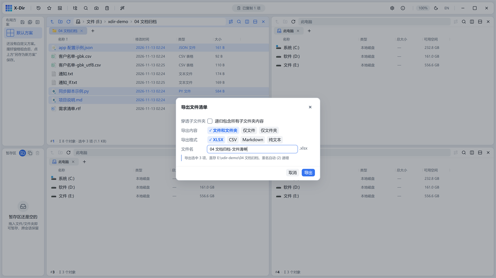

# 办公 · 导出文件清单

把当前文件夹（可穿透子文件夹）的内容清单导出为表格，直存当前目录。

## 入口

- 选中若干条目（只导选中项）；或不选直接在空白处右键（导整层）；
- 右键 →「导出文件清单」。

## 参数

| 参数 | 说明 |
|---|---|
| 穿透子文件夹 | 开：递归列出全部层级 |
| 导出内容 | 仅文件 / 仅文件夹 / 全部 |
| 格式 | XLSX（默认）/ CSV / TXT / Markdown |
| 文件名 | 内联校验（非法名/重名红字），默认 `<文件夹名>-文件清单` |

## 步骤

1. 进入目标文件夹 → 右键 →「导出文件清单」；
2. 选内容范围与格式 → 执行；
3. 清单文件直接出现在当前文件夹，免保存对话框。

## 输出与注意

- XLSX/CSV/MD 为**十列**：名称/类型/扩展名/大小/路径/修改时间等；TXT 为完整路径一行一条；
- 单次行上限 20 万，超限自动中止并提示；
- 交付附件目录清单、盘点底稿一键生成。
