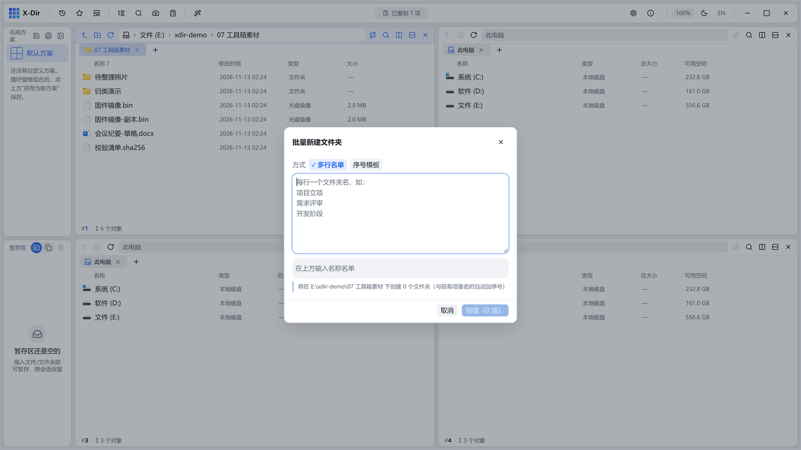

# 办公 · 批量新建文件夹

按名单或序号模板一次创建多个文件夹。

## 入口

在目标位置**空白处右键** →「批量新建文件夹」（或功能库执行）。

## 参数

| 模式 | 说明 |
|---|---|
| 名单 | 一行一个名字（如 `01 勘察`、`02 设计`、`03 施工`），非法名/批内重名实时标红 |
| 序号模板 | 前缀 + `{}` 占位 + 止号（如 `月份-{}`，止号 12 → `月份-01…月份-12`，按止号位数自动补零） |

## 步骤

1. 空白处右键 →「批量新建文件夹」；
2. 选模式并填入名单/模板；
3. 预演确认（与磁盘重名按 `(2)` 递增）→ 执行（单次上限 500 个）。

## 输出与注意

- 名单内重名标红阻止；与磁盘现有重名自动 `(2)` 递增不覆盖；
- 创建为同步轻操作，免任务进度，瞬时完成；
- 项目初始目录骨架、归档年度目录一次生成。
