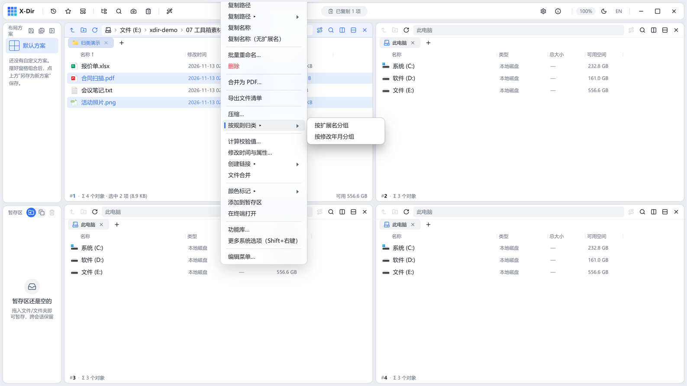
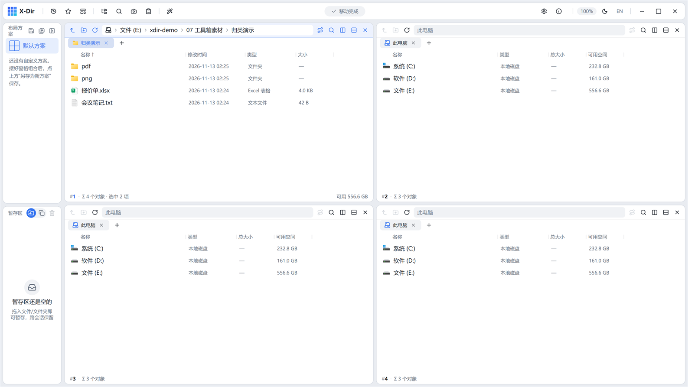

# 办公 · 按规则归类

按扩展名或修改年月自动分组建子夹并移动，桌面/下载目录一键清爽。

## 入口

选中 **≥2 个文件** → 右键 →「按规则归类 ▸」→ 按扩展名 / 按修改年月。

## 规则

| 规则 | 分组效果 |
|---|---|
| 按扩展名 | `图片\`、`文档\`、`表格\`、`PDF\`、`文本\` 等语义子夹 |
| 按修改年月 | `2026-10\`、`2026-11\` 等年月子夹 |

## 步骤

1. 选中要归类的文件 →「按规则归类 ▸」→ 选规则；
2. 直接执行——子夹自动创建，文件移入；
3. 完成后窗格自动刷新：

## 输出与注意

- 移动走 transfer 引擎，**冲突照常弹冲突对话框**（覆盖/跳过/保留两者）；
- 同类子夹已存在时直接复用不重建；
- 先用[导出文件清单](export-list.md)留底再归类，随时可查原路径。
