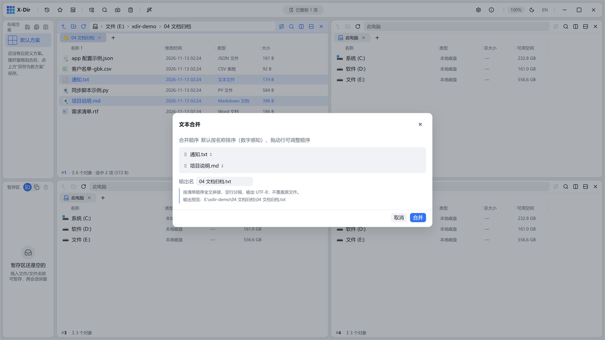

# 办公 · 文本合并

把多份 txt/md/log 按选中顺序拼接为一份。

## 入口

选中 **≥2 个文本文件**（txt/md/log）→ 右键 →「文本合并」。

## 参数

| 参数 | 说明 |
|---|---|
| 合并清单 | 拖动定序 |
| 输出名 | 可改 |

## 步骤

1. 选中要拼接的文本 →「文本合并」；
2. 确认顺序 → 执行，输出 **UTF-8 BOM**。

## 输出与注意

- 文件之间以空行分隔，段落边界清晰；
- 不同编码的源文件统一转 UTF-8 后拼接（GBK 源不乱码）；
- 需要去表头式的结构化合并请用[CSV 合并](csv-merge.md)。
