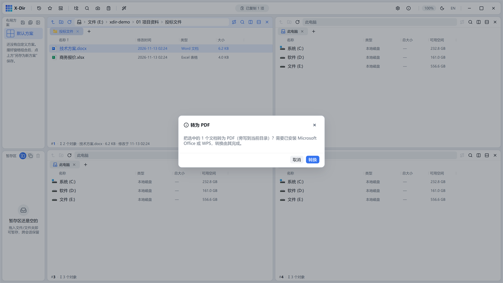

# 办公 · 转为 PDF

Word / Excel / PPT 转 PDF：PowerShell COM 派发本机已装的 **MS Office（优先）或 WPS**，不打包外部引擎。

## 入口

选中 **Office 文档**（doc/docx/docm/xls/xlsx/xlsm/xlsb/ppt/pptx/pptm/rtf，可多选批量）→ 右键 →「转为 PDF」。

## 步骤

1. 选中文档 →「转为 PDF」；
2. 直接执行（无需参数）——本机未装 Office/WPS 时回执明确报错；
3. 输出旁写 `<同名>.pdf`。

## 输出与注意

- 转换由本机 Office/WPS 完成，**版式 100% 保真**（与「另存为 PDF」一致）；
- 批量选中多份文档一次转换，逐份经灵动岛回执；
- 转换引擎不随 X-Dir 打包（开源许可红线），纯 Rust 抽取文本请用[导出文本 TXT](to-txt.md)，预览用 `Space`（无需 Office）。
