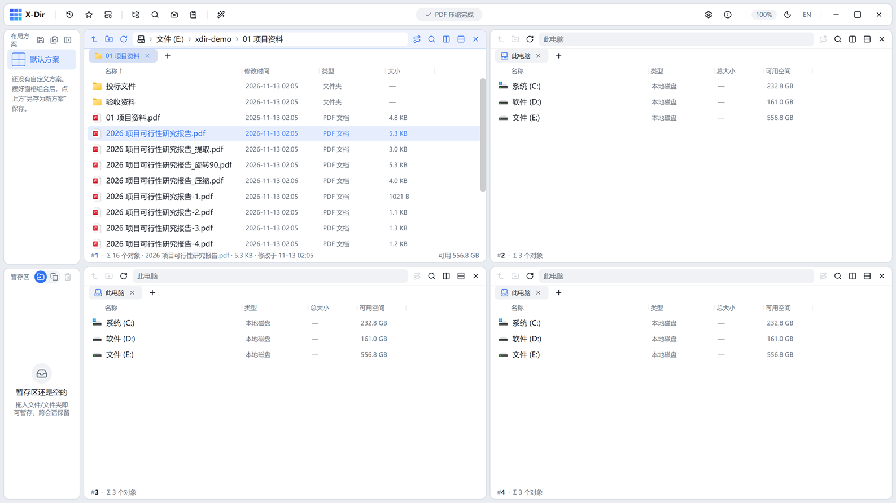

# PDF · 轻压缩

**无损**瘦身 PDF：同内容对象去重（合并重复字体）+ 对象流压缩。

## 入口

选中 **PDF 文件**（可多选批量）→ 右键 →「PDF 轻压缩」。

## 步骤

1. 选中一个或多个 PDF →「PDF 轻压缩」；
2. 直接执行，进度经灵动岛播报；
3. 完成回执中可见压缩前后体积对比。

## 输出与注意

- 输出旁写 `<原文件名>_压缩.pdf`，原文件不动；
- **无损**：不降图片质量、不丢内容，收益来自冗余对象消除与流压缩——扫描图片型 PDF 建议交给专业有损压缩工具；
- 重复执行同一文件收益递减（去重已完成）。
