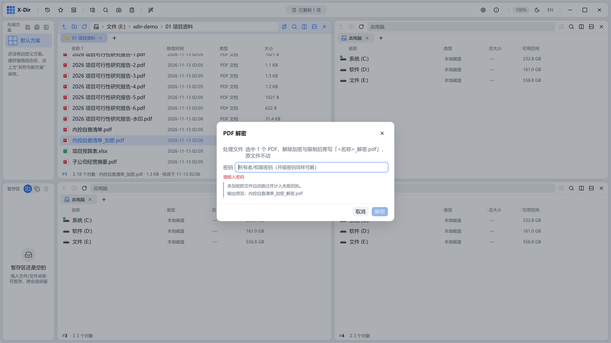

# PDF · 解密

输入权限密码，解除 PDF 的加密与权限限制。

## 入口

选中 **已加密的 PDF** → 右键 →「PDF 解密」。

## 参数

| 参数 | 说明 |
|---|---|
| 权限密码 | 加密时设置的口令（仅权限密码即可解除；仅打开密码保护而无权限限制的文件需作者口令） |

## 步骤

1. 选中加密 PDF →「PDF 解密」；
2. 输入权限密码；
3. 执行后输出**无密码**的旁写副本，原加密文件不动。

## 输出与注意

- 密码错误会即时提示，不会产出半成品文件；
- 解除后打印/复制/编辑限制一并消失；
- 仅自己拥有版权的文件可用此功能（请遵守法律法规，勿用于破解他人文档）。
