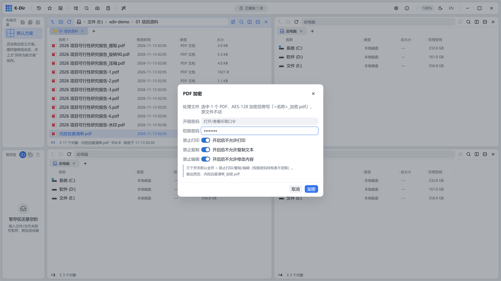

# PDF · 加密

AES-128 加密 PDF，并可限制打印/复制/编辑权限。

## 入口

选中 **1 个 PDF** → 右键 →「PDF 加密」。

## 参数

| 参数 | 说明 |
|---|---|
| 打开密码 | 输入后阅读器打开此 PDF 需要口令 |
| 权限密码 | 用于修改权限设置的口令（可与打开密码相同） |
| 权限限制 | 允许打印 / 允许复制 / 允许编辑 三项开关 |

## 步骤

1. 选中 PDF →「PDF 加密」；
2. 输入密码并勾选权限限制；
3. 执行，输出旁写新文件（如 `清单_加密.pdf`）。

## 输出与注意

- 加密后的 PDF 用[解密](decrypt.md)（输入权限密码）解除限制；
- 输出文件名在对话框内即时预览，重名 `(2)` 递增；
- 密码**不会**被记录进任何参数记忆，请自行妥善保管。
