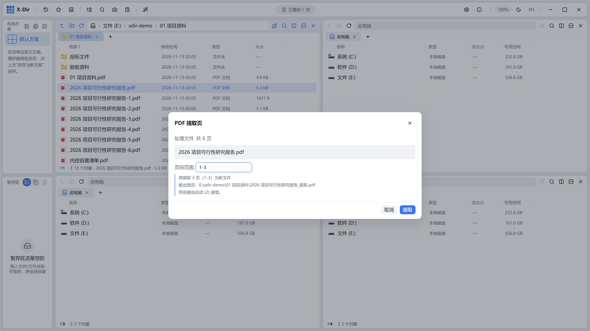

# PDF · 提取页

抽取指定页另存新文件，原文件不动。

## 入口

选中 **1 个 PDF** → 右键 →「PDF 提取页」。

## 页码范围表达式

与[删除页](remove.md)同语法：`1-3,5,8-`

| 写法 | 含义 |
|---|---|
| `3` | 第 3 页 |
| `1-3` | 第 1~3 页 |
| `8-` | 第 8 页到末页 |
| `1-3,7,10-` | 组合 |

## 步骤

1. 选中 PDF →「PDF 提取页」；
2. 输入页码范围（非法表达式即时红字提示）；
3. 执行，输出 `<原文件名>_提取.pdf`（重名 `(2)` 递增）。

## 输出与注意

- 提取不改原文件，页内书签/旋转随页保留；
- 反向需求（留其余页）请用[删除页](remove.md)。
