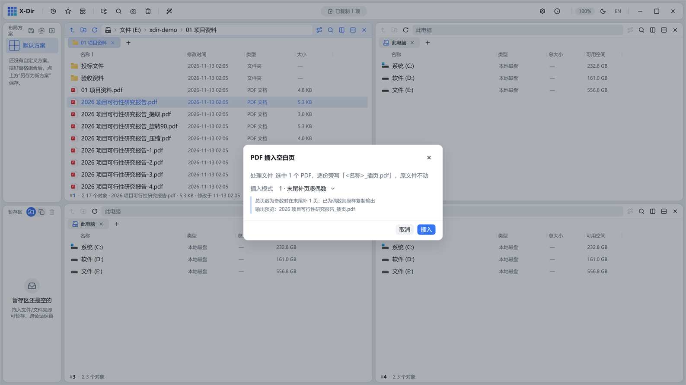

# PDF · 插入空白页

在指定位置插补 A4 空白页——审计底稿双面打印凑偶数的经典需求。

## 入口

选中 **PDF 文件** → 右键 →「PDF 插入空白页」。

## 参数

| 参数 | 说明 |
|---|---|
| 插入模式 | 12 种：每份最后补一页凑偶数 / 凑指定倍数 / 在第 1 页之前 / 最后 1 页之后 / 指定页码前后等 |
| 输出名 | 默认 `<原文件名>` 旁写，重名 `(2)` 递增 |

## 步骤

1. 选中 PDF →「PDF 插入空白页」；
2. 选择插入模式（如「最后 1 页之后」凑偶数）；
3. 执行后输出旁写新文件。

## 输出与注意

- 空白页为标准 A4（595×842pt），与常见扫描件页面尺寸一致；
- 插页位置由 lopdf 重建页树，不影响原页内容；
- 只处理单份 PDF 时与「合并」对话框中的空白页选项效果相同，多份批量时用本工具更直接。
